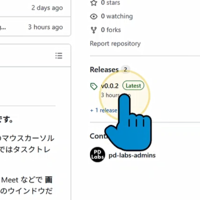
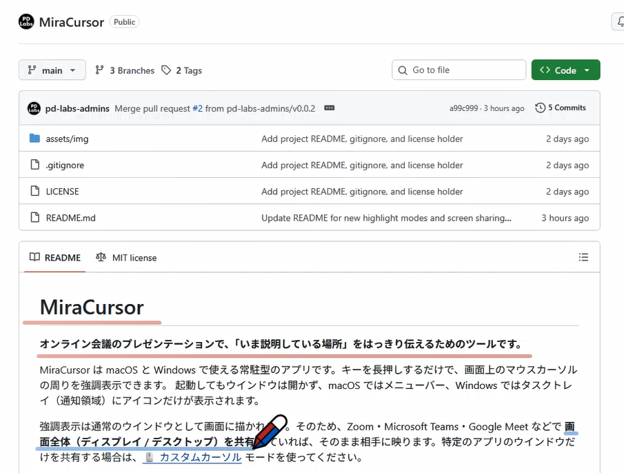
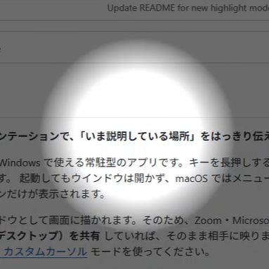
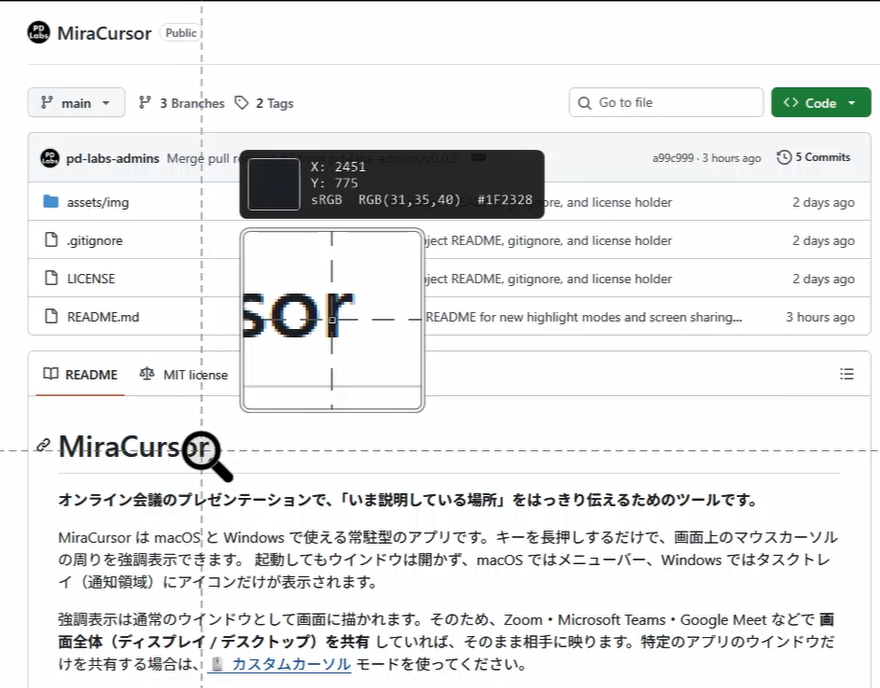

# MiraCursor

[MiraCursor](https://github.com/pd-labs-admins/MiraCursor)は**オンライン会議のプレゼンテーションで「いま説明している場所」をはっきり伝えるためのツールです。** 「Mira」はスペイン語で「見て！」という意味があるそうで、「カーソルの位置を見てくださいね！」というメッセージを込めて、この名前にしました。

MiraCursor は macOS と Windows で使える常駐型のアプリです。設定したキーを長押しするだけで画面上のマウスカーソルの周りを強調表示できます。起動してもウインドウは開かず、macOS ではメニューバー、Windows ではタスクトレイ（通知領域）にアイコンだけが表示されます。

---

## 目次

- [できること](#できること)
- [外観](#外観)
- [動作環境](#動作環境)
- [ダウンロードとインストール](#ダウンロードとインストール)
- [必要な権限](#必要な権限)
- [使い方](#使い方)
- [設定](#設定)
- [アップデート](#アップデート)
- [アンインストール](#アンインストール)
- [よくある質問・トラブルシューティング](#よくある質問トラブルシューティング)
- [ライセンス](#ライセンス)

---

## できること

MiraCursor にはいくつかの「強調表示モード」があります。設定で決めたキー（トリガーキー）を長押しすると、そのキーに割り当てたモードが始まります。同時に使えるモードは 1 つだけです。

### カスタムカーソル

マウスカーソルそのものを通常のカーソル・指差し・指差し棒などの画像や、カーソルの周りに半透明の色を重ねる「ハイライトカーソル」、カーソルの位置を拡大して表示する「ズームカーソル」、任意の画像に変更することができます。特定のウインドウだけを画面共有しているときでも相手に見えます。カーソルの動きに合わせた残像や、クリックした位置に波紋も表示できます。



### ペン

マウスのドラッグで画面に線を描けます。左ボタンと右ボタンで別々の色・太さ・線の種類を使えます。45 度単位のまっすぐな線を描く「直線モード」もあります。描いた線は、モードを終えるとすべて消えます。描いた内容を含めて画面をキャプチャし、クリップボードやファイルに保存することもできます。



### スポットライト

画面全体を薄暗くして、マウスカーソルの周りだけを明るく表示します（以前の「ライト」）。カーソルを動かすと、明るい部分も一緒に動きます。カーソルの周りに半透明の色を重ねる「ハイライト」は、カスタムカーソルの「ハイライトカーソル」に移りました。



### ウインドウサイズ

クリックしたウインドウの大きさを、登録した大きさ（1920 x 1080・1024 x 768 など）にまとめて変えます。資料用の画像を、いつも同じ大きさのウインドウで撮影したい場合などに使います。

### ズーム

マウスカーソルの周りを拡大して表示します（ルーペ）。カーソルを中心にした十字線や、カーソル位置の X / Y 座標も表示できます。カーソル位置の色を `RGB(255,0,0)` や `#FF0000` の形式で表示し、クリックで色の値を選んだ形式でクリップボードにコピーすることもできます。



### キーモニタ

キーボードで押したキーを画面に表示します（新規）。「a」のような 1 つのキーだけでなく、「⇧ + A」（Windows は「Shift + A」）のような修飾キーとの組み合わせも表示できます。表示のしかたは、押したキーのアイコンを並べる「スクロール」と、キーボードの絵で押したキーを強調する「キーボード」から選べます。タイピング数の統計情報（1分間・5分間・10分間・1時間・合計）と、削除キー（Backspace / DEL）を押した回数も表示できます。押したキーは、アプリにそのまま届きます。

---

## 外観

設定画面・メニュー・ダイアログ・パレット・通知・情報ウインドウ・ウィジェットの外観は、OS のアプリ用テーマ設定に従います。ライトテーマでは明るい背景と暗い文字、ダークテーマでは暗い背景と明るい文字で表示し、起動中のテーマ変更にも追従します。ペンやカーソルなどで指定した色、編集中の画像や保存する画像の色は、テーマを切り替えても変わりません。Windows のコントラストテーマを使用している場合は、その配色を優先します。

---

## 注意点：画面共有時の見え方

Cisco Webex、Slack、Microsoft Teams、Zoomなどのコミュニケーションツールを使い、オンライン会議で画面共有する場合、共有範囲に応じて「相手側の見え方」は以下となります。「ウインドウ共有」を多用される方はカスタムカーソルを中心にご利用ください。

- デスクトップ共有
    - ペン・スポットライト・ズームなどの効果は共有相手にも表示されます。
    - カスタムカーソルも共有相手に表示されます。
- ウインドウ共有
    - ペン・スポットライト・ズームなどの効果は共有相手にも **表示されません**
    - カスタムカーソルも共有相手に表示されます。

以前は、ペン・ズーム・キーモニタ・スポットライトのモードを開始したときに、OS の通知で「ウインドウ共有時、相手には効果が表示されません。」という注意書きを表示できました（「管理」タブの「表示」グループの「開始時に注意書きを表示」）が、この設定と通知は廃止しました。

---

## 動作環境

| OS | 対応バージョン | 備考 |
| --- | --- | --- |
| macOS | macOS 13 Ventura 以降 | Apple Silicon / Intel の両方に対応しています。ズームは macOS 14 Sonoma 以降で使えます。 |
| Windows | Windows 10 / 11（x64 / ARM64） | Arm 版には ARM64 向けのインストーラーがあります。.NET などの追加ソフトウェアを別途インストールする必要はありません。 |

---

## ダウンロードとインストール

GitHubの [Releases](https://github.com/pd-labs-admins/MiraCursor/releases/latest) から、お使いの OS 用ファイルをダウンロードしてください。

| OS | ダウンロードするファイル |
| --- | --- |
| macOS | `MiraCursor-x.y.z-macos.dmg` |
| Windows（x64） | `MiraCursor-x.y.z-windows-x64.msi` |
| Windows（ARM64） | `MiraCursor-x.y.z-windows-arm64.msi` |

<details>
<summary>リリースに含まれるファイルの一覧</summary>

| ファイル | 用途 |
| --- | --- |
| `MiraCursor-x.y.z-macos.dmg` | macOS 用のインストーラー（通常はこちら） |
| `MiraCursor-x.y.z-macos.zip` | macOS 用のアプリ（zip）。自動アップデートでも使います |
| `MiraCursor-x.y.z-windows-x64.msi` / `MiraCursor-x.y.z-windows-arm64.msi` | Windows 用のインストーラー。CPU に合うものを選びます。自動アップデートでも使います |
| `MiraCursor-x.y.z-windows-x64.zip` / `MiraCursor-x.y.z-windows-arm64.zip` | Windows 用のポータブル版（インストール不要） |
| `MiraCursor-x.y.z-*.sha256` | ファイルの SHA-256 チェックサム |

</details>

### macOS

1. `MiraCursor-x.y.z-macos.dmg` を開きます。
2. `MiraCursor.app` を `Applications`（アプリケーション）フォルダへドラッグします。
3. アプリケーションフォルダの **MiraCursor** を起動します。
4. 初回起動時に「入力監視」の許可を求められます。[必要な権限](#必要な権限) を参考に許可してください。

> **「開発元を検証できないため開けません」と表示される場合**
> MiraCursor は Apple の公証（notarization）を受けていないため、初回起動時にこのメッセージが出ることがあります。次のどちらかの方法で開いてください。
>
> - **システム設定 → プライバシーとセキュリティ** を開き、下の方にある「このまま開く」をクリックする
> - ターミナルで次のコマンドを実行してから、もう一度起動する
>
>   ```sh
>   xattr -dr com.apple.quarantine /Applications/MiraCursor.app
>   ```

### Windows

1. x64 版または ARM64 版の Windows に合う `MiraCursor-x.y.z-windows-<アーキテクチャ>.msi` をダブルクリックします。
2. インストールが終わると MiraCursor が起動し、タスクトレイにアイコンが表示されます。スタートメニューにも登録されます。
   - インストール先は `%LOCALAPPDATA%\Programs\MiraCursor` です（ユーザーごとのインストールなので、管理者権限は不要です）。

> **「Windows によって PC が保護されました」と表示される場合**
> MiraCursor にはコード署名をしていないため、Microsoft Defender SmartScreen の警告が出ることがあります。「詳細情報」→「実行」を選ぶとインストールできます。

> **インストールせずに使う場合**
> Windows の CPU に合う `MiraCursor-x.y.z-windows-x64.zip` または `MiraCursor-x.y.z-windows-arm64.zip` を展開し、`MiraCursor.exe` を実行してください（ポータブル版）。ポータブル版は自動アップデートされません。新しいバージョンが出ると通知が表示されます。

---

## 必要な権限

### macOS

| 権限 | 必要なとき | 理由 |
| --- | --- | --- |
| **入力監視** | **常に必要** | どのアプリを使っているときでも、トリガーキーの長押しと ESC キーを検出するため |
| **画面収録** | ズーム・ペンのキャプチャを使うときだけ | マウスカーソルの周りを拡大表示し、カーソル位置の色を読み取るため / 画面をキャプチャするため |
| **マイク** | 設定の「ウィジェット」（以前の「マイクレベル」）の「マイク入力」を有効にするときだけ | マイクの入力レベル（音量）を画面のアイコンに表示するため（音声は録音・保存しません） |
| **アクセシビリティ** | クリップボード履歴の「テキスト選択時の動作」「画像選択時の動作」が「貼り付け」「クリップボードと貼り付け」のとき・ウインドウサイズモードを使うときだけ | 選んだ履歴を、選択中のアプリケーションへ貼り付ける（⌘V を送る）ため / ほかのアプリケーションのウインドウの大きさを変えるため |

クリップボード履歴で貼り付ける場合・ウインドウサイズモードを除き、アクセシビリティの権限は必要ありません。MiraCursor はキー入力を読み取るだけで、入力の内容を記録したり、送信したり、書き換えたりはしません。

**許可のしかた**

1. **システム設定 → プライバシーとセキュリティ → 入力監視**（ズーム・ペンのキャプチャを使う場合は **画面収録とシステムオーディオ録音**、ウィジェットのマイク入力を使う場合は **マイク** も）を開きます。
   メニューバーの MiraCursor のアイコンから開くこともできます。
2. 一覧の **MiraCursor** をオンにします。一覧に無い場合は「＋」で `/Applications/MiraCursor.app` を追加します。
3. メニューバーのアイコン →「MiraCursor を再起動」を選びます。

権限が足りないときは、メニューバーのアイコンが ⚠️ に変わります（これまでどおりです）。

### Windows

**特別な権限は必要ありません**（管理者権限も不要です）。

ただし、設定の「ウィジェット」の「マイク入力」を使う場合は、Windows の **設定 → プライバシーとセキュリティ → マイク** で「マイクへのアクセス」と「デスクトップ アプリがマイクにアクセスできるようにする」をオンにしてください。

---

## 使い方

### 基本の操作

1. MiraCursor を起動しておきます（メニューバー / タスクトレイにアイコンが出ていれば起動中です）。
2. 使いたいモードの **トリガーキーを長押し** します（既定は 1.5 秒）。
3. 強調表示が始まります。
4. トリガーキーを離すと終わります（終了方法が「キーを離す」（既定）の場合。「キーの長押し」にしたトリガーで始めた場合は、もう一度トリガーキーを長押しすると、「ESCキー」にしたトリガーで始めた場合は **ESC** キーで、「メニュー」にしたトリガーで始めた場合は、メニューで実行中のモード名を選ぶと終わります。[終了方法](#終了方法) を参照）。どの方法で始めた場合も、**ESC** キーを「強制終了の長押し」の時間（既定 1.5 秒）だけ長押しすると強制的に終わります。

メニューバー / タスクトレイのアイコンのメニューでモード名を選んで始めることもできます（トリガーキーが無いモードも始められます）。この場合の終了方法は「メニュー」です（v0.0.5 までは「トグル動作」）。もう一度メニューで同じモード名を選ぶと終わり、**ESC** やトリガーキーでは終わりません（**ESC** キーの「強制終了の長押し」（既定 1.5 秒）を除く）。使っている間は、他のモードのトリガーキーを長押ししても切り替わりません。ただし、そのモードにトリガーキーが「なし」のトリガーがある場合は、そのトリガーの終了方法（「ESCキー」か「メニュー」）で始まります。メニューで使っていないモードを選ぶと、そのモードに切り替わります。使っているモードには、メニューのモード名にチェックマークが付きます。

メニューバー / タスクトレイのアイコンには、MiraCursor のアイコンに状態のバッジが重なって表示されます（どのモードでも同じです）。モードを使っていないときは時計の針の付いた黄色の丸（「退席中」のようなアイコン）、モードを使っている間（キャプチャのショートカットキーで始めたキャプチャモードを含む）はチェックマークの付いた緑色の丸（「連絡可能」のようなアイコン）です。以前の設定「アプリケーションのアイコンを変更」はなくなりました。

メニューにはモードの一覧、クリップボード履歴、定型文、MiraPaint、ウィジェット、タイマー、アラームが並びます。ショートカットを設定した「設定…」「MiraPaint」「タイマー」「アラーム」などの項目には、割り当てたキーが表示されます。ウィジェットのサブメニューには各ウィジェットを表示するかどうかが並び、有効な項目にはチェックマークが付きます。タイマーとアラームはそれぞれプリセット一覧を表示し、選ぶと実行状態を切り替えます。アラームメニューの「指定時刻」から時刻を入力して開始すると、その時刻がプリセットに追加されます。MiraCursor の終了時には実行中のタイマーとアラームを停止し、次回起動時も停止状態で始まります。MiraPaint を選ぶと、クリップボードに画像があればその画像を、無ければ白い無地の画像（1280 × 720）で開きます。

#### メニューを開くショートカット

**メニューを開くショートカット**（新規）を押すと、MiraCursor のメニューが **マウスカーソルの位置** に開きます。既定は macOS が **⌥⇧M**（Option+Shift+M）、Windows が **Alt+Shift+M** です（以前は macOS が ⌃⌥M、Windows が Ctrl+Alt+M。以前に変更・保存した値はそのまま使います）。

- モードを使っている間（ペンモードなどで、画面のクリックがモードに使われている間）でも、メニューからモードを終わらせたり、MiraPaint・設定などの他の項目を選んだりできます。
- Windows でタスクトレイのアイコンが通知領域の「隠れているインジケーターを表示」（「^」）の中に入っていて、すぐにクリックできない場合でも、メニューを開けます。
- 設定の「キー設定」カテゴリーの「ショートカット」メニューの「MiraCursor」グループ（以前の「メニュー」グループ）の「ツールメニューを開く」（以前の「メニューを開くショートカット」）で変えられます。ボタンをクリックしてから、修飾キー（macOS は Control・Option・Command のどれか、Windows は Ctrl か Alt）を押しながらキーを押すと記録されます（**ESC** で取り消し。記録中は欄の枠が強調色になります）。欄の右の「✕」（キーが設定されているときだけ表示。以前の「なし」のボタン）を押すと未設定になり、ショートカットでは開かなくなります。未設定の欄は、薄い文字で「未設定（クリックして記録）」と表示します。他の項目で使っているキーを設定すると、その項目は未設定になり、欄の下に「「<項目名>」から移しました」と数秒間表示します。
- ショートカットキーには Shift を含む組み合わせも使えます（例: macOS は ⇧⌘X、Windows は Win + Shift + X・Ctrl + Shift + X。Windows は Windows キーも使えます。Windows 自身のショートカット（Win + E など）と重ならないキーを選んでください）。記録している間は、押している修飾キーをボタンに表示します。
- 押したキーは、他のアプリにもそのまま伝わります。他のアプリのショートカットと重なる場合は、別のキーに変えてください。

#### キャプチャのショートカット

設定の「キー設定」カテゴリーの「ショートカット」メニューの「キャプチャ」グループの **キャプチャパレット**（変更。以前の「キャプチャの開始」）のショートカットキー（既定は macOS が ⌥⇧X（Option + Shift + X）、Windows が Alt + Shift + X。以前は macOS が ⌥⇧C、Windows が Alt + Shift + C、さらに以前は macOS が ⇧⌘X、Windows が Ctrl + Shift + X）を押すと、キャプチャモードを開始します（メニューのキャプチャモードの項目と同じです）。キャプチャモードの実行中に押すと終了します。撮影する対象やキャプチャ後の動作などは、「キャプチャ」タブの設定とキャプチャモードの選択ウインドウに従います（[キャプチャ](#キャプチャ) を参照）。実行中の他のモードは終了します。記録の方法は「ツールメニューを開く」と同じです。同じキーを他の項目に設定すると、元の項目は「なし」になります。

以前は「選択範囲から文字/QRコード読み取り」「選択範囲」「クリックしたウインドウ」「アクティブなデスクトップ」「全てのデスクトップ」ごとに、キャプチャモードを始めずにすぐに撮影・読み取りをするショートカットキーがありましたが、廃止しました（選択範囲から文字/QRコードを読み取るには、キャプチャモードの選択ウインドウの「文字認識」を使います）。

「キー設定」カテゴリーの「ショートカット」メニューのショートカットキーは、上から次のグループに並びます（どれも、同じキーを他の項目に設定すると元の項目は「なし」になり、一番下の「既定値に戻す」で、これらのショートカットキーをまとめて初期値に戻せます）。

| グループ | 項目 | 既定 | 内容 |
| --- | --- | --- | --- |
| **MiraCursor**（以前の「メニュー」） | ツールメニューを開く | macOS ⌥⇧M / Windows Alt + Shift + M | マウスカーソルの位置に MiraCursor のメニューを開きます（[メニューを開くショートカット](#メニューを開くショートカット) を参照）。 |
| | 設定ウインドウを開く（新規） | なし | MiraCursor の設定ウインドウを開きます（メニューの「設定…」と同じ）。 |
| **キャプチャ** | キャプチャパレット | macOS ⌥⇧X / Windows Alt + Shift + X | キャプチャモードを開始します（実行中なら終了します）。 |
| **MiraPaint**（新規） | MiraPaintを開く | なし | MiraPaint を開きます（メニューの「MiraPaint」と同じ）。クリップボードに画像がある場合はその画像を、無い場合は新しい画像（新規作成）で開きます。 |
| **クリップボード** | ビュアー（履歴の上） | なし | 現在のクリップボード内容をビュアーに表示します。 |
| | 履歴 | なし | クリップボード履歴のメニューを開きます。 |
| **AIウィジェット**（「モード」の次） | AIの利用状況ウィジェットを設定します。 |
| ├ **全般** | すべてのAIウィジェットに共通する「表示」設定（トークン・料金・リセット時の通知・本日のリセット予想・週間のリセット予想・料金しきい値）をまとめています。 |
| **タイマー**（一番下） | プリセットの表示 | なし | カーソル位置にプリセット一覧を表示し、選んだ時間で開始します。 |
|  | デフォルトプリセットの開始 | なし | 「タイマー」のプリセットで既定に設定した時間で開始します。 |
| **アラーム** | プリセットの表示 | なし | カーソル位置にアラーム時刻の一覧を表示し、有効 / 無効を切り替えます。 |
|  | デフォルトプリセットの開始 | なし | 既定にしたアラーム時刻を有効にします。 |
|  | 指定時刻 | なし | 時計風の時刻入力を開き、指定した時刻でアラームを開始します。指定時刻はプリセットに追加されます。 |

**開く（新規）:** 「キー設定」カテゴリーの「ショートカット」メニューの「開く」グループの **テキストの保存先** / **画像の保存先**（既定: なし）を押すと、「管理」タブのテキスト・画像の保存先のディレクトリを Finder / エクスプローラーで開きます（無い場合は作ります）。

**重複の注意書き（新規）:** 「キー設定」カテゴリーの「ショートカット」メニューのショートカットキー（ツールメニューを開く・設定ウインドウを開く・キャプチャパレット・MiraPaintを開く・ウインドウサイズの開始・ウィジェット・クリップボード）が、OS や他のアプリケーションのショートカットキーと重なっている場合は、キーの欄の下に注意書きを表示します。macOS はシステム設定の「キーボードショートカット」で有効なものと、⌘C・⌘V などの多くのアプリケーションで使われるものと比べます。Windows は Windows の主なショートカットキー（Win + L・Alt + Tab など）、Ctrl + C などの多くのアプリケーションで使われるもの、ほかのアプリケーションが登録しているグローバルなショートカットキー（ホットキー）と比べます。アプリケーションの中だけで使うショートカットキーなど、調べられないものもあります。
| **クリップボード** | 履歴（以前の「履歴の表示」） | なし | マウスカーソルの位置にクリップボード履歴のメニューを開きます（[クリップボード履歴](#クリップボード履歴) を参照）。 |
| | 定型文（新規） | なし | マウスカーソルの位置に定型文の選択メニューを開きます（[定型文](#定型文) を参照）。 |

### クリップボード履歴

**クリップボード履歴**（新規）を使うと、クリップボードへコピーしたテキスト・画像を記録しておき、MiraCursor のメニューから選んでもう一度使えます。モードではないため、トリガーキーはありません。

1. 設定の「クリップボード」タブ（変更。以前の「クリップボード履歴」タブ。サイドバーの「共通」の「MiraPaint」の下）の「履歴」グループ（変更。以前の「全般」グループと「履歴」グループをまとめました）の「有効」をオンにします（既定は無効です）。オンにしている間にクリップボードへコピーされたデータを記録します（オンにする前からクリップボードにあったデータは記録しません）。
2. メニューバー / タスクトレイのアイコンのメニュー（またはメニューを開くショートカット）の **クリップボード履歴**（モードの一覧の下）にマウスポインタを重ねると、履歴が番号付きで並びます（macOS は行ごとに青と青緑を交互にした番号のバッジと「Apple」、Windows は「1:Apple」のように表示し、1 行おきに背景を薄い青にします。どの行も選べる同じ意味の項目です）。長いテキストは先頭だけ、画像は「(Image)」と表示します。項目にマウスポインタを重ねている間は、テキストはその内容をプレビュー（テキストで表示するウインドウ。定型文と同じもの。以前はテキストの項目では表示しませんでした）に、画像はその画像のサムネイルを表示します（「プレビュー」グループの「有効」が有効な場合。表示する位置は自動で決まり、開いているメニューのすぐ横（右か左）に、メニューと重ならないように表示します。大きさは「幅」「高さ」に従います。サムネイルは縦横比を保って「幅」×「高さ」に収まる大きさで表示します。以前は「キャプチャ」タブの「プレビュー」の「サイズ」に従っていました）。
3. 項目を選ぶと、テキストは「テキスト選択時の動作」、画像は「画像選択時の動作」の設定に従って使います。

**ビュアー**（新規）を有効にすると、クリップボードの内容（テキスト・画像）を画面に表示します。コピーした内容をその場で確かめたり、オンライン会議の相手に見せたりできます。クリップボード履歴が無効でも使えます。

- テキストの表示には「クリップボードへコピーされました」のタイトルが付き、改行を含むテキストにはタイトルの隣に三角形の警告マークとオレンジ色の「改行あり」を表示します。「フォントの種類」「フォントのサイズ」は「クリップボード」タブの「ビュアー」で設定できます。画像の透明な部分は暗い背景に重ねて表示します。

- 新しい内容をコピーするたびに、表示を差し替えます。表示中にコピーした場合も内容を差し替えて、「表示時間」を数え直します。「表示時間」が過ぎると、少しずつ消えます。
- 「表示時間」が「常に」の場合は、表示したままにして、クリップボードが変わるたびに内容を更新します。ビュアーを有効にしたときと MiraCursor を起動したときは、今のクリップボードの内容を表示します。クリップボードが空の場合や、表示しない内容の場合は、何も表示しません。
- パスワード管理アプリなどが記録しないよう指定したデータは、クリップボード履歴と同じく表示しません。「テキストを履歴に残す」「画像を履歴に残す」の設定には関係なく、テキストと画像の両方を表示します。
- 大きさは「プレビュー」グループの「幅」「高さ」に収まる大きさです。テキストはテキストのプレビューと同じ見た目（OS のテーマに応じた半透明の背景と文字色。「テキストのプレビュー」グループのフォントの種類・フォントサイズ・折り返し・不透明度に従います）で、短いテキストは文字が収まる大きさに縮めます。画像はサムネイルと同じ見た目で、縦横比を保って縮小します（拡大はしません）。
- 表示はドラッグで好きな位置へ動かせます（クリックだけでは何もしません）。動かした位置は保存せず、「位置」「モニタ」を変えたとき・既定値に戻したとき・MiraCursor を起動し直したときは、「位置」の場所に戻ります。「全てのモニタ」の場合は、ディスプレイごとに動かせます。
- **重なりの自動調整（変更）:** ウィジェット・カウントダウン（表示中のとき）と重なる位置の場合は、その下（「位置」が下端（左下・下・右下）の場合は上）に、少し間を空けてずらして表示します（以前はウィジェットだけを避け、カウントダウンとは重なることがありました）。ずらした先でまた重なる場合は、さらにずらします。ずらすと画面に収まらない場合は、画面の端で止めます（重なりが残ることがあります）。ウィジェット・カウントダウンが「位置の自動調整」やドラッグで移った場合や、カウントダウンの開始・終了などで大きさや位置が変わった場合は、表示中のビュアーの位置もそれに合わせて決め直します。ドラッグで動かしたビュアーはずらしません。ディスプレイごとに判断します。
- 表示しても、ほかのアプリケーションはアクティブになりません（入力中のアプリケーションのまま）。ウィジェットと同じく、オンライン会議ツールで「特定のウインドウだけ」を共有している場合は相手に映りません（画面全体 / デスクトップを共有している場合は映ります）。

| 設定 | 内容 |
| --- | --- |
| **ビュアー**（新規。タブの一番上） | クリップボードの内容を画面に表示する設定です。 |
| 　**有効**（既定: 無効） | オンにすると、クリップボードの内容（テキスト・画像）を画面に表示します。 |
| 　**表示時間**（1秒 / 3秒 / 5秒 / 10秒 / 30秒 / 1分 / 常に。既定: 5秒） | コピーしてから表示する時間です。過ぎると少しずつ消えます。「常に」は表示したままにして、クリップボードが変わるたびに内容を更新します。 |
| 　**位置**（8 方向。既定: 右上） | ビュアーを表示する場所を、「モニタ」で選んだディスプレイから見た位置で指定します（ウィジェット・カウントダウンの「位置」と同じ）。 |
| 　**モニタ**（既定: モニタ1） | ビュアーを表示するディスプレイです。「アクティブなモニタ」はマウスカーソルのあるディスプレイ、「全てのモニタ」はすべてのディスプレイに表示します（ウィジェット・カウントダウンの「モニタ」と同じ）。 |
| 　**フォントの種類**・**フォントのサイズ** | ビュアーのテキストに使うフォントです。テキストのプレビューと同じ設定を使います。 |
| **有効**（「履歴」グループ（変更。以前の「全般」グループ）。既定: 無効） | オンの間、クリップボードへコピーされたデータを記録します。パスワード管理アプリなどが記録しないよう指定したデータは記録しません。 |
| **テキスト選択時の動作**・**画像選択時の動作**（「履歴」グループ（変更。以前の「全般」グループ）。どちらも既定: クリップボード） | テキスト（履歴・定型文）を選んだときと、画像（履歴・定型文）を選んだときの動作を、それぞれ選びます。**クリップボード**: 選んだデータをクリップボードへコピーします（コピーしたデータも一番新しい履歴として記録します）。**貼り付け**: 選んだデータを選択中のアプリケーションへ貼り付けます（クリップボードは貼り付けた後で元に戻します）。**クリップボードと貼り付け**: その両方を行います。macOS で貼り付けるには「アクセシビリティ」の権限が必要です（権限が無い場合は、クリップボードへコピーするだけにします）。Windows では、管理者として実行しているアプリケーションには貼り付けられない場合があります。 |
| **プレビュー**（「履歴」の下。以前は「定型文」タブにありました。その前の名前は「情報ウインドウ」） | クリップボード履歴・定型文の項目にマウスポインタを重ねている間、テキストはその内容をテキストで表示するウインドウ（OS のテーマに応じた半透明の背景と文字色）に、画像はサムネイルで表示します（画像の透明な部分は暗い背景に重ねて表示します）。その設定です。このグループの設定は、テキストのプレビューと画像のサムネイルの両方に適用します。表示する位置は自動で決まります（以前の「位置」の設定は無くなりました）。開いているメニュー（メニュー・クリップボード履歴のメニュー・定型文の選択メニュー）のすぐ横に、メニューと重ならないように表示します。右か左のうち、元のメニュー（そのメニューを開いたメニュー）が無い側に表示し、画面に収まらない場合は反対側に表示します。上下は、マウスポインタを重ねている項目の高さを中心にし、画面からはみ出さないようにします。設定の調整中の見本のように、メニューを開いていないときは、マウスカーソルのあるディスプレイの右端（上下の中央）に表示します。 |
| 　**有効**（既定: 有効） | 無効にすると、テキストのプレビューも画像のサムネイルも表示しません（画面共有中などに意図せず内容が画面に表示されることがなくなります）。以前の「サムネイル画像を表示」は無くなり、画像もこの設定に従います。 |
| 　**幅**・**高さ**（既定: 400 × 200。macOS は pt、Windows は px） | テキストのプレビューと画像のサムネイルの大きさです。サムネイルは縦横比を保って「幅」×「高さ」に収まる大きさで表示します（以前は「キャプチャ」タブの「プレビュー」の「サイズ」に従っていました）。調整している間は、見本の文章（『不思議の国のアリス』の冒頭）を書いたプレビューを実際の大きさで表示します（フォントなどを変えたときも表示します）。 |
| **テキストのプレビュー**（新規。「プレビュー」の下） | テキストのプレビューだけに適用する設定です（画像のサムネイルには適用しません）。 |
| 　**メニューに表示する文字数**（既定: 40 文字。10〜100、5 刻み） | メニューの「クリップボード履歴」「定型文」に、テキストを先頭から何文字まで表示するかです。見た目の 1 文字を 1 として数え、全角・半角（2 バイト文字・1 バイト文字）を区別しません（「あ」も「A」も、絵文字も 1 文字）（以前は「全般」グループ。その前は 40 文字に固定で、少し前までは「定型文」の「プレビュー」グループにありました）。 |
| 　**折り返して表示**（既定: 有効。以前は無効） | 有効にすると、幅に収まらない行を折り返します。無効の場合は、収まらない部分を「…」で省略します。高さに収まらない行は表示しません。 |
| 　**フォントの種類**・**フォントサイズ**（既定: システムフォント（Windows は Yu Gothic UI）、macOS 13 pt / Windows 11 pt） | プレビューの文字のフォントと大きさです。 |
| 　**不透明度**（既定: 85%。20〜100%） | テキストのプレビューのウインドウ全体（背景と文字）の不透明度です。画像のサムネイルは透明にしません。 |
| **テキストを履歴に残す**（「履歴」グループ。以前は「プレビュー」「テキストのプレビュー」の下の「履歴」グループ。新規。既定: 有効） | オンの間、テキストをコピーしたときに履歴に記録します（ビュアーには関係しません）。オフにすると、テキストのコピーは記録しません（テキストと画像の両方を含むデータは、テキストとして扱います）。 |
| **画像を履歴に残す**（「履歴」グループ。新規。既定: 有効） | オンの間、画像をコピーしたときに履歴に記録します（ビュアーには関係しません）。オフにすると、画像のコピーは記録しません。 |
| **表示順序**（「履歴」グループ。以前の「履歴の表示順」。既定: 新しいもの順） | メニューの「クリップボード履歴」に並べる順序です（新しいもの順 / 古いもの順）。 |
| **履歴数**（「履歴」グループ。1〜100。既定 20） | 保持する履歴の数です。超えた履歴は古いものから順に削除します。同じデータをもう一度コピーした場合は、前の履歴を削除して一番新しい履歴にします。 |
| **現在の履歴数**（「履歴」グループ。以前の「履歴」） | 記録している履歴の数と、「履歴の削除」ボタン（記録している履歴を全て削除します）です。 |

履歴は MiraCursor を終了しても残ります（以前は終了すると消えていました）。変更した履歴は自動で保存し、終了・再起動時には最新の内容の保存を完了します。履歴は設定とは別のファイルに保存します（macOS は本人だけが読み書きできる権限のファイル、Windows は Windows のデータ保護機能（DPAPI）で暗号化したファイル）。パスワードなどを含むことがあるため、「管理」タブの「設定の保存」で書き出すファイルには含めません。「全て初期設定に戻す」でも削除しません。削除するには「履歴の削除」を押します。「既定値に戻す」は「ビュアー」「履歴」「プレビュー」「テキストのプレビュー」の設定を初期値に戻し、記録している履歴は削除しません。

設定の「キー設定」カテゴリーの「ショートカット」メニューの「クリップボード」グループの「履歴」（以前の「履歴の表示」）のショートカットキー（既定はなし。設定すると）を押すと、マウスカーソルの位置にクリップボード履歴を表示できます（メニューの「クリップボード履歴」と同じ内容です）。

### 定型文

**定型文**を使うと、よく使うテキスト（改行を含められます）や画像を登録しておき、MiraCursor のメニューから選んで使えます。モードではないため、トリガーキーはありません。

1. 設定の「定型文」タブ（サイドバーの「共通」の「クリップボード」の下）の「定型文」グループで、テキストは「テキストを追加」を押して入力欄にテキストを入力します。画像は「画像を追加」を押し、表示された画像の欄をクリックして画像ファイルを選ぶか、画像ファイルを欄にドラッグ＆ドロップします（欄には画像のサムネイルを表示します）。定型文ごとの「削除」で削除でき、一覧の上の「全ての定型文を削除」で全て削除できます（確認が表示されます）。入力した内容はすぐに保存され、MiraCursor を終了しても残ります。
2. メニューの **定型文**（「クリップボード履歴」の下）にマウスポインタを重ねると、登録した定型文が登録した順に番号付きで並びます（テキストは改行をまとめた 1 行の先頭を、「クリップボード」タブの「テキストのプレビュー」の「メニューに表示する文字数」（既定 40 文字）まで、画像は「(Image)」（画像を選んでいない画像の定型文は、選べない「(画像なし)」）。クリップボード履歴と同じく、行ごとに見た目を変えています）。テキストの定型文にマウスポインタを重ねている間は、その内容をプレビュー（テキストで表示するウインドウ）に、画像の定型文ではサムネイルを表示します（クリップボード履歴と同じく、「クリップボード」タブの「プレビュー」の設定に従います）。
3. 定型文を選ぶと、「クリップボード」タブの「履歴」（以前の「全般」）の「テキスト選択時の動作」「画像選択時の動作」（クリップボード / 貼り付け / クリップボードと貼り付け）に従って使います。

設定の「キー設定」カテゴリーの「ショートカット」メニューの「クリップボード」グループの「定型文」のショートカットキー（新規。既定は「なし」）を設定すると、キーを押したときにマウスカーソルの位置に定型文の選択メニューを表示できます（メニューの「定型文」と同じ内容です）。

| 設定 | 内容 |
| --- | --- |
| **定型文** | 定型文の一覧です。一番上の「全ての定型文を削除」で全て削除し、一番下の「テキストを追加」「画像を追加」で追加し、「削除」で 1 つずつ削除します。定型文の見出し（macOS は左のつまみ「≡」と「定型文 1」など、Windows は「≡ 定型文 1」など）をドラッグして別の定型文の上にドロップすると、順序を入れ替えられます（メニューの「定型文」の順序も変わります）。 |

「定型文」タブには「定型文」グループだけがあります（「プレビュー」グループは「クリップボード」タブに移動し、「既定値に戻す」ボタンも無くなりました）。登録した定型文は「全て初期設定に戻す」でも削除しません。

### 終了方法

終了方法（以前の「開始/終了方法」）は **トリガーごと** に選べます。トリガーとは、「トリガーキー」「開始するモード」「終了方法」の組のことです。設定の「キー設定」カテゴリーの「トリガー」メニューの「トリガーキー」グループの「トリガーの一覧」（以前は「キー設定」カテゴリーの「トリガー」メニューの「トリガーキー」グループ。その前は「トリガー」タブ・「トリガー」グループの中にありました）には、登録したトリガーが追加した順に 1 行ずつ並んでいて、左に開始するモードを選ぶメニュー、その右に、選んだモードに応じて「⚠ ウインドウ共有時は反映されません」（オレンジ。ペン / ズーム / キーモニタ / スポットライト）または「✓ ウインドウ共有時も反映されます」（緑。カスタムカーソル）の表示（カメラでは表示されません）、トリガーキーのボタン・終了方法（ドロップダウンリスト。macOS はポップアップメニュー、Windows はコンボボックス）・削除のボタン（macOS はマイナスのアイコン、Windows は「✕」のボタン（「メニュー」「キャプチャ」などのキーの割り当てを解除するボタンと同じ形。以前は「削除」の文字のボタン））があります。一覧の下には「トリガーを追加」のボタンがあります（以前あった「ESCキーを2秒間、長押しすると強制終了します」の注意書きはなくなりました）。終了方法は、次の 4 つから選びます（v0.0.5 までは「一時的動作」「トグル動作」の 2 つ）。

| 終了方法 | 動作 |
| --- | --- |
| **キーを離す**（既定。以前の「トリガーキーを離す」。v0.0.5 までは「一時的動作」） | トリガーキーを押している間だけ有効です。そのトリガーのキーを離すか **ESC** キーを押すと終わります。キーモニタのトリガーでは選べません。 |
| **キーの長押し**（新規。以前の「トリガーキーの長押し」） | トリガーキーを長押しすると始まり、キーを離しても続きます。もう一度トリガーキーを長押しすると終わります（同じモードを使っている間なら、別のトリガーで始めた場合でも、終了方法が「キーの長押し」のそのモードのトリガーキーを長押しすると終わります）。**ESC** キーでは終わりません（**ESC** キーの「強制終了の長押し」（既定 1.5 秒）を除く）。 |
| **ESCキー**（v0.0.5 までは「トグル動作」） | トリガーキーを長押しすると始まり、キーを離しても続きます。**ESC** キーを押すと終わります。もう一度長押ししても終わりません（v0.0.5 の「トグル動作」は、もう一度長押ししても **ESC** でも終わりました）。 |
| **メニュー**（新規） | トリガーキーを長押しすると始まり、トリガーキーを離しても **ESC** を押しても終わりません（**ESC** キーの「強制終了の長押し」（既定 1.5 秒）を除く）。終わるには、MiraCursor のメニュー（macOS はメニューバー、Windows はタスクトレイのアイコンのメニュー）で実行中のモード名を選びます。使っている間は、別のモードのトリガーキーを長押ししても切り替わりません（同じトリガーキーをもう一度長押ししても終わりません）。 |

「キーを離す」「ESCキー」の場合は、**ESC** キーでいつでも終了できます（「キーの長押し」「メニュー」の場合は、ESC では終了しません）。

**ESC キーの長押しで強制終了**（新規）**:** どのモードも、トリガーキーとメニューのどちらで始めたかや、終了方法（「キーの長押し」「メニュー」も含む）にかかわらず、**ESC** キーを「強制終了の長押し」の時間（既定 1.5 秒）だけ長押しすると強制的に終了します。終了すると「ESC キーの長押しで、モードを強制的に終了しました」と表示されます。終わり方がわからなくなったときや、メニューを開けないときに使えます（長押しする時間は、設定の「キー設定」カテゴリーの「トリガー」メニューの「トリガーキー」グループの「強制終了の長押し」で 0.5〜5.0 秒（0.1 秒刻み）の間で変えられます（以前は 2 秒固定）。このことは「開始/終了」グループの説明（ⓘ）にも表示しています）。メニューを開くショートカット（既定: macOS は ⌃⌥M、Windows は Ctrl+Alt+M）でメニューを開いて、実行中のモード名を選んで終わることもできます（[メニューを開くショートカット](#メニューを開くショートカット) を参照）。

同じモードに複数のトリガーキーを割り当てて、キーごとに終了方法を変えることもできます。例えば、次のように登録すると、ペンを「押している間だけ」使うことも、「キーを離しても続けて」使うこともできます。

| トリガーキー（Windows） | トリガーキー（macOS） | モード | 終了方法 |
| --- | --- | --- | --- |
| 右 Alt | 右 Option | ペン | キーを離す |
| 右 Ctrl | 右 Control | ペン | ESCキー |

（この例のように登録する場合は、既定のトリガー（ペン = 左 Shift + 左 Ctrl（macOS は左 Shift + 左 Control））のキーを右 Alt（macOS は右 Option）に変えてから、右 Ctrl（macOS は右 Control）・ESCキーのトリガーを追加してください。同じキーは複数のトリガーに割り当てられません。）

- **既定値:** 既定のトリガーは終了方法「ESCキー」（以前は「キーを離す」）、「トリガーを追加」で追加したトリガー（キーは「なし」）は「ESCキー」です（v0.0.5 までは「一時的動作」）。「管理」タブの「全て初期設定に戻す」や、「キー設定」カテゴリーの「トリガー」メニューの「トリガーキー」グループの「既定値に戻す」を実行したときも、既定のトリガー（ペン = 左 Shift + 左 Ctrl（macOS は左 Shift + 左 Control）・「ESCキー」の 1 つだけ）に戻ります。すでに設定している終了方法は、アップデートしてもそのままです（v0.0.5 の「一時的動作」は「キーを離す」、「トグル動作」は「ESCキー」になります。「ESCキー」はもう一度長押ししても終わらないため、長押しで終わりたい場合は「キーの長押し」に変えてください）。
- **macOS の注意表示:** 終了方法が「キーを離す」で、クリックが背後のアプリに届くモード（ペン以外。ペンはクリックを MiraCursor が受け取ります）のトリガーには、トリガーキーに含む修飾キーに応じて、そのトリガーの行の下に次の注意が表示されます。
  - Option を含む場合: 「Option キーを押したまま他のアプリのウインドウをクリックすると、それまで使っていたアプリが隠れます（macOS の機能）。クリックする場合は終了方法を「キーを離す」以外にすることをおすすめします。」
  - Control を含む場合: 「Control キーを押したままクリックすると、副ボタンのクリック（右クリック）として扱われます（macOS の機能）。左クリックする場合は終了方法を「キーを離す」以外にすることをおすすめします。」
  - 既定の設定（ペン = 左 Shift + 左 Control・キーを離す）では、注意は表示されません。以前の既定のトリガーにあったカスタムカーソル（右 Option・キーを離す）のように、Option を含むトリガーには Option の注意が表示されます。キーを押したまま他のアプリのウインドウをクリックすると、それまで使っていたアプリが隠れるため、カスタムカーソルの表示中に他のアプリのウインドウをクリックしたい場合は終了方法を「キーを離す」以外にしてください（ペン（右 Control）はクリックを MiraCursor が受け取るため、注意は表示されません）。
- **まとめて変更:** 「キー設定」カテゴリーの「トリガー」メニューの「トリガーキー」グループ（以前の「トリガー」グループ）にある「終了方法の一括変更」（以前の「全トリガーを一括変更」）の「キーを離す」「キーの長押し」「ESCキー」「メニュー」ボタン（以前の「トリガーキーを離す」「トリガーキーの長押し」。v0.0.5 までは「一時的」「トグル」）で、すべてのトリガーの終了方法を一度に変えられます（トリガーが 1 つもないときは押せません。「キーを離す」「キーの長押し」を選んでも、トリガーキーが「なし」のトリガーは「ESCキー」になります。キーモニタのトリガーは、「キーを離す」を選ぶと「ESCキー」になります）。
- **以前の設定:** 以前のバージョンでモードごとに設定していたトリガーキーと開始/終了方法（さらに以前の全モード共通の開始/終了方法）は、そのままトリガー（キーと終了方法）として引き継がれます。
- **メニューでの確認:** メニューバー / タスクトレイのアイコンのメニューには、モードごとに 1 行で、そのモードのすべてのトリガーのキーと終了方法が表示されます（例: macOS は「ペン: 右 Control（キーを離す）、右 Option（ESCキー）」、Windows は「ペン: 右 Ctrl（キーを離す）、右 Alt（ESCキー）」。以前は「（トリガーキーを離す）」「（トリガーキーの長押し）」、v0.0.5 までは「（一時的）」「（トグル）」と表示されていました。キーを設定したトリガーがないモードは「未設定」と表示されます）。

### トリガーキー

トリガーキーには、**修飾キー**（Ctrl / Alt / Shift / Windows、macOS では Control / Option / Shift / Command / fn）を使います。左右のキーは区別され、複数のキーを組み合わせることもできます（例: 「左 Shift + 左 Ctrl」）。

既定では、ペンのトリガー 1 つだけが登録されています（終了方法は「キーを離す」。以前はカスタムカーソル（右 Alt、macOS は右 Option）のトリガーもありました）。

| モード | 既定のトリガーキー（Windows） | 既定のトリガーキー（macOS） |
| --- | --- | --- |
| カスタムカーソル | なし（以前は右 Alt） | なし（以前は右 Option） |
| ペン | 左 Shift + 左 Ctrl（以前は右 Ctrl） | 左 Shift + 左 Control（以前は右 Control） |
| スポットライト | なし | なし |
| ズーム | なし | なし |
| キーモニタ | なし | なし |

カスタムカーソル・スポットライト・ズーム・キーモニタには、既定ではトリガーがありません。使う場合は、設定の「キー設定」カテゴリーの「トリガー」メニューの「トリガーキー」グループの「トリガーを追加」でトリガーを追加し、モードとキーを設定してください。

> 既定のトリガーキーは、新しくインストールしたとき、「管理」タブの「全て初期設定に戻す」を実行したとき、「キー設定」カテゴリーの「トリガー」メニューの「トリガーキー」グループの「既定値に戻す」を押したときに使われます。すでに設定しているトリガーキーと終了方法は、アップデートしてもトリガーとしてそのまま引き継がれます（以前のバージョンの既定値のまま使っている場合も変わりません。保存しているトリガーの一覧も、既定のトリガーが変わってもそのままです（カスタムカーソルのトリガーも残ります）。新しい既定値にしたいときは「既定値に戻す」を押してください）。

- **キーの登録方法:** 設定の「キー設定」カテゴリーの「トリガー」メニューの「トリガーキー」グループで、トリガーの行のモードのメニューの右にあるキーの欄（キーが未設定なら薄い文字で「未設定」と表示）をクリックし、トリガーにしたいキーを実際に押して離します（記録中は欄の枠が強調色になります）。欄の右の「✕」（キーが設定されているときだけ表示）を押すと、キーを未設定にできます。
- **トリガーキーを「なし」にする:** キーのボタンをクリックした後（記録中）に **ESC** キーを押すと、トリガーキーは「なし」になります（v0.0.5 までは記録の取り消し）。トリガーキーが「なし」のトリガーのモードは、メニューからだけ始められます。このとき終了方法は「ESCキー」か「メニュー」だけ選べます（リストに「キーを離す」「キーの長押し」が表示されません）。「なし」にしたときに「キーを離す」「キーの長押し」だった場合は「ESCキー」に変わります。読み込んだ設定でキーが「なし」かつ「キーを離す」「キーの長押し」の場合も「ESCキー」になります。ペンの直線モード・キャプチャパレットのキーの記録では、ESC は従来どおり記録の取り消しです。
- **トリガーの追加と削除:** 一覧の下の「トリガーを追加」で、キーが「なし」・終了方法「ESCキー」（v0.0.5 までは「一時的動作」）のトリガーを追加します（モードは、まだトリガーがないモードのうち先頭のもの。すべてのモードにトリガーがある場合はペン）。使わなくなったトリガーは、行の右端の削除のボタン（macOS はマイナスのアイコン、Windows は「✕」のボタン（「メニュー」「キャプチャ」などのキーの割り当てを解除するボタンと同じ形。以前は「削除」の文字のボタン））で削除します。トリガーが 1 つもないときは「トリガーがありません。「トリガーを追加」で追加してください。」と表示されます。
- **ウインドウ共有時の表示:** 「トリガーキー」の一覧の各行には、その行で選んだモードに応じて、トリガーキーのボタンの左（Windows は行の下。以前はボタンの左でしたが、行が設定ウインドウの幅に収まらず、右端の削除のボタンが見切れていたため移しました）に、ペン / スポットライト / ズーム / キーモニタでは「⚠ ウインドウ共有時は反映されません」、カスタムカーソルでは「✓ ウインドウ共有時も反映されます」が表示されます（カメラでは表示されません。行のモードを変えると表示も変わります）。以前の「トリガー」タブの「モード」のグループ（電球のアイコン・モード名・モードの説明）はなくなりました。
- **重複の禁止:** 同じキー（組み合わせ）を、複数のトリガーに割り当てることはできません（「X は「<モード>」のトリガーキーで使用中のため設定できません。」と表示されます）。
- **ペンのトリガーの制限:** ペンのトリガーには、ペンの直線モードの「開始キー」と「撮影キー」に含まれるキーは使えません。キーを記録するときも、トリガーのモードをペンに変えるときも同じで、変更できない場合は行の下にエラーが表示されます。
- **ショートカット操作との区別:** 長押しの途中で他のキーやマウスボタンを押した場合は、通常のショートカット操作（コピーなど）とみなします。この場合、強調表示は始まりません。
- **既定値に戻す:** 「キー設定」カテゴリーの「トリガー」メニューの「トリガーキー」グループの一番下の「既定値に戻す」で、開始の長押し（以前の「長押し時間」）・強制終了の長押しとトリガーの一覧（上の表の既定のトリガー。すべて「キーを離す」）を初期値に戻せます。このとき、ペンの直線モードの開始キー・撮影キーが、ペンのトリガーキーに含まれるキーを使っている場合は「なし」になります。

### カスタムカーソル

マウスカーソルのアイコンを変更します

- **トリガーキー:** 既定は左 Shift + 左 Ctrl（macOS は左 Shift + 左 Control）で、終了方法は「ESCキー」です。「キー割り当て」の既定は、直線モードが左 Shift、設定対象の変更が右 Shift、ツールパレットが右 Alt / 右 Option、キャプチャパレットが右 Ctrl / 右 Control です。直線モードのキーはペンのトリガーキーと重なっていても使えます。保存済みの直線モード・ツールパレット・キャプチャの割り当ては引き継ぎます。
- **画面共有で見える:** 別のウインドウに描くのではなく、システムのマウスカーソル自体を変えます。そのため、Slack・Webex・Teams・Zoom などで **特定のアプリのウインドウだけを共有している場合でも、相手に見えます**。
- **表示するアイコン:** 次の 4 つのグループから選べます（4 つのグループを通して、必ず 1 つだけ選ばれます）。設定画面では上から ハイライトカーソル / ズームカーソル / シンプルカーソル / オリジナルカーソル の順に並んでいます。
  - **ハイライトカーソル**（既定。以前の既定は通常のカーソル）: 通常のカーソルの周りに半透明の色を重ねたカーソルです（下の「ハイライトカーソル」を参照）。
  - **ズームカーソル**: マウスカーソルの位置を拡大して表示する拡大鏡のカーソルです（下の「ズームカーソル」を参照）。
  - **シンプルカーソル**（色を設定できる）: 通常のカーソル / 指差し / 斜めの指 / 指差し棒 / マウス / いいね！ / 流星 / 位置情報ピン / ハート / スイカ。画像の下に名前を書いたタイルを、1 行に 5 つまで並べています（上の段: 通常のカーソル〜マウス、下の段: いいね！〜スイカ。macOS・Windows とも、ウインドウの幅によらず同じ並びです）。
  - **オリジナルカーソル**（色は設定できない）: 任意の画像1 / 任意の画像2 / 任意の画像3（以前の「カラーカーソル」の名前を変えたものです。スイカはシンプルカーソルに移りました）
  - シンプルカーソルの「虫眼鏡」「懐中電灯」「メガホン」「吹き出し」「足跡」「カーブした矢印」「魔法のステッキ」「円形」はなくなりました。選んでいた場合は、既定の通常のカーソルになります。
  - 以前の「四角（正方形）」と「パルスカーソル」はなくなりました。これらや不明な画像を選んでいた場合は、既定の通常のカーソルになります。以前の「流れ星」はなくなり、選んでいた場合は、ぐるっと円を描くように尾を引く「流星」になります。パルスカーソルの代わりに、「表示」の「アイコンをアニメーションする」で、どのアイコンもアニメーションできます。
- **ハイライトカーソル:** 通常のカーソル（黒い矢印）の周りに半透明の色の円を重ねて、マウスカーソルとして表示します（以前のライトモードの動作モード「ハイライト」を移したものです）。
  - 画面に重ねて描く（オーバーレイ）のではなく、色の円を含めた画像をシステムのマウスカーソルそのものにするため、オンライン会議で **特定のウインドウだけを共有している場合でも、ハイライトが相手に見えます**（会議アプリが大きなカーソルを縮小・切り取る場合は、その表示になります）。
  - 円の中心（矢印の先端）がクリックする位置です。
  - **色:** 既定は黄色（`#FFCC00`）
  - **不透明度:** 10〜100%（既定 40%）
  - **半径:** 10〜300（既定 50。macOS は pt、Windows は 96 DPI 換算の px）
  - **ぼかし:** 0〜100%（既定 30%）
  - 以前のライトモードの「ハイライト」の設定値は、そのまま引き継がれます。「表示」の大きさ・アニメーションは使いません（ハイライトカーソルを選んでいる間は変更できません）。
- **ズームカーソル:** マウスカーソルの位置を拡大した拡大鏡を、マウスカーソルとして表示します。
  - 画面に重ねて描く（オーバーレイ）のではなく、システムのマウスカーソルそのものを書き換え続けるため、オンライン会議で **特定のウインドウだけを共有している場合でも、拡大した内容が相手に見えます**。
  - クリックする位置は拡大の中心です。
  - 「ズームカーソル」の選択の下に、「ズーム」と「十字線」の 2 つのサブグループがあります。
  - **ズーム / サイズ:** 拡大鏡の一辺の長さです（64〜600、8 刻み、既定 160。macOS は pt、Windows は 96 DPI 換算の px）。
  - **ズーム / 形:** 「四角」（既定）/「丸」から選べます（ラジオボタン）。
  - **ズーム / 拡大率:** 1.5〜20.0 倍（0.5 刻み、既定 2.0 倍）。
  - **十字線 / 種類:** 拡大鏡の中に表示する、中心を通る十字線の種類です（以前の「十字線」）。なし / 実線 / 破線（既定）/ 点線 / 一点鎖線 / 二重線 / 二重破線 / 二重点線 から選べます。クリックする位置（拡大の中心）が分かりやすくなります。
  - **十字線 / 太さ:** 1〜10（既定 1。ズームモードの十字線と同じ）。
  - **十字線 / 不透明度:** 10〜100%（既定 80%。ズームモードの十字線と同じ）。
  - **十字線 / 色:** 既定は、ズームモードの十字線の色と同じグレー。
  - 種類が「なし」のときは、太さ・不透明度・色は変更できません。「表示」の大きさ・アニメーションは使いません（ズームカーソルを選んでいる間は変更できません）。
  - macOS では、画面の内容を読むため「画面収録」の権限が必要です（macOS 14 以降。それより前の macOS では通常のカーソルを表示します）。
  - 拡大鏡にはカーソルの周りの画面がそのまま映るため、ウインドウの端の近くでは、共有していない隣のウインドウや通知なども拡大して相手に映ることがあります。
- **指差し棒:** 先端が左上を向いた棒です。先端がクリックする位置です。単色（モノトーン）のアイコンなので、色を変えられます。
- **スイカ:** 三角形に切ったスイカです。左上を向いた頂点がクリックする位置です。単色（モノトーン）のアイコンなので、ほかのシンプルカーソルと同じく色を変えられます。
- **色:** シンプルカーソルは単色（モノトーン）のアイコンで、シンプルカーソルのグループの中にある「色」で色を変えられます（既定は黒）。
  - 黒・白・グレー・赤・オレンジ・黄・緑・水色・青・紫・ピンクから選べるほか、好きな色も指定できます（「色選択」ボタン）。
  - 縁取りは、選んだ色に合わせて自動で白か黒になるため、どんな背景の上でも見えます。
  - オリジナルカーソル（任意の画像）は色を変えられません。
- **任意の画像:** 好きな画像を 3 つまで登録できます（任意の画像1〜3）。オリジナルカーソルのグループの中に、任意の画像ごとの行が縦に並んでいます。
  - **行の並び:** 左から、使う画像を選ぶボタン（ラジオボタンのように 1 つだけ選べます。画像のプレビューと名前が表示されます）、「クリック位置」、「画像を選択…」、「削除」の順です。画像が登録されていない枠を選ぶと、画像を選ぶダイアログが開きます。
  - **登録のしかた:** 「画像を選択…」で画像を選ぶか、画像ファイルを行にドラッグ＆ドロップします。
  - macOS: PNG / JPEG / HEIC / GIF / TIFF / SVG / PDF など
  - Windows: PNG / JPEG / BMP / GIF / TIFF / ICO
  - 選んだ画像は PNG に変換して保存します（macOS: `~/Library/Application Support/MiraCursor/cursor-image-1.png`〜`cursor-image-3.png`、Windows: `%APPDATA%\MiraCursor\cursor-image-1.png`〜`cursor-image-3.png`）。大きな画像は、長い辺が 1024 ピクセルになるように縮小します。
  - **削除:** 「画像を選択…」の右にある「削除」ボタンで、登録した画像を削除できます。その画像をカーソルに選んでいた場合は、既定のハイライトカーソルに戻ります。画像が登録されていないときは押せません。
  - **クリック位置:** 画像のどこでクリックするかを「左上」（既定）/「右上」/「左下」/「右下」/「中央」から選べます。縦横比を保って表示した画像の角または中央です。
  - 「管理」タブの「全て初期設定に戻す」を実行すると、登録した画像もすべて削除されます。
  - 以前のバージョンで登録した画像（`cursor-image.png`）は、自動で「任意の画像1」に引き継がれます。
  - 以前の、任意の画像1〜3 を横に並べた一覧はなくなりました。画像は各行の左のボタンで選びます。
- **クリックする位置:** 通常のカーソル・指差し・斜めの指・指差し棒は先端、流星は左上の星の中心、位置情報ピンは下の先端、マウス・いいね！・ハートは画像の中心、ハイライトカーソルは円の中心（矢印の先端）、ズームカーソルは拡大の中心、スイカは左上の頂点、任意の画像は「クリック位置」で選んだ位置です。
- **表示:** 「表示」の設定では、アイコンのサイズとアニメーションを設定できます。
  - **表示するアイコンのサイズ:** 15〜512（8 刻み（15, 16, 24, … 512）、既定 128。macOS は pt、Windows は 96 DPI 換算の px）。macOS では、アクセシビリティの「ポインタのサイズ」を大きくしていても、指定したサイズで表示します。
  - **アニメーションの種類**（既定: なし）**:** シンプルカーソル・オリジナルカーソルのどちらにも使えます。以前の「アイコンをアニメーションする」をオンにしていた場合は、「拡大縮小」になります。
    - **なし:** アニメーションしません。
    - **拡大縮小:** クリックする位置を中心に、ゆっくり大きくなったり小さくなったりします（設定したサイズの 55〜100% の間）。
    - **ゆらゆら:** クリックする位置を支点に、振り子のように左右に揺れます（±20 度）。
    - **明滅:** 透明度が変わり、薄くなったり濃くなったりします（不透明度 20〜100% の間）。
    - 以前の「左回転」「右回転」はなくなりました。選んでいた場合は「なし」になります。
    - クリックする位置は、どのアニメーションでも動きません。Windows でアニメーションする場合は、一辺 256 ピクセルまでで表示します（ゆらゆらでは、揺れても収まるように広げた画像が 256 ピクセルに収まる大きさになります）。
  - **アニメーションの早さ:** 1 周期の時間です。短いほど早く動きます（0.4〜4.0 秒、0.1 刻み、既定 1.6 秒）。「なし」のときは変更できません。
- **残像 / 波紋:** 残像と波紋は、「表示」とは別の「残像」「波紋」の 2 つのグループで設定します。どちらのグループにも「ウインドウ共有時は反映されません」という注意が表示されます。
  - **マウスカーソル移動時に残像を表示する**（既定: オフ）**:** カーソルが通った位置に、そのときのカーソルの形で残像を表示します。不透明度 50% から始まり、「残像を残す時間」をかけて薄くなって消えます。
    - **残像を残す時間:** 0.1〜2.0 秒（0.1 刻み、既定 0.5 秒）
    - **残像の数:** 同時に表示する残像の数です（1〜30、既定 8）。残像は「残像を残す時間」の中で等間隔に残します（間隔は「残す時間 ÷ 残像の数」。最大で 1 秒に 60 個）。数を超えると、古い残像から消えます。
  - **マウスクリック時に波紋を表示する**（既定: オフ）**:** クリックした位置から、波紋が円形に広がって消えます。クリックは、そのまま背後のアプリに届きます。
    - **波紋の色:** 既定は黄色（`#FFCC00`）
    - **波紋の広がる早さ:** 波紋が広がりきるまでの時間です。短いほど早く広がります（0.2〜2.0 秒、0.1 刻み、既定 0.4 秒）。
    - **波紋の大きさ:** 広がりきったときの半径です（20〜300、10 刻み、既定 60。macOS は pt、Windows は 96 DPI 換算の px）。
    - **波紋の透明度:** 0〜90%（5% 刻み、既定 20%）
  - 残像と波紋は、ペンやスポットライトと同じく画面に重ねて描くため、特定のアプリのウインドウだけを共有している場合は相手に映りません（画面全体を共有すれば映ります）。カーソルそのものは、ウインドウだけの共有でも相手に見えます。
- **ちらつかない:** マウスを動かしても、カーソルが OS の通常のカーソルに戻ってちらつくことはありません。
- **設定の反映:** 設定の変更は、次にモードを開始したときから反映されます。
- **注意:** 独自のカーソル画像を使っているアプリの上では、そのアプリのカーソルが表示されることがあります。
- **以前の設定:** 以前の「マウスカーソル」モードで使っていた設定（トリガーキーを含む）は、そのまま引き継がれます。

### ペン

画面に線を描けます。

- **トリガーキー:** 既定は左 Shift + 左 Ctrl（macOS は左 Shift + 左 Control）で、終了方法は「ESCキー」です。「キー割り当て」の既定は、直線モードが左 Shift、設定対象の変更が右 Shift、ツールパレットが右 Alt / 右 Option、キャプチャパレットが右 Ctrl / 右 Control です。直線モードのキーはペンのトリガーキーと重なっていても使えます。保存済みの直線モード・ツールパレット・キャプチャの割り当ては引き継ぎます。
- ツールパレットを表示している間に ESC キーを押すと、ペンモードを終了せずにツールパレットだけを閉じます。
- **全般:** 設定の「ペン」タブのいちばん上の「全般」グループには、「アイテムの再選択」と「クリック時の動作を表示」（新規）を置きます（変更。以前はこのグループにあった「直線モード」「ツールパレット」「キャプチャ」は、下の「キー割り当て」グループに移しました）。
  - **アイテムの再選択**（既定: 有効）**:** 有効なら、ペンモードで描いた線・四角・テキストをクリックすると、もう一度選択できます（左右どちらのボタンでも選択できます）。重なっている場合は、後から描いたアイテムを選びます。キャプチャのときは、選択の枠を写さないよう選択をやめます。無効にすると、以前と同じく、描いた線の上をクリックしても新しい線を描きます。
    - **選択の表示:** 選択したアイテムは、点線の枠と 8 つのハンドル（四隅と各辺の中央の白い四角）で囲みます。
    - **移動:** 選択したアイテムはドラッグで移動できます（アイテムの上を押してそのままドラッグしても移動できます）。
    - **大きさの変更（新規）:** ハンドルをドラッグすると、反対側の辺・角を動かさずに大きさを変えられます（四隅は幅と高さ、各辺の中央はその向きだけ。線の太さは変わりません。テキストは文字の大きさが変わります。水平・垂直の線の、長さの無い向きは変わりません）。
    - **縦横比を保つ（新規）:** **Shift** キー（左右どちらでも）を押しながらハンドルをドラッグすると、ドラッグを始めたときのアイテムの縦横比を保って大きさを変えます。四隅のハンドルは反対側の角を動かさずに、縦横の倍率を大きい方にそろえます。各辺の中央のハンドルは、その向きの倍率をもう一方の向きにも同じだけかけます（もう一方の向きは、中央を基準に広げます）。番号・テキストは、もともと縦横比が決まっているため、Shift キーを押さないときと同じです。
    - **削除（新規）:** アイテムを選択している間に Delete キー（macOS は delete キー・forward delete キー、Windows は Delete キー・Backspace キー）を押すと、選択したアイテムを削除します。選択している間、これらのキーは発表中のアプリケーションには渡しません（macOS は、ペンモードの間のキー入力をすべてほかのアプリケーションに渡しません。下の「元に戻す」を参照）。
    - アイテムが無い位置をクリックすると、選択をやめて新しい線を描きます。
    - **カーソルの形（新規）:** クリック・ドラッグすると何が起きるかが分かるよう、マウスカーソルの位置に応じてカーソルの形を変えます。選択しているアイテムのハンドルの上では、大きさの変更のカーソル（ハンドルの向きに合わせて、左右の辺は ↔、上下の辺は ↕、左上・右下の角は ⤡、右上・左下の角は ⤢）、動かせるアイテムの上では、移動のカーソル（上下左右の 4 方向の矢印）、それ以外の位置では、今までどおりペンのカーソル（ペンのアイコンと左右の表示例）です。どのカーソルになるかは、クリックしたときと同じ判定（ハンドル、アイテム（重なっている場合は後から描いたもの）、描く、の順）で決めます。移動・大きさの変更のカーソルは、白い縁取りの付いた黒い矢印で、大きさは「カーソルの大きさ」に合わせます。
      - 移動のカーソルを表示している間は、クリックで選ばれるアイテムを薄い点線の枠で囲みます（選択しているアイテムには表示しません）。隣り合うアイテムのどれを選ぶかを見分けられます。
      - ドラッグで移動・大きさの変更をしている間は、そのカーソルのままです。線を描いている間は、途中でアイテムの上を通ってもペンのカーソルのままです。
      - 「アイテムの再選択」が無効なら、常にペンのカーソルです。テキストを入力している間・キャプチャの範囲を選んでいる間・ツールパレットの上は、今までと変わりません。「カーソルのアイコンを変更」がオフの場合、macOS ではカーソルの形は変えずに（OS のカーソルのまま）点線の枠だけを表示し、Windows では移動・大きさの変更の位置だけ OS 標準の移動・サイズ変更のカーソルにします（どちらも点線の枠は表示します）。
    - 「実線」の表示例には、そのボタンの「矢印」設定（なし・シンプル・双方向・円形）も反映します。例えば左クリックが「実線・双方向」なら、カーソル左側には両端に矢印のある実線を表示します。設定画面やパレット、Q / W / E / R で矢印を変更すると表示例も更新します。
    - **ツールパレットとの連動（新規）:** ペンモードの間は、ツールパレットの「アイテムの再選択」でも有効 / 無効を切り替えられます。設定画面とツールパレットのどちらで変えても、もう一方も同じ値になります。
  - **クリック時の動作を表示（新規）**（既定: 有効。「アイテムの再選択」の下）**:** 有効なら、ペンモードの間、ペンのカーソルアイコンの左隣に左クリックの、右隣に右クリックの「種類」（と矢印）の表示例を表示します（下の「カーソルの形」の「描かれるものの表示例」）。無効にすると、表示例を出さず、ペンのアイコンだけを表示します。アイテムの上で表示する移動・大きさの変更のカーソルには影響しません。「カーソルのアイコンを変更」がオフでペンのアイコン自体を表示しない場合は、この設定に関係なく表示例も表示しません。変更すると、実行中のペンモードにもすぐに反映します。
  - **元に戻す（新規）:** ペンモードの間に OS の「元に戻す」のショートカット（macOS は ⌘Z、Windows は Ctrl + Z）を押すと、直前の操作（線・四角・丸を描く・テキストを入力する・アイテムを移動する・大きさを変える・削除する・テキストを編集し直す）を元に戻します。続けて押すと、さらに前の操作に戻ります。テキストを入力している間は、入力欄の「元に戻す」になります。このキーは発表中のアプリケーションには渡しません（発表中のアプリケーションで「元に戻す」が実行されないように）。macOS では、ペンモードの間のキー入力はすべてほかのアプリケーションに渡しません。macOS で、線を描いた後に ⌘Z を押しても元に戻せない（テキストを入力した後だけ戻せる）ことがある問題を直しました（変更）。線・テキストは 1 つずつ元に戻せます。複数のディスプレイがある場合、「元に戻す」はディスプレイごとで、最後にクリックしたディスプレイの操作を戻します。
- **キー割り当て:** 「ペン → キー割り当て」には、直線モード・設定対象の変更・ツールパレット・キャプチャパレット（変更。以前の「キャプチャ」）をこの順で表示します。「左クリックの設定変更」「右クリックの設定変更」の個別設定は廃止しました。
  - **直線モード**（既定: 左 Shift）: 押している間、線の角度を45度単位にします。ペンモードのトリガーキーとの重複も許可します。「なし」なら無効です。
  - **設定対象の変更**（既定: 右 Shift）: ペンモードの間、修飾キーなしで数字・文字キーを押すと左クリック側、このキーを押しながらだと右クリック側の種類・矢印を変更します。例えば **2** は左クリックを四角に、**右 Shift + 2** は右クリックを四角に変更します。未設定ならキーボードで変更できるのは左クリック側だけです。パレット・キャプチャパレットのキーを含む組み合わせは設定できません。
  - **ツールパレット**（既定: Windows は右 Alt、macOS は右 Option）: ペンモード中に押すと、カーソルの近くに種類・矢印・アイテムの再選択・キャプチャ・左クリック時の色・右クリック時の色を表示します。もう一度押すか **ESC** を押すとパレットだけを閉じ、ペンモードは続きます。種類・矢印の選択肢を左クリックすると左クリック側、右クリックすると右クリック側を変更してパレットを閉じます。キーボードで選択した場合は、パレットを開いたまま次の選択もできます。
    - **種類:** 1 = 実線、2 = 四角、3 = 番号、4 = 星。以前の丸・点線・クレヨンが保存されている場合は実線として読み込みます。
    - **矢印:** Q = なし、W = シンプル、E = 双方向、R = 円形。
    - 各選択肢にキーを表示し、タイトルの脇に左右の変更方法を表示します。選択中の印は「左」を左列、「右」を右列の固定位置に表示します。これらのキー操作は **パレットを閉じていても** 有効です（文字入力中は文字の入力を優先します）。変えた種類・矢印は、そのペンモードの間だけ使い、設定には保存しません。次にペンモードを開始すると設定の値に戻ります。
    - **左クリック時の色・右クリック時の色:** タイトル直下に左右の色設定を並べて表示します。それぞれの色見本をクリックすると、MiraPaint の「色」と同じカラーパレットを表示します。原色10色・設定した段数の濃淡・直近10回の選択履歴・任意の色選択・履歴消去を使えます。MiraPaint のパレットの段数を適用します。色選択ウインドウを表示している間も、ツールパレットの開始キーを押すと、色選択ウインドウとツールパレットの両方を閉じます。色を決定すると、カラーパレットとツールパレットを閉じ、ペンモードは続きます。変更した色は設定画面の「ペン」の左クリック・右クリックの色にも反映され、保存されます。設定画面で色を変えた場合も、ツールパレットの色見本と「左」「右」の印に反映します。描画済みのアイテムの色は変わりません。
    - **アイテムの再選択:** 有効・無効を切り替え、設定にも反映します。
    - **キャプチャ:** 撮影対象の選択ウインドウを開きます。キャプチャパレットのキーが未設定の場合は選べません。
  - **キャプチャパレット**（変更。以前の「キャプチャ」。既定: 右 Control / 右 Ctrl）: 一度押すと撮影対象の選択ウインドウを開き、もう一度押すとペンの描画を含めて撮影します。パレットを開いていれば閉じます。選択ウインドウのESC・閉じるボタンは撮影を取り消し、ペンモードは続けます。「連続してキャプチャ」が有効な場合や、遅延時間を設定して撮影する場合は、ペンモードと選択ウインドウを維持します。MiraPaintへ取り込む場合は、撮影が終わってからペンモードを終了してMiraPaintを開きます。
  - キー欄をクリックし、修飾キーを押して離すと割り当てます。右の✕で解除できます。直線モード・キャプチャパレット・ツールパレットのキー同士は重複できず、キャプチャパレット・ツールパレットはペンのトリガーキーに含まれるキーも使えません。旧「右クリックの設定変更」の割り当ては「設定対象の変更」に引き継ぎます。
- **不透明度の既定値（変更）:** 「左クリック」「右クリック」の「不透明度」の既定値を 60%（以前は 35%）にしました。以前に保存した設定はそのまま使います。
- **「左クリック」「右クリック」の並び（変更）:** 種類・色・不透明度・影・アウトライン、「線」サブグループ（太さ・矢印（以前の「終点」））、「フォント」サブグループ（サイズ・種類）の順にしました（以前は 種類・不透明度・色・太さ・終点、さらに以前は 種類・太さ・不透明度・色・終点）。
  - **影（新規）**（既定: 無効）**:** 有効にすると、そのボタンで描いた線・四角・テキストの右下に、ぼかした影を付けます（MiraPaint の「影」と同じような見た目。影の位置・ぼかしは、線の太さ（テキストは文字の大きさ）に合わせます。Windows 版は、半透明の黒を少しずつ太さを変えて重ねて、ぼかしの代わりにしています）。
  - **アウトライン（新規）**（既定: 無効。既存の設定値は維持）**:** 有効にすると、そのボタンで描いた線・四角・テキスト・番号（と矢印の形）の周りに、色に合わせた黒か白の縁（太さ 3。明るい色なら黒、暗い色なら白。MiraPaint の「アウトライン」と同じ見た目）を付けます。
- **フォント（新規）:** 「左クリック」「右クリック」グループの「フォント」サブグループで、そのボタンのダブルクリックで入力するテキストの **サイズ**（既定: 32。macOS は pt、Windows は 96 DPI 換算の px）と **種類**（既定: システムフォント（Windows は Yu Gothic UI））を設定します。サイズはスライダーで、8 / 9 / 10 / 11 / 12 / 14 / 16 / 18 / 20 / 24 / 28 / 32 / 36 / 40 / 44 / 48 / 54 / 60 / 66 / 72 / 80 / 88 / 96 / 108 / 120 / 144 / 160 / 180 / 200 から選びます。文字は太字で表示します（太字の無いフォントは標準の太さ）。変更すると、実行中のペンモードでも、次に入力するテキストから使います（以前は、文字の大きさはボタンの「太さ」の 3 倍でした）。
- **左右のボタン:** 設定の「左クリック」「右クリック」（以前の「左クリック時の表示」「右クリック時の表示」）で、ボタンごとに「種類・色・不透明度・影・アウトライン・線（太さ・矢印）・フォント（サイズ・種類）」（以前の「線の種類」「線の太さ」「線の不透明度」「線の色」。設定画面ではこの順）を設定できます。
  - 種類は、実線 / 四角（新規）/ 丸（新規）/ 番号（新規）/ 点線 / 星（新規）から選べます（変更。この順に並べます。以前は 実線 / 点線 / 四角 / 丸 / 番号 の順でした。星はドラッグした範囲に五芒星の枠を描き、矢印は使いません。破線・一点鎖線・二重線・二重破線・二重点線・消しゴム・テキストは選択肢から削除しました（テキストは、ダブルクリックで入力します）。以前にテキストを選んでいた場合は実線にします。以前にこれらの線の種類を選んでいた場合は実線に、消しゴムを選んでいた場合は、そのボタンの線の種類（削除した線の種類なら実線）にします）。
  - **既定値:** 「種類」の既定値は、左クリック・右クリックとも実線です。「色」の既定値は、左クリックが赤、右クリックが青です。
  - **テキスト（変更）:** 左ボタン・右ボタンを **ダブルクリック** すると、その位置に入力欄を表示し（以前は「種類」の「テキスト」のボタンでクリック。1 回目のクリックで描いた点は消します。アイテムの上のダブルクリックは、アイテムの選択・移動になります）、文字を入力できます（日本語入力も使えます）。Shift + Return / Shift + Enter キーで改行し（新規。行数に合わせて入力欄が下に伸びます）、Return / Enter キー・ESC キー、またはほかの位置のクリックで確定し、ダブルクリックしたボタンの「フォント」サブグループのサイズ・種類の太字で、そのボタンの色・不透明度・影・アウトラインで表示します（何も入力しなかった場合は残しません。太さ・矢印は使いません）。入力している間は、キャプチャパレットのキーで撮影せず、ESC キーでモードを終了しません。入力を始めると発表中のアプリケーションからキー入力を移し、確定すると元に戻します（Windows は入力欄を前面のウインドウにし、確定すると元のウインドウを前面に戻します）。ただし、ペンモードの終了方法が「キーを離す」の場合は、文字を入力するために両手を使うとトリガーキーを押し続けられないため、ダブルクリックしても入力欄を表示せず、ふつうのクリックとして扱います。
  - **テキストの編集し直し（新規）:** 「全般」の「アイテムの再選択」が有効な場合、書き込み済みのテキストをダブルクリックすると、そのテキストを入力欄に戻して編集し直せます（色・不透明度・影・アウトライン・文字の大きさ・フォントは、書き込んだときのまま。確定すると元の位置・重なり順に戻し、文字をすべて消して確定するとテキストを削除します）。終了方法が「キーを離す」の場合は、ほかのアイテムと同じく選択・移動になります。
  - **四角（新規）:** ドラッグした始点と終点を対角にする四角の枠を、そのボタンの不透明度・色・太さの実線で描きます（直線モード・矢印は使いません。ドラッグせずにクリックしただけのときは描きません）。
  - **丸（新規）:** ドラッグした始点と終点を対角にする四角に収まる丸（楕円）を、四角と同じように実線で描きます。四角と同じく、アイテムの再選択で移動・大きさの変更・削除ができます。
  - **番号（新規）:** クリックするごとに、その位置に 1 つずつ増える番号（塗りつぶした円に白い数字。MiraPaint の「番号」と同じ見た目）を置きます。円の色はそのボタンの「色」、大きさは「フォント」サブグループの「サイズ」に合わせます（サイズの 1.5 倍の直径。既定の 32 で直径 48）。不透明度・影・アウトラインは、ほかの種類と同じくそのボタンの設定を使います（太さ・矢印・直線モードは使いません）。番号はペンモードを開始するたびに 1 から始まり、途中の番号を削除しても振り直しません（次の番号はそのまま続きます）。元に戻す（⌘Z / Ctrl + Z）と、置いた番号を消し、次の番号も 1 つ戻ります。ほかのアイテムと同じく、アイテムの再選択で選択・移動・大きさの変更（円の大きさが変わります）・削除ができます。ダブルクリックは、ほかの種類と同じくテキストの入力になります（1 回目のクリックで置いた番号は消し、次の番号も戻します。番号を続けて置くときは、同じ位置で素早く 2 回クリックしないでください）。macOS では、複数のディスプレイがある場合、番号はディスプレイごとに 1 から数えます（「元に戻す」と同じくディスプレイごと）。
  - 「矢印」（変更。以前の「終点」。「線」サブグループの「太さ」の下）は、なし（既定）/ シンプル（塗りつぶした三角の矢じり）/ 双方向（新規。シンプルと同じ矢じりを、線の始めと終わりの両方に付けます）/ 円形（終わりの点を中心に塗りつぶした円） から選べます（変更。この順に並べます。設定画面では、名前とその形で終わる短い線の表示例が並び、双方向は左右対称に表示します）。描いた線の端に、選んだ形を線の色で描きます（矢じりは線の向きを向きます。大きさは太さの 3 倍。最小 12）。以前の「オープン」（線の太さの 2 本の線で描く開いた矢じり）・「鋭い」「ひし形」は廃止しました（変更。以前に保存した設定・設定の読み込み（読み込む前のプレビューも）で「オープン」「鋭い」「ひし形」だった場合は「シンプル」にします。MiraPaint の矢印は変わりません）。種類が四角・丸・星・番号のときは使えません。動かさずにクリックしただけのときは描きません。
- **直線モード:** 線の角度が 45 度単位（水平・垂直・斜め）になり、まっすぐな線を描けます。
  - 「キー割り当て → 直線モード」のキー（既定: 左 Shift）を押している間だけ有効です。「なし」にすると無効です。
  - ペンモードや他のモードのトリガーキーとの重複は許可します。キャプチャ・ツールパレットのキーと同じにはできません。
- **線を消すには:** モードを終えると、描いた線はすべて消えます。
- **クリックの扱い:** ペンモードの間、マウスのクリックは MiraCursor が受け取ります（背後のアプリはクリックされません）。
- **カーソルの形:** ペンモードの間、マウスカーソルは左右ボタンの色の 2 色で塗ったペンのアイコンになります（設定で無効にできます）。
  - **描かれるものの表示例（新規）:** ペンのアイコンの左に「左クリックで描かれるもの」、右に「右クリックで描かれるもの」の小さな表示例を、そのボタンの色で表示します（実線 = 横線、点線 = 点線、四角 = 四角の枠、丸 = 楕円の枠、番号 = 塗りつぶした円に次に置く番号。種類が実線・点線で矢印が「なし」以外なら、線の右の端に矢印（シンプル = 三角、双方向 = 両端に三角、円形 = 円）も付けます）。大きさはアイコンの高さくらいです。ツールパレットや設定変更のキーのショートカットでペンモードの間だけ変えた種類・矢印も表示し、設定（色・矢印など）を変えたときもすぐに表示し直します。「全般」の「クリック時の動作を表示」（新規。既定: 有効）を無効にすると、表示例を出しません。
  - **カーソルの大きさ:** ペンのアイコンの大きさです（16〜128、4 刻み、既定 48。macOS は pt、Windows は 96 DPI 換算の px）。「実行中はアイコンを変更する」がオンのときだけ変更でき、次にモードを開始したときから反映されます。
- **キャプチャ:** ペンで描いた内容を含めて画面をキャプチャできます。キーは、設定の「ペン」タブの「キー割り当て」グループ（変更。以前は「全般」グループ、さらに以前は「キー割り当て」グループ・「キャプチャ」グループの「キー」）の **キャプチャパレット**（変更。以前の「キャプチャ」。既定: 右 Ctrl / 右 Control。以前は右 Shift）で設定します。
  - **キャプチャの流れ（変更）:** ペンモードの間にキャプチャパレットのキーを押すと、キャプチャモードと同じ「キャプチャ対象の選択ウインドウ」を開きます。選択ウインドウで撮影対象（選択範囲 / ウインドウ / デスクトップ / 文字/QRコード読み取り など）や遅延時間などを選び、**もう一度キャプチャパレットのキーを押す**と、ペンで描いた内容を含めてキャプチャします（以前は、選択ウインドウを開いた後のクリック・ドラッグで撮影していました。ペンモードでは左クリック・右クリックは線の描画に割り当てているため、操作ごとに意味を分けて分かりやすくしました。選択ウインドウを表示している間も、クリック・ドラッグで線を描けます）。ウインドウ・デスクトップは、キーを押したときのマウスカーソルの位置のウインドウ・ディスプレイを撮影します。選択範囲・文字/QRコード読み取りは、キーを押すと範囲の選択に切り替わり、ドラッグした範囲を撮影します（範囲を選んでいる間にもう一度キャプチャパレットのキーを押すと、範囲の選択をやめて線の描画に戻ります）。選択ウインドウを表示している間は、ペンモードのトリガーキーやキャプチャパレットのキーから指を離しても、選択ウインドウは閉じません（終了方法が「キーを離す」のトリガーでも、ペンモードは終了しません）。キャプチャした後は、「キャプチャ」タブの「全般」の **連続してキャプチャ** に従います（有効なら選択ウインドウを表示したまま、ペンモードを続けて何度でもキャプチャできます。無効でも遅延撮影ならカウントダウン中・撮影後もペンモードを維持し、描画や種類・矢印の変更を続けられます。遅延なしの場合はペンモードを終了します。MiraPaintへ取り込む場合は、撮影完了後にペンモードを終了してMiraPaintを開きます。キャプチャする場合、描いた線はキャプチャが終わるまで表示したままです）。選択ウインドウの「閉じる」（✕）で取り消した場合は、ESC キーと同じく、ペンモードに戻ります（変更。下の「✕（閉じる）で取り消し」を参照。以前の「選んでいる間にもう一度キャプチャパレットのキーを押すと取り消す」は、撮影の操作に変わりました）。
  - **ESC キーで取り消し（変更）:** 選択ウインドウを表示している間に **ESC** キーを押すと、選択ウインドウを閉じて、キャプチャ（範囲の選択中ならそれも）を取り消します。ペンモードは終了せずに続け、描いた線も残ります（以前は、ペンモードを終了していました）。テキストを入力している間の ESC キーは、これまでどおり入力の確定です。**ESC** キーの長押し（強制終了）は、これまでどおりペンモードを終了します。
  - **✕（閉じる）で取り消し（変更）:** 選択ウインドウの **✕**（閉じる）をクリックしたときも、ESC キーと同じく、選択ウインドウを閉じてキャプチャ（範囲の選択中ならそれも）を取り消し、ペンモードに戻ります（「キャプチャを取り消しました」と表示します。描いた線も残ります。以前は、ペンモードを終了していました）。終了方法が「キーを離す」のトリガーで開始していて、トリガーキーを既に離している場合は、ESC キーと同じくペンモードを終了します。ペンモードの間は、✕ のヒントも「キャプチャを取り消します（ペンモードは続けます）」になります。
  - **ツールパレットを閉じる（新規）:** キャプチャを始めるとき（キャプチャパレットのキー・ツールパレットの「キャプチャ」のどちらでも）に、ツールパレットを開いていれば閉じます。
  - 以前の「キャプチャ」グループの **対象** の設定は廃止しました（選択ウインドウで選びます）。
  - **タイミング:** 「キャプチャしない」/「ペンモードの終了時」（描いた線が消える前にキャプチャします）/「撮影キーを押した時」（既定。ペンモードの間に「撮影キー」を押すとキャプチャします。ペンモードは続きます）から選びます。
  - **撮影キー:** 「撮影キーを押した時」のときに使うキーです（既定: 右 Alt、macOS は右 Option）。トリガーキーと同じく、ボタンをクリックしてから実際にキーを押して記録します。他のモードのトリガーキーと同じキーも使えます（ペンモードの間だけ使うキーのため、区別できます）。ただし、ペンのトリガーキー（ペンにトリガーが複数ある場合はそのすべて）に含まれるキーや、直線モードの開始キーと同じキーは使えません。ペンのタブの「既定値に戻す」を押したときに、既定のキーがペンのトリガーキーに含まれるキーと重なる場合や、直線モードの開始キーと同じ場合は「なし」になります。
    - macOS・Windows とも、修飾キー（Shift / Control（Ctrl）/ Option（Alt）/ Command / fn / Windows）の組み合わせだけを使えます。F キーなどの修飾キー以外のキーは、macOS ではキー入力を止められず前面のアプリ（プレゼンテーションのアプリなど）にも入力されてしまうため、両方で使えないようにそろえています。
  - **撮影条件:** 「常に撮影する」（既定）/「ペンを利用した場合のみ」から選びます。「ペンを利用した場合のみ」の場合、ペンで何も描いていなければ撮影しません（撮影キーを押した場合は、撮影しなかったことをメッセージで知らせます）。
  - **撮影までの遅延時間:** 0〜10 秒（1 秒刻み、既定 0 秒＝すぐにキャプチャ）。0 秒以外のときは、画面の中央にカウントダウンを表示してからキャプチャします。カウントダウンはキャプチャ画像には写りません。
  - **撮影音を鳴らす**（既定: オン）**:** 撮影するときに、カメラのシャッター音を鳴らします。遅延時間がある場合は、画面の数字がカウントダウンするのに合わせて「かちっ」「かちっ」「かちっ」とカウントダウン音を鳴らし、遅延時間が終わってからシャッター音を鳴らします。
  - **撮影対象:** 「アクティブなデスクトップ」（既定。マウスカーソルのあるディスプレイ）/「全てのデスクトップ」（マルチモニタのすべてのディスプレイを、配置どおりに 1 枚の画像にします）から選びます。
  - **マウスカーソルをキャプチャする**（既定: オフ）**:** オンにすると、キャプチャ画像にマウスカーソルも写します。ペンモードの間はカーソルがペンのアイコンになっていますが、画像には OS 標準の矢印のカーソルを、撮影したときのマウスカーソルの位置に描き込みます。
  - **保存先:** 設定の「キャプチャ」タブの「キャプチャ後の動作」（「ファイルに保存」（既定）/「クリップボードにコピー」/「ファイルとクリップボード」/「MiraPaint」。キャプチャモード・ショートカットキーと共通）に従います。ファイルに保存する場合は、あらかじめ選んだフォルダ（既定はユーザーのデスクトップ。「開く」ボタンで、macOS は Finder、Windows はエクスプローラーで開けます）に `Image-yyyymmdd-HHMMSS.<拡張子>`（例: `Image-20261012-105120.png`）の名前で保存します（同じ名前のファイルがある場合は `-2` などを付けます。以前は `Capture-yyyymmdd-HHMMSS`）。
  - **画像ファイルの拡張子:** PNG（既定）/ WebP（可逆圧縮）/ JPEG から選びます。保存先が「クリップボードにコピー」の場合は使いません。
  - **MiraPaint:** 保存先が「MiraPaint」の場合は、撮影した画像を MiraCursor の MiraPaint で開きます（撮影キーで撮影した場合は、ペンモードを自動的に終了します。サムネイルは表示しません）。ボタンはすべて文字の無いアイコンで、マウスポインタを重ねると名前を表示します。選んでいるツールの設定は画像の上に浮かぶ設定パネルに表示し、見出し（ツール名）の右の情報ボタン（丸の中の i）にマウスポインタを重ねると、そのツールの説明と操作の方法をすぐに表示します（以前はパネルの下に表示していた操作の説明を、情報ボタンに移しました。説明は、見出しにツール名があるためツール名を繰り返さない文です。例: スポットライトは「ドラッグした範囲以外を暗くして、範囲だけを明るく見せます。続けて置いたスポットライトは、「暗さ」を変えるとまとめて変わります。」。ツールバーのボタンのツールチップは従来どおり「ツール名（説明）」です）。
    - **ツールバーの並び:** 「表示」「読込」「保存」「図形の整列」「文字の位置」「編集」「描画」「図形」「加工」「選択」の順です。「読込」には「開く」、「保存」には「保存」、「図形の整列」には同名のツール、「文字の位置」には「文字の配置」を置きます。「編集」は「選択」「トリミング」「サイズ変更」「回転」の順です。
    - **読込・保存:** 「開く」から新規作成・ファイルを開く・クリップボードから開く・カメラから取り込みを選べます。「保存」から上書き保存・ファイル名を指定して保存・指定ディレクトリへ保存・クリップボードへコピーを選べます。上書き保存は保存先のファイルがあり、未保存の変更がある場合に使えます。画像がない場合は「読込」だけが使えます。
    - **ツールの表示形式:** 設定の「MiraPaint → 基本 → ツールの表示形式」で、読込・保存・図形の整列・文字の配置を個別に「ウインドウ」または「ボタン」にできます。ウインドウではツールをクリックして操作のメニューを開き、ボタンでは各操作をカテゴリー内に展開します。既定は読込・保存がウインドウ、図形の整列・文字の配置がボタンです。変更は開いている MiraPaint にも反映します。
    - **同じファイルを開く:** 既にプレビューで開いているファイルをもう一度開くと、新しいプレビューを作らず、開いている該当ファイルを選択します。プレビュー右上の閉じるボタンは、白い輪郭の角丸四角で表示します。プロパティと文字のプロパティの色見本は角丸四角で、選択中は青い外枠と白い内枠で示します。
    - **Tab キーでツールを切り替え（新規）:** **Tab** を押すと、選んでいるツールの次のツールを、**Shift + Tab** を押すと前のツールを選びます（ツールバーの並び順。最後のツールの次は最初のツールに戻ります）。テキストを入力している間・入力欄（表示倍率・数値など）で入力している間と、マウスのボタンを押している間は、通常の Tab キーの動作になります。
    - **コマンドパレット（新規）:** 画像の上で英字のキーを押すと、MiraPaint のウインドウの上部に、ツールや操作を名前で選ぶ小さなウインドウ（コマンドパレット）が開き、押した文字から入力が始まります。続けて文字を入力すると、入力と一致するコマンドを、一致度の高い順（完全に一致 → 先頭が一致 → 途中が一致。同じならツールバーの並び順）に、アイコン・名前・英語名と一緒に最大 8 つ表示します。候補が多い場合は、キー操作で後続の候補も表示できます。「開く」「保存」の各メニュー（新規作成・ファイル・クリップボード・カメラ・上書き保存・ファイル名指定・指定ディレクトリ・コピー）と、図形・文字の整列操作も検索できます。例えば `open` / `hiraku`、`save` / `hozon`、`shape align left` / `zukeiwohidarisoroe`、`text align center` / `mojiwosayuuchuuousoroe` で探せます。実行条件を満たさない操作は灰色で表示し、実行できません。
      - **入力のしかた:** 入力は英数字だけです（コマンドパレットでは日本語入力を使いません。日本語入力がオンのままでも、キーの英字がそのまま入力されます）。ツールの英語名（例: eraser・loupe・arrow）か、ツール名の読みのローマ字（例: kesigomu / keshigomu で消しゴム、rupe / ru-pe でルーペ、sikaku / shikaku で四角）で探せます。ローマ字は「shi/si」「tsu/tu」「fu/hu」「ji/zi」などのどちらの書き方でもよく、長音（ー）は入力しても省いてもかまいません。入力の途中（「kes」など）でも候補を表示します。一部のツールは、以前の名前・別の呼び方でも探せます（例: 文字/QRコード読み取りは moji / ocr、範囲選択は hanisentaku、反転操作は hanten）。
      - **選ぶ・閉じる:** ↑・↓（または Tab・Shift + Tab）で候補を選び、Return（Enter）キーかクリックで、ツールの切り替えや選んだ操作を実行します。**ESC** キーを押すと、MiraPaint は閉じずにコマンドパレットだけを閉じます。Delete（Backspace）キーで 1 文字消し、すべて消すと閉じます。ほかのウインドウをクリックしても閉じます。
      - **開かない場合:** テキストを入力している間、入力欄（表示倍率・数値など）で入力している間、ドラッグ・折れ線を描いている途中、マウスのボタンを押している間と、Command / Ctrl / Option / Alt キーを押している場合は開きません。コマンドパレットは画像に重ねずに別のウインドウで表示するため、開いても画像を描き直しません。
    - **編集・選択**（以前の「全体」「変形」。サイズ変更・クロップ・回転は「編集」のグループにあります）**:** サイズ変更（画像の拡大・縮小。画像の端・角のつまみをドラッグするか、画像の上をドラッグすると（右下の角を動かします）、画像の大きさを変えます。設定パネル（見出しは「サイズ変更」）で幅・高さ（px）か倍率（%）を入力して ✓（または Return / Enter）を押しても変えられます（「縦横比を保持」をオンにすると、幅・高さの一方を変えたときにもう一方を合わせます。この設定は数値の入力だけに使い、つまみのドラッグでは Shift キーで縦横比を保ちます（以前はドラッグも「縦横比を保持」に従いました）。↺ で入力した値を取り消します。Windows は、入力した大きさを画像の上に破線の枠で表示します。ハンドルをドラッグしている間は、クロップと同じく新しい大きさの外側を暗く、内側を明るく表示します（Windows は入力した大きさのプレビュー中も同じ。以前は枠だけでした））。以前は独立した「画像サイズ」のボタンで、その後「クロップ」に統合していましたが、再び独立したツールになりました）/ クロップ（画像の切り抜き。画像の端・角のつまみをドラッグして範囲を調整するか、画像の上をドラッグして新しい範囲を決めると切り抜きます。以前は設定パネルで幅・高さ・倍率を入力して画像の大きさも変えられましたが、今は「サイズ変更」を使います）/ 範囲選択 / 魔法の杖（以前の「部分削除」。クリックした部分とつながっている似た色の部分を選択します）/ 背景透過（背景と思われる部分を透明にします）/ 背景トリム（背景と思われる余白を除いて切り抜きます）/ 表示の拡大・縮小（ウインドウに合わせる・100% で表示も選べます）。変形のツールの設定も、設定パネルで設定ごとに枠線で囲んだグループに並びます（例えば範囲選択は「選び方」「編集」。グループが 1 つだけのクロップ・背景などはタイトル無しの枠）
    - **描画:** ペン（以前の「鉛筆」。「線の頂点」を「丸」にすると、手ぶれによる細かな揺れを取り除き、曲がっている部分を大きく、緩やかで自然なカーブに丸めます。「種類」（新規）で線の描き方を、ペン（既定。これまでと同じなめらかな線）・ボールペン（細く均一な線）・クレヨン（かすれて筋が入った線）・鉛筆（細かな筋でうっすらかすれた線）・筆（描き始めと描き終わりが細くなる線）から選べます（それぞれの種類で描いた見本の画像のボタンを並べて表示します）。描いた線を選択して種類を変えることもでき、MiraCursor 独自形式のファイルにも保存されます）/ 直線 / 折れ線（画像をクリックするたびに点を追加し、クリックした点を順に線でつなぎます。ダブルクリックした位置で終了します（Return / Enter キーでも終了、Esc キーで取り消し。Shift キーで、前の点から 45 度単位）。「線」タブの「線の頂点」で「丸」を選ぶと、すべての頂点を通る自然なカーブにします）/ 矢印（起点・終点ごとに なし・直線矢印・太い矢印・ひし形・円形）/ 四角形 / 丸 / テキストなどを選び、プロパティの「線」「図形」「文字」「効果」「特殊」の各タブで設定を変えられます。テキストでは、フォント（既定: システムフォント）と縁取り（既定: オフ。縁の色は文字の色に合わせて黒か白に自動で決まり、太さはスライダーで 1〜20 px（既定 1 px）に変えられます）も選べます。Shift キーを押しながらドラッグすると、直線・矢印は 45 度単位、四角形・丸は正方形・正円になります。
    - **図形:** 四角形 / 丸 / 三角 / ルーペ（クリックした位置を拡大した拡大鏡（レンズ）を置きます。「表示位置」（既定は「クリックした位置」）が「クリックした位置」の場合は、クリックした位置の上に拡大鏡を表示し（拡大している位置は常に拡大鏡の中心のため表示しません）、「離れた位置」の場合は近くの空いている所に表示します。「離れた位置」の場合は、拡大元とレンズを接続線で結びます。接続線の色・透明度・幅・種類・始点矢印・終点矢印・線の頂点は「プロパティ」の「線」タブで指定します。接続線をダブルクリックすると頂点を追加でき、ドラッグで曲げたり、途中の頂点をダブルクリックして削除したりできます。「線の頂点」が「丸」の場合は、追加した頂点を通る曲線になります。置いた拡大鏡は選択した状態になり、周りのハンドルで大きさを変えると、拡大する範囲の大きさも変わります。拡大する範囲には何も描きません。画像の一部を拡大して、説明用の資料に使えます。設定パネルで、枠の色・太さ・不透明度・影・アウトラインと、形（四角・角丸四角・円）・倍率（1.5〜10.0 倍を 0.1 刻み。既定 2 倍）を選べます。置いた拡大鏡はドラッグで移動、周りのハンドルで大きさを変えられ（倍率はそのままで、拡大する範囲が変わります）、拡大鏡を選択している間は拡大する範囲を破線の枠で表示し、枠の中をドラッグすると拡大する範囲を動かせます。拡大鏡には、背景の画像とルーペより下のアイテムが拡大して表示されます）/ 番号（置くたびに番号が 1 つずつ増えます）/ キーボード（画像をクリックしてキー入力待ちにし、修飾キーを含むキー操作を記録します。もう一度画像をクリックすると確定し、キーキャップのアイコン列で表示します。入力待ち中の Ctrl + N（macOS は ⌘ + N）などのアプリ内ショートカットもキー表示として記録し、新規作成・保存・閉じるなどの操作は実行しません。Esc で入力を取り消せます。修飾キーとキー本体の間には「+」を表示します。サイズは「文字」のプロパティで指定し、新しく描く文字と同じサイズ設定を使います。プロパティの「サイズ」はキーボードの大きさには使いません。「表示」は「平面」（既定）・「立体」から選べます。立体では淡い灰色の上面と濃い灰色の側面で、キーに奥行きを付けて表示します）。ツールバーではルーペをキーボードの次に配置します。
    - **加工:** モザイク（クロップと同じように、最初は画像全体を範囲として画像の端・角につまみを表示します。つまみで範囲を調整して ✓ ボタン（または Return / Enter キー）で確定するか、画像の上をドラッグして範囲を決めると、すぐにモザイクにします。設定パネルに範囲の大きさ（「範囲: 幅 × 高さ px」）を表示します。以前はドラッグした範囲だけ）/ スポットライト（ドラッグした範囲だけを明るくし、それ以外を暗くする。形は 四角（既定。変更: 以前の既定は角丸四角） / 角丸四角 / 円（以前は 四角形（Windows は 四角）/ 楕円）。「暗さ」は 10〜90%（既定 60%）。「ぼかし」（新規。0〜100 px、既定 0 = ぼかさない）で、範囲の縁を指定した量だけぼかして、明るい部分から暗い部分へなめらかに変えます（画像の端は薄くなりません）。「暗さ」と同じく、置いた後に変えると、続けて置いたスポットライトすべてのぼかしが変わります。置いた後に「暗さ」を変えると、続けて置いたスポットライトすべての暗さが変わります（スポットライトの後に別の操作をした場合は、これから置くスポットライトに使います））/ 部分削除（クリックした部分とつながっている似た色の部分を透過する）/ 背景削除（背景と思われる部分を透過する）。加工のツールの設定も、設定パネルで設定ごとに枠線で囲んだグループに並びます（例えば画質調整は「明るさ」「色」「質感」）
    - **フェイドアウト:** 画像の四方のハンドルを動かして残す範囲を決め、範囲の外側を「色」で塗ります（既定は白）。「ぼかし」は 0〜300 px を 1 px 刻みで指定でき、既定は 100 px です。プレビューを確認して ✓ ボタンまたは Return / Enter キーで確定します。レイヤーを背景に統合して確定時と同じ処理結果をプレビューし、確定直後は効果を二重に表示しません。
    - **保存:** クリップボードへ保存 / 指定ディレクトリへ保存（上の「保存先ディレクトリ」に、「画像ファイルの拡張子」の形式で、`Image-yyyymmdd-HHMMSS.<拡張子>`（例: `Image-20261012-105120.png`。キャプチャと同じ名前）の名前で保存します。同じ名前のファイルがある場合は `-2` などを付けます。「ファイル名を指定して保存」で最初に表示する名前も同じ形です（以前は `Capture-yyyymmdd-HHMMSS`））
    - **レイヤー:** 描いたアイテム（ペン・蛍光ペン・直線・折れ線・矢印・四角形・丸・三角・ブラシ・テキスト・ルーペ・番号・キーボード）は、1 つずつレイヤーとして残り、右側の「レイヤー」の一覧に、下から積み上げて表示されます（いちばん下が背景の画像で、新しく描いたアイテムほど上（前面）。レイヤーが少ないときも、背景は一覧のいちばん下に表示されます）。レイヤーと操作履歴の名前は「テキスト1「abc」」「爆発1（コミック）」「雲2（雨雲）」のように、連番を括弧や引用符より前に表示します。選択したアイテムは **⌘C / Ctrl + C** でコピーし、**⌘V / Ctrl + V** で複製できます。複数選択もまとめて複製します。複製したアイテムは少し右下にずらして選択します。番号を複製すると、現在ある番号の最大値に 1 を足した番号を付けます。一覧の行をドラッグ＆ドロップすると、レイヤーの順序を入れ替えられます（複数選択している場合はまとめて移動。背景は動かせず、背景より下にも置けません。「元に戻す」で戻せます）。一覧の下のボタンで、前面へ移動 / 背面へ移動 / 削除もできます。
    - **レイヤーのパネルへのドロップ:** 画像ファイルや、順序を入れ替えるレイヤーの行は、「レイヤー」のパネルのどこにでもドロップできます（新規作成した直後でレイヤーが背景だけのときも、背景の行に合わせる必要はありません）。一覧の行の間にドロップするとその行の間に、一覧より上の空いている所にドロップするといちばん上（前面）に、一覧の下のボタンの並びにドロップすると背景のすぐ上に置きます。
    - **レイヤーの表示 / 非表示:** 「レイヤー」の一覧の各行の目のボタンで、レイヤーの表示 / 非表示を切り替えられます（「元に戻す」で戻せます）。非表示のレイヤーは画像に描かず、画像の上でクリックしても選択できません。一覧では薄い文字で表示します。画像ファイルに保存するときとクリップボードにコピーするときは、非表示のレイヤーを含めません。MiraPaint 形式（.mirapaint）で保存した場合は、非表示のまま保存し、開いたときも非表示です。レイヤーを背景の画像に統合する処理（モザイク・スポットライトなど）でも、非表示のレイヤーは統合せずに残します。
    - **画像をレイヤーとして追加:** 画像ファイルをキャンバスや「レイヤー」パネルへドラッグ＆ドロップすると、編集中の画像にレイヤーとして追加します。キャンバスで ⌘V（macOS）/ Ctrl+V（Windows）を押すと、クリップボードの画像を新しいレイヤーとして画像の中央へ追加します（テキストの入力中は文字の貼り付けになります）。ツールバーの「レイヤー」カテゴリーと追加ボタンは廃止しました。
    - **ブラシ:** 「描画」グループから選び、設定パネルの「種類」で水彩・油彩・スプレー・鉛筆・クレヨン・マーカー・フェルトペン・パステル・木炭・インクを選択して描画します。各種類は見本画像付きのボタンから選べ、5種類ずつ上下2段に並びます。サイズの初期値は30 pxです。
    - **影の長さ:** 「効果」タブで、「影」の右側にあるスライダーから影の長さを 0〜30 px で調整できます。変更はこれから描くアイテムと、選択中のアイテムに反映されます。
    - **選択:** 「選択」のグループの「選択」ツール（矢印のアイコン）でアイテムをクリックするか、レイヤーの一覧で選ぶと選択できます。選択したアイテムは、プロパティにそのアイテムの設定値を表示し、色・サイズなどを変更できます。ドラッグで移動、Delete キーで削除できます。⌘+クリック（macOS）/ Ctrl+クリック（Windows）か Shift+クリックで、アイテムを選択に追加・解除できます（複数選択）。以前の「Control+クリック（macOS）/ Alt+クリック（Windows）で同じ種類のアイテムをまとめて選択」は廃止しました。四角・丸・背景のあるテキスト・ルーペと、追加した画像のレイヤー（ドロップや貼り付けで追加した画像）を 1 つだけ選択すると、周りに 8 つのハンドル（左上・上・右上・左・右・左下・下・右下）が表示され、ドラッグで大きさを変えられます。2 つ以上のアイテムを選択すると、まとめて囲む範囲の周りに 8 つのハンドルが表示され、ドラッグすると選択しているすべてのアイテムの大きさをまとめて変えられます（線の太さ・文字の大きさなども同じ割合で変わります）。どちらも、Shift キーを押したままドラッグすると縦横比を保ちます（角のハンドルは反対側の角を、辺のハンドルは反対側の辺を固定して伸縮します。「元に戻す」で戻せます）。テキストはダブルクリックすると、文字の内容・サイズ・色などを編集し直せます。番号を削除すると、後ろの番号を詰めて連番にし直します。
    - **線の頂点（直線・矢印・折れ線）:** 描いた線をダブルクリックすると、その位置に頂点を追加します（選択していない線は、1回目のクリックで選択されます）。頂点のハンドルをドラッグすると線を曲げられ、途中の頂点をもう一度ダブルクリックすると削除します（両端は削除できません）。プロパティの「線」タブにある「線の頂点」で「角」（既定）または「丸」を選びます。「丸」はすべての頂点を通る緩やかな曲線になります。頂点と曲がり方は MiraCursor 独自形式（.mirapaint）に保存されます。
    - **自由に描いた線の曲がり方:** ペン・ブラシはプロパティの「線」タブ、蛍光ペンは「特殊」タブにある「線の頂点」に従います。「角」は通った点を線でつなぎ、「丸」は細かな揺れを取り除いて緩やかな曲線にします。描いた線を選択して変更でき、元の点列は保持されます。
    - **選択ツールの「特殊」タブの見出し:** 2 つ以上のアイテムを選択しているときの配置のグループの見出しを、「左右」→「左右に揃える」、「上下」→「上下に揃える」、「整列」→「上下/左右に整列」にしました。
    - **矢印の設定:** 始点・終点の矢じり、線の種類、曲がり方は、プロパティの「線」タブで指定します。「特殊」タブには「反転」設定と「削除」ボタンを表示しません。削除は Delete キーまたはレイヤーパネルの削除ボタンから行えます。
    - **プロパティの説明:** 「プロパティ」の見出しにある情報ボタンで、選択中のツールの説明を確認できます。
    - **消しゴム（新規）:** 「描画」のグループの「ペン」の次に **消しゴム** を追加しました。ドラッグした部分を透明にします。消しゴムは 1 つのレイヤーになり、消しゴムより下のレイヤーと背景の画像だけを消します（消しゴムより上のレイヤーは消しません。レイヤーの一覧で順序を変えると、消す対象も変わります。消しゴムのレイヤーを移動・削除・非表示にすると、消した部分も移動・元に戻ります）。設定は **形**（四角 / 丸。既定: 丸）・**幅**（「線」タブで指定。2〜200 px。既定: 30 px）・**ぼかし**（縁をぼかす幅。0〜50 px。既定: 0）です（色パレット・不透明度などの描画プロパティは使いません）。保存する画像では、消した部分は透明になります（透明を保存できない形式では、その形式の既定の色になります）。MiraCursor 独自形式（.mirapaint）にも消しゴムのレイヤーとして保存します。
    - **描画ツールと図形ツール:** ツールバーを「描画」と「図形」のグループに分けています。「描画」はペン・消しゴム・蛍光ペン・ブラシ・テキスト、「図形」は直線・折れ線・矢印・四角・丸・吹き出し・カスタム・番号・キーボード・ルーペです。正三角形・星・爆発は「カスタム」の「図形」タブ最下部の「形」ボタンから開く選択ウインドウで選びます。キーボードは画像をクリックしてキー入力待ちにし、キー操作を記録してからもう一度クリックすると確定します。
    - **範囲ハンドルの操作:** クロップ・モザイク・文字/QRコード読み取り・範囲選択・余白トリムのハンドルを Shift を押しながらドラッグすると、ドラッグ開始時の範囲の縦横比を保ちます。Ctrl を押しながらドラッグすると、ハンドルの移動方向にある強い色の境界（画像上でおよそ 10 pt 以内）に吸着します。両方を押した場合は縦横比の維持を優先します。どちらもドラッグ中にキーを押す・離すとすぐに反映します。新しく範囲をドラッグする操作には影響しません。サイズ変更や描画アイテムのハンドルの Shift 操作はこれまでどおりです。
    - モザイク・スポットライト・部分削除・背景削除を使うと、その時点のレイヤーは背景の画像に統合されます（統合したアイテムは、あとから編集できません）。クロップ・90 度の回転・反転・サイズ変更（以前の「画像サイズ」）では、レイヤーも一緒に変わります。保存するときは、レイヤーを描き込んだ画像を保存します。
    - アンドゥ・リドゥができます。画面の下のステータスバーに、画像の縦横のサイズ・予想ファイルサイズ（保存する形式で変換したときの大きさを、KB や MB などの単位で表示します）・保存先ディレクトリ・表示倍率を表示します。
    - **表示倍率・グリッド:** 「表示を縮小」と「表示を拡大」の間の一覧に、現在の表示倍率をパーセントで表示します（拡大・縮小ボタンに連動します）。一覧から選ぶか数値を入力すると、その倍率で表示します。「100% で表示」の右の「グリッドの表示」ボタンで、画像の上にグリッド（方眼）の表示をオン / オフできます（画像には描き込みません）。
    - **テキストブラー:** 「グリッドの表示」の右の「テキストブラー」ボタン（以前は「加工」のグループ）で、「グリッドの表示」と同じく押すたびにオン / オフを切り替えます。オンにすると画像全体の文字を認識して、設定の「テキストブラー」タブの条件に一致する文字列を加工し、オフにすると元に戻します（アンドゥもできます）。文字を認識している間は、ボタンがオンの表示になります。条件に関係なくすべての文字を加工したい場合は、「モザイク」の「文字だけモザイク」を使います。キャプチャでテキストブラーを使った場合や、設定の「テキストブラー」の「有効」（以前の「有効にする」）がオンの場合は、画像全体を加工した状態で MiraPaint が開きます。
      - **キャプチャでのテキストブラー（廃止）:** 以前は、設定の「テキストブラー」タブの「ぼかし処理」の「有効」をオンにすると、画面のキャプチャのたびにテキストブラーを行い、MiraPaint も加工した状態で開いていましたが、この設定は廃止しました。画面のキャプチャでは、テキストブラーは行いません（MiraPaint もテキストブラーがオフの状態で開きます）。テキストブラーを行うには、MiraPaint のこのボタンを使います。「テキストブラー」タブの「ぼかし処理」「対象」の設定は、いつでも変更できます。
    - **文字/QRコード読み取り:** 表示のグループの「文字/QRコード読み取り」で、範囲の文字と QR コード・バーコードを読み取り、コピーできる文字列として表示します。モザイク・クロップと同じように、最初は画像全体を範囲として画像の端・角につまみを表示します。つまみで範囲を調整して ✓ ボタン（または Return / Enter キー）で確定するか、画像の上をドラッグして範囲を決めると（描いたアイテムの上でも範囲を決めます）、すぐに読み取ります。範囲の大きさ（「範囲: 幅 × 高さ px」）は、macOS は設定パネル、Windows はステータスバーに表示します（以前はドラッグした範囲を読み取るだけ）。
    - **文字入力の確定方法:** 設定の「MiraPaint → 基本 → 文字入力」で、確定に使うキーを「Enter」または「Shift+Enter」（既定。Enter で改行）から選べます。「確定方法の表示」は既定で有効です。文字入力中は、入力中の図形と重ならない位置に「改行」と「確定」をこの順に2行で表示し、キーは Enter・Shift のキーキャップアイコンで示します。図形の左側に収まる場合は、案内の上端を文字入力位置の高さに合わせます。左側に収まらない場合は上側・右側・下側から表示できる位置を選びます。ESC キーでも入力を確定し、文字や図形を選択した状態にします。キーボードツールの入力待ち中には「確定: 背景のクリック」と表示します。
    - **複数の画像:** MiraPaint のウインドウ上部に画像のプレビューが並びます。画像ファイルをプレビュー領域へドロップすると、新しい画像として追加します。プレビューを選ぶと、その画像へ切り替わり、選択中に画像を貼り付けると新しい画像として追加します。保存済みファイルのプレビューにカーソルを重ねるとファイル名を表示します。各プレビュー右上の ×、または Delete キーで画像を閉じます。プレビューを左右にドラッグすると順番を変えられます。保存していない変更がある画像を閉じるときは、設定に応じて確認します。設定の「MiraPaint → 基本 → プレビュー」で「ショートカットで切り替える」が有効（既定）なら、プレビュー左下の丸付き番号と対応する Shift + 1〜9・0 で、先頭から10枚まで切り替えられます。テキスト編集中・キーボードツールの入力記録中・マウス操作中は切り替えません。
    - **ウィジェットをキャプチャ:** 設定の「キャプチャ → 初期設定」で、「ウインドウの影をキャプチャ」の次にあります。既定は有効です。撮影範囲に重なる時計・CPU・AI などのウィジェットと、表示中の追加情報を画像に含めます。無効にすると含めません。ウインドウ単体の撮影では、ウインドウの範囲（影を含む場合はその範囲）に重なる部分だけを含めます。撮影用の選択枠・カウントダウンは含めません。 撮影対象の選択ウインドウにも「ウインドウの影」の次に「ウィジェット」ボタンがあります。初期値は設定に従い、クリックするとそのモードの間だけ有効／無効を切り替えます（設定には保存しません）。「文字認識」選択中は無効になります。
    - **閉じる:** ⌘W（macOS）または Ctrl+W（Windows）で選択中の画像を閉じます。最後の画像を閉じても MiraPaint のウインドウは残り、画像がない状態でもう一度閉じるショートカットを押すとウインドウを閉じます。Esc キーは途中の操作の取り消し・選択解除に使います。
    - **簡易ウインドウを閉じる:** 色選択・形選択・図形や文字の整列メニューなどを表示している間は、Esc キーでそのウインドウやメニューを閉じます。新規画像の作成、カメラからの取り込み、文字認識の確認などの簡易ウインドウも同じ操作で閉じられます。Esc で選択や確定の操作は行いません。
    - **未保存で閉じる場合は確認**（以前の「閉じる前に確認する」「変更がある場合、閉じる前に確認する」。既定: オフ）**:** 設定の「MiraPaint」カテゴリーの「基本」メニューの「ウインドウ」グループで設定します（以前はペンのタブの一番下の「MiraPaint」のグループ）。オンにすると、保存していない変更がある画像を閉じるときに、確認のダイアログを表示します。オフのときは、確認せずに閉じます。
    - **開いたときのツール（変更）:** MiraPaint を開いた直後は、いつも「選択」ツールを選んだ状態になります（以前は macOS が最後に使ったツール、Windows がペン）。
    - **表示倍率（変更）:** MiraPaint を開いたときの表示倍率は、常に「自動」です（画像全体がウインドウに収まる倍率で表示し、ウインドウの大きさを変えても合わせ続けます。拡大・縮小ボタンや表示倍率の一覧などで倍率を指定した後は、その倍率のままになります。「ウインドウに合わせる」を押すと、また合わせるようになります）。以前の設定「画像サイズを自動調整」（その前は「常に画像サイズをウインドウサイズに合わせる」）は廃止しました。
    - **ツールバーの表示位置**（設定の「MiraPaint」カテゴリーの「基本」メニューの「ツールバー」グループの「表示位置」。ラジオボタン）**:** 左（新規。すべてのボタンをウインドウの左に並べる。いちばん上に縮小・表示倍率・拡大を横に並べ、その下の左の列に表示・読込・保存・図形の整列・文字の位置、右の列に編集・描画・図形・加工・選択を縦に並べる。縮小・表示倍率・拡大には「ツール名」が有効でも名前を表示しない。「ツール名」が無効のときは、左の部分の幅を節約するため、表示倍率の下に縮小・拡大を横に並べる。「編集」は右の列の描画のツール群の上に置き、グループの区切り線の代わりに、グループの先頭にグループの名前（左の列: 表示・読込・保存・図形の整列・文字の位置、右の列: 編集・描画・図形・加工・選択）を表示する。左の列のボタンの名前は、グループの名前と合わせて短くしています（表示: ウインドウ幅・グリッド・テキストブラー・文字認識、読込・保存: 開く・保存。ツールチップは以前のまま）。）/ 左と上（既定。以前の「縦と横」。編集・描画・図形・加工・選択のツールをウインドウの左に縦に並べる）/ 上（以前の「横」。すべてのボタンをウインドウの上に並べる）。
    - **カラー表示:** 有効な場合、ツールバーの「表示」「読込」「保存」「図形の整列」「文字の位置」「編集」「描画」「図形」「加工」「選択」のアイコンを、それぞれ異なる色で表示します。macOS の暗い外観では、見やすい明るさの色を使います。
    - **カテゴリー名**（「ツールバー」グループの「ツール名」の上。既定: 無効（変更。以前は有効））**:** 有効にすると、「表示位置」が「左」「左と上」のときに、左に縦に並べたボタンのカテゴリーごと（表示・読込・保存・図形の整列・文字の位置・編集・描画・図形・加工・選択）の先頭にカテゴリー名を表示します（クリックでそのカテゴリーを折りたためます）。左に縦に並べたボタンのカテゴリーの間には、カテゴリー名の有無にかかわらず水平線を表示します。
      - 「表示位置」がどれでも使えるようにしました。上のツールバーに横に並べたボタン（「上」のときのすべてのボタン、「左と上」のときの表示・読込・保存・図形の整列・文字の位置）でも、カテゴリーごとの最初のボタンの左にカテゴリー名を表示します（区切りの線はこれまでどおり。クリックでそのカテゴリーを折りたためます）。
    - **新規作成（新規）**（設定の「MiraPaint」カテゴリーの「基本」メニューの「ツールの表示形式」グループの下）**:**
      - **背景を透過**（既定: 無効）**:** 有効にすると、新規作成する画像の背景を透明にします。無効の場合は「背景色」で塗ります。
      - **背景色**（既定: 白）**:** 「背景を透過」が無効の場合に、新規作成する画像の背景を塗る色です。
    - **プリセット（新規）**（設定の「MiraPaint」カテゴリーの「基本」メニューの下の **プリセット** メニューの「新規作成」グループ）**:** 新規作成のダイアログに並べる、画像の大きさ（px）の一覧です（既定: 1920 x 1200 WUXGA (16:10)・1920 x 1080 Full HD (16:9)・1600 x 1080・1440 x 1080・1280 x 1024 SXGA (5:4)・1280 x 800 WXGA (16:10)・1024 x 768 XGA (4:3)・800 x 600 SVGA (4:3)・640 x 480 VGA (4:3)。デフォルトは 1280 x 1024）。
      - 幅・高さ（1〜16384）と **説明**（新規。任意。例: SXGA (5:4)。空欄でもかまいません）を入力して「追加」で追加し、行の右のボタンで削除できます。最後の 1 つは削除できません（プリセットは必ず 1 つ以上あります）。同じ大きさは追加できません。
      - 行をドラッグして、行の間にドロップすると並べ替えられます（挿入する位置に青い線を表示します）。この順にダイアログに表示します。
      - 説明は、一覧と新規作成のダイアログで、幅・高さの右に表示します。初期のプリセットのうち、一般的な解像度名がある大きさには、解像度名とアスペクト比を説明にしています（解像度名が無い大きさは空欄です）。
      - 行の **デフォルト** を選ぶと、その大きさを「デフォルトプリセット」にします（どれか 1 つだけ）。デフォルトプリセットを削除した場合は、先頭のプリセットがデフォルトになります。
    - **プロパティの高さ:** プロパティと「レイヤー／操作履歴」を合わせた高さに対して、プロパティは最大70%です。境目をドラッグした場合も同じ上限です。項目が収まらない場合は縦にスクロールできます。縦スクロールバーの幅は常に確保するため、表示の有無によって右端の項目が隠れたり、折り返し位置が変わったりしません。
    - **設定変更の操作履歴:** 「四角・線幅」「右矢印・塗り色」のように、対象の図形と変更した設定を短く表示します。複数の図形を同時に変更した場合は「四角×3・透明度」のように個数も表示します。
    - **新規作成のダイアログ（新規）:** 「読込」→「開く」→「新規作成」・⌘N / Ctrl+N・クリップボードに画像が無いときのメニューの「MiraPaint」（と「MiraPaintを開く」のショートカットキー）で新しい画像を作るときに、大きさを選ぶダイアログを表示します（以前は常に 1280 x 720 の白い画像でした）。
      - MiraPaint のウインドウを表示している場合は、その中央に表示します（表示していない場合は画面の中央）。
      - 選択肢の先頭に **クリップボードから開く** を表示します。画像がある場合は、選んで「作成」を押すとその画像を開きます。画像がない場合はグレーアウトし、Tab / Shift + Tab でもフォーカスされません。
      - 「プリセット」の大きさを、その順にラジオボタンで並べます。最初は「デフォルトプリセット」を選んで、フォーカスしています。
      - **Tab** / **Shift + Tab** で、「クリップボードから開く」（画像がある場合） → プリセット → 「サイズを指定」 → 幅 → 高さ → 「作成」「キャンセル」のボタン（画面の並びの順）の順にフォーカスを移します。最後のボタンで Tab を押すと先頭の有効な選択肢へ戻ります。Tab / Shift + Tab ではフォーカスが移るだけで、選んでいる大きさは変わりません。フォーカスしているプリセット・「サイズを指定」を選ぶには **Space** を押します（「サイズを指定」は、選んで幅の欄へ移ります）。ボタンにフォーカスしているときは、Space でそのボタンを押します。
      - マウスでクリックした項目は選ばれ、フォーカスも移ります（プリセットはそのプリセット、「サイズを指定」と幅・高さの欄は「サイズを指定」）。幅・高さを入力したときも「サイズを指定」を選びます。そこから続けて Tab / Shift + Tab で移れます。Return / Enter で「作成」、Esc で「キャンセル」です。
      - MiraPaint を開いていないときに、メニューの「MiraPaint」・「MiraPaintを開く」のショートカットキーで新規作成する場合（クリップボードに画像が無い場合）は、先に画像の無い MiraPaint のウインドウを表示してから、その中央にダイアログを表示します。「キャンセル」した場合も、画像の無い MiraPaint のウインドウは開いたままです。
      - 最後の **サイズを指定** で、幅・高さ（px）を入力することもできます。入力した大きさは、設定には保存しません。
      - 「作成」で、選んだ大きさの画像を、「新規作成」グループの背景（透過・背景色）で開きます。「キャンセル」では開きません。
    - **ツール名**（「ツールバー」グループの「サイズ」の下。新規。既定: 有効）**:** 有効にすると、左に縦に並べたツールのアイコンの右に、ツールの名前を表示します。「表示位置」が「左」「左と上」の場合だけ使えます（「左」では、左の列のボタンにも名前を表示します）。
    - **選んでいるツールの表示:** 選んでいるツールのボタンの端に、アクセント色の線を引きます（左に縦に並べているときは左端に縦線、上に横に並べているときは下端に横線）。名前を表示している場合は、選んでいるツールの名前を太字にします。
    - **縦に収まらない場合:** 左に並べたボタン（「左」「左と上」）が縦に収まらない場合は、スクロールして表示します（以前は、すべてのボタンが収まるようにウインドウの高さの最小を大きくしていました）。「左」のときは、グループの名前（▾ 描画 など）をクリックすると、そのグループのボタンを折りたためます（もう一度クリックすると広げます。MiraPaint を開き直しても、アプリを終了するまでは同じ状態です）。
    - **見やすさ・キーボード操作:** macOS の「コントラストを上げる」、Windows のハイコントラストが有効な場合は、選んでいるツールの線を太くし（macOS は文字の色で引く）、グループの名前の文字を濃くし、ツールバーのアイコンを「カラー表示」でも文字の色にします（Windows のハイコントラストは以前から）。Tab・Shift+Tab でツールバーに移り、矢印キーで隣のボタンへ、Space・Return（Enter）で押せます（macOS は Esc で画像の操作に戻ります）。
    - **ツール名の変更:** 「クロップ」は「トリミング」、「魔法の杖」は「自動選択」、「画質調整」は「調整」に名前を変えました（ツールバー・ツールチップ・操作履歴など。この文書のほかの箇所では、以前の名前で書いている場合があります）。
    - **背景ツールの分離:** 選択グループ（以前の「変形」グループ）に「背景透過」と「余白トリム」（以前の「背景トリム」）を別々のツールとして表示します。背景透過は背景と思われる部分を透明にし、余白トリムは余白を除いた範囲をハンドルで調整し、ハンドルを離すとすぐに切り抜きます。ハンドルを動かさずにそのまま切り抜く場合は、設定パネルの ✓（トリムを実行する）ボタンか Return / Enter キーで確定します（トリムできる背景が無い間は押せません）。「元に戻す」で戻せます。
    - **吹き出しの枠線:** 本体と先端を結合した外周だけを描きます。「塗りつぶしなし」でも、先端の付け根に内側の線は表示しません。角丸や先端位置を変更した場合も同じです。
    - **図形:** 図形グループには「吹き出し」「カスタム」があります。「三角」「星」はツールバーから外し、「カスタム」の「基本図形」から「正三角形」「星」を選ぶようにしました。吹き出しは四角の形で、線と塗りと「角丸」（変更。四角ツールの「角丸」と同じ範囲で、既定 0 px。以前は「種類」で10種類の形から選びました。「種類」は廃止し、以前のファイルの吹き出しは、近い角丸の四角で表示します）を設定できます。角丸を大きくすると角丸吹き出しになります。選択後は先端のハンドルで発生位置を変えられます。いずれもドラッグして描き、塗りつぶし・線・影・アウトライン・ぼかしを設定できます。ツールバーの「爆発」は廃止し、爆発の図形は「カスタム」の「形」選択ウインドウにある「爆発」グループから選びます。以前に描いた爆発の図形は引き続き編集できます。
    - **ツールバーのサイズ**（設定の「MiraPaint」カテゴリーの「基本」メニューの「ツールバー」グループの「サイズ」。新規）**:** ツールバーに表示するアイコン（ボタン）の大きさを、小 / 中（既定。これまでの大きさ）/ 大 / 特大 から選べます。変更すると、開いている MiraPaint にもすぐに反映します。
    - **カスタム（新規）:** 図形グループの「吹き出し」の次に「カスタム」ツールを追加しました。「図形」タブ最下部の「形」ボタンから選択ウインドウを開きます。直近に選んだ形のグループは、次に開いたときに最上部へ「最近使ったグループ (雲)」のような見出しで表示します。元の位置にも同じグループを表示します。初めて選ぶときは **基本図形** グループから表示します。「基本図形」の次には **矢印** グループがあり、上下左右・双方向・三方向・四方向の矢印、曲折・Uターン・カーブの矢印、ストライプ・V字形の矢印、ホームベース、山形、矢印吹き出し、円弧矢印の27種類を選べます。その次の **括弧** グループには、左右の丸括弧・波括弧・角括弧の6種類があります。丸括弧は上下の端が滑らかに曲がり、波括弧は中央が尖った形、角括弧は上下に短い横線のある形です。描いた括弧を選択すると、端点や曲がる位置に丸いハンドルが表示されます。ハンドルを図形の枠内でドラッグすると、曲がる位置や形を調整できます。上下で対になるハンドルは連動し、図形の中央線を基準に上下対称の位置へ動きます。上側のハンドルは上半分、下側は下半分で動かせます。波括弧の中央のハンドルは、中央線上を左右に単独で動かせます。外枠の四角いハンドルで大きさを変えられ、調整した形は MiraPaint 形式で保存・読み込みできます。「括弧」の次の **演算** グループには、加法（＋）・減法（−）・乗法（×）・除法（÷）・剰余（％）・等号（＝）・不等号（≠）・より大きい（＞）・より小さい（＜）・以上（≥）・以下（≤）・プラスマイナス（±）・近似等号（≈）の13種類があります。その次には **爆発** と **雲** グループがあり、それぞれ形の異なる図形を8種類ずつ選べます。爆発はコミック・集中衝撃・炎・煙・閃光・光芒・連続火花・衝撃波、雲はわた雲・入道雲・層雲・うろこ雲・雨雲・雷雲・きのこ雲・思考雲の各8種類です。輪郭の凹凸や曲線、火花・雨粒・雷などの構成がそれぞれ異なります。以前のファイルに保存した雲・爆発は、元の形のまま表示・編集できます。選んだ図形をドラッグして描き、外枠のハンドルで大きさを調整できます。 一番下の **フローチャート** グループには、処理・代替処理・判断・データ・定義済み処理・内部記憶・書類・複数書類・端子・準備・手入力・手作業・結合子・他ページ結合子・カード・紙テープ・加算接合・論理和・照合・分類・抽出・組合せ・記憶データ・遅延・順次アクセス記憶・磁気ディスク・直接アクセス記憶・表示装置の28種類を用意しています。他のグループと同じ形でも、このグループから選べます。
      - **選べる形（変更）:** 1つの角を切り取った四角形・片側の2つの角を切り取った四角形・対角の角を切り取った四角形・1つの角を切り取り1つの角を丸めた四角形・1つの角を丸めた四角形・片側の2つの角を丸めた四角形・対角の角を丸めた四角形・正三角形・直角三角形・平行四辺形・台形・ひし形・五角形・六角形・パイ・弦・涙形・フレーム・フレーム（半分）・L字・斜め縞・十字形・八角形・円柱・直方体・額縁・星 の 27 種類です。正三角形は、描画枠の縦横比にかかわらず3辺の長さを等しく保ちます。矢印・矢印吹き出し・円弧矢印は「矢印」グループから選びます。メモは一覧に表示しません（以前のファイルに描いたメモは、そのまま表示します）。
      - **アイコン:** 各グループのアイコンは、ひとつずつ独立したボタンとして表示します。形を選ぶと、ツールバーの「カスタム」のボタンのアイコンが、選んだ形になります。既定は「基本図形」の先頭（左上）の「1つの角を切り取った四角形」です。
      - **操作:** 四角ツールと同じく、ドラッグで描き（Shift キーで縦横同じ大きさ）、選択して移動・大きさの変更ができ、ダブルクリックで図形の中に文字を入力できます。設定は「線」（線の種類など）と「塗り」です（「角丸」はありません）。MiraCursor 独自形式（.mirapaint）のファイルにも保存されます。
    - **描画後の選択（新規）:** 描画・図形のツール（ペン・蛍光ペン・ブラシ・直線・折れ線・矢印・テキスト・四角・丸・三角・吹き出し・星・爆発・ルーペ・番号・キーボードなど、レイヤーとして描くすべてのツール）で描くと、描いたアイテムを選択した状態になります（ツールはそのまま。消しゴムは選択しません）。周りのハンドルですぐに大きさを変えたり、設定パネルで色・線などを変えたりできます。別の場所をドラッグ（クリック）すると、続けて新しく描けます。
    - **位置を揃える（新規）:** 設定の「MiraPaint」カテゴリーの「基本」メニューの「移動」グループ（新規。「選択範囲」グループの前）の「位置を揃える」（既定: 有効）が有効の場合、線・図形などのアイテムをドラッグで移動すると、移動しているアイテム（複数選択ならまとめた範囲）の左右の端・中央が、ほかのアイテムの左右の端・中央に近づくと X 座標が、上下の端・中央が近づくと Y 座標が吸い付きます（画面上で約 6 ピクセル以内）。吸い付いている間は、その位置にガイドラインを表示します。ガイドラインの見た目は、同じグループの **種類**（既定: 一点鎖線。選択肢はズームの十字線の「種類」と同じ 実線・破線・点線・一点鎖線・二重線・二重破線・二重点線）と **色**（既定: 赤）で設定できます。整列を使わなくても位置を揃えやすくなります。無効の場合は、ほかのアイテムの位置に影響されずに移動します。
    - **透過部分（廃止）:** 設定の「MiraPaint」カテゴリーの「基本」メニューの「透過部分」（透過部分を指定した色で表示する機能）は廃止しました。画像の透明な部分は、常に市松模様で表示します。
    - **マウスホイールでは設定を変えない（変更・Windows 版）:** 設定パネル（ツールの設定・カラーパレットなど）のスライダー・数値の欄・選択欄の上でマウスホイールを回しても、設定は変わりません。ホイールは設定パネルのスクロールに使います（スクロールできない場合は何もしません）。スクロールしたいのか設定を変えたいのかが分かりにくく、誤って設定を変えてしまうのを防ぐためです。設定は、ドラッグ・クリック・キーボード・数値の入力で変更します（選択欄を開いている間は、ホイールで一覧をスクロールできます）。
    - **スライダーの数値入力（新規）:** 設定パネル（プロパティ・図形のプロパティ・文字のプロパティなど）のスライダーの右の設定値は、数値を入力しても変えられます。数値を入力して Return / Enter を押すか、ほかの欄に移ると反映します（範囲外の値は範囲に収め、数値でなければ元の値に戻します。不透明度・暗さは % の値で入力します）。スライダーを動かすと欄の値が、欄に入力するとスライダーの位置が、連動して変わります。
    - **数値の設定（Windows 版）:** 設定パネルのサイズ・不透明度・角丸・ブロックの大きさ・暗さ・ぼかし・許容値・塗りつぶし幅・フェイド幅を、数値の入力欄から macOS 版と同じスライダーに変えました（矢印キーで 1 ずつ調整できます）。範囲選択・サイズ変更の幅・高さと、番号の「次の番号」は数値の入力欄のままです。
    - **図形の整列・文字の位置:** ツールバーの「保存」の右側に、それぞれ別のカテゴリーを置きます。「図形の整列」には図形の整列ツール、「文字の位置」には「文字の配置」ツールを表示します。
      - **図形の整列:** 左・左右中央・右・上・上下中央・下揃え、左右・上下への等間隔の整列の8操作を選べます。揃えは2個以上、等間隔の整列は3個以上のアイテムを選択すると使えます。
      - **文字の配置:** 左・左右中央・右・上・上下中央・下揃えの6操作を選べます。選択した文字や図形内テキスト、入力中の文字、これから入力する文字に適用します。新しい文字の既定は左詰め・上下中央揃えです。選択中の揃え方はメニューのチェックまたはボタンの選択状態で示します。
    - **回転:** 「編集」カテゴリーの「サイズ変更」の次にあります。選ぶと「特殊」タブに右へ90度回転・左へ90度回転・左右反転・上下反転を表示します。各操作はコマンドパレットからも検索できます。画像全体を自由な角度へ回す場合は、キャンバス中央のハンドルをドラッグします。Shiftキーで15度刻み、Escキーで取り消せます。自由回転は画像サイズを維持し、画像からはみ出た部分は削除し、レイヤーを背景へ統合します。図形・文字ごとの角度調整バーとは別の機能です。
    - **右側のパネル:** 上側のプロパティ欄と、下側のレイヤー／操作履歴欄に分かれます。両方ともタブを欄の上側に表示します。レイヤー／操作履歴は左から「レイヤー」「操作履歴」の順で、最初はレイヤーを表示します。タブの下には見出しと説明ボタンを置かず、一覧を広く表示します。
    - **選択中のツールの背景:** 選択中のツールは、選択中のタブと同じ背景色で表示します。ツールの外枠と端の選択線は従来どおりです。
    - **タブの選択表示:** 「プロパティ」と「レイヤー/操作履歴」では、選択中のタブを色付きの枠線・背景色で強調します。未選択のタブにマウスカーソルを重ねると枠線を強調します。有効なタブは文字だけでなく、背景や枠内をクリックしても切り替えられます。キーボード操作中はフォーカスも表示します。macOS・Windowsとも、各OSの配色に合わせて表示します。
    - **プロパティ:** 「線」「図形」「文字」「効果」「特殊」の5つのタブを表示します。「描画」「図形」カテゴリーのツール固有設定は、蛍光ペンを除き「線」「図形」「文字」の対応するタブに表示します。蛍光ペンとその他のツール固有設定は「特殊」タブに表示します。選択中のツールやアイテムで使えない項目は無効表示になります。変更できない色設定は、色自体を薄めず、色見本に白黒の×印を重ねます（「線」タブの色見本は、幅が0 pxの場合だけ×印を表示します）。
      - タブ内の全項目が設定不可の場合、タブ名を灰色で表示します。灰色のタブもクリックして内容を確認できます。ツールを切り替えると、設定できる項目が1つ以上あるタブを左から順に選びます。選択中のタブは枠線と塗りで示します。
      - ペンの「種類」は、ペン選択時だけ「線」タブ最下部の「個別プロパティ」グループに表示します。ペン・ボールペン・クレヨン・鉛筆・筆を選べます。
      - ブラシの「種類」も、ブラシ選択時だけ「線」タブ最下部の「個別プロパティ」グループに表示します。
      - 消しゴムの太さは「線」タブの「幅」で変更します（2〜200 px、既定30 px）。消しゴム選択中は「幅」だけが有効になり、色・透明度・線種などは使いません。「形」と「ぼかし」は「線」タブ最下部の「個別プロパティ」グループに表示します。
      - 「線」タブの幅と「文字」タブのサイズは、スライダーの横のコンボボックスから一般的な値を選べます。線の候補は1・2・3・4・5・6・8・10・12・16・20・24・32・40・48・60 pxで、四角・丸・吹き出し・カスタム・番号では0 px（枠線なし）も選べます。消しゴムでは80・100・150・200 pxも選べます。文字の候補は8〜200 pxの一般的なフォントサイズです。候補にない値も直接入力し、Return / Enterで設定できます。
      - ルーペの「形」「倍率」「表示位置」は、ルーペ選択時だけ「線」タブ最下部の「個別プロパティ」グループに表示します。
      - **線:** 線の色・透明度・幅・種類・始点矢印・終点矢印・線の頂点を指定します。図形では枠線の設定になります。透明度は0%で不透明、100%で透明です。線の種類は実線・点線・破線・一点鎖線・長破線・長鎖線・長二点鎖線の7種類で、選択肢にサンプルを表示します。始点・終点矢印は直線・折れ線・矢印ツールとルーペの接続線で指定できます。線の頂点は幅の広いサンプル画像で、鋭角に曲がる「角」と緩やかな曲線の「丸」から選び、既定は「角」です。直線・折れ線・矢印・ルーペの接続線では、追加した頂点の曲がり方を変えます。ペン・ブラシでは、ドラッグして描く線の曲がり方を変えます。蛍光ペンの曲がり方は「特殊」タブで設定します。
      - **図形:** 「色」「塗り」「透明度」「パターン」の順に表示します。塗りは「塗りつぶしなし」「単色で塗りつぶす」（既定）「パターンで塗りつぶす」の3種類です。「塗りつぶしなし」の場合は色見本に×印を重ねます。透明度の既定は0%（不透明）で、100%にすると透明になります。パターンの塗りでは、サンプル画像から斜線・横線・縦線・格子・斜め格子・ドット・逆斜線・細かいドット・横破線・縦破線の10種類を選べます。パターン設定は「パターンで塗りつぶす」の場合に有効です。パターンの線や点の間は透明です。塗り色は枠線の色と別に設定でき、線の透明度を変えても塗り色は維持します。塗り色の初期値は赤です。古い MiraPaint ファイルでは従来どおり線と同じ色で塗ります。
      - 四角・吹き出しの「角丸」は、対応するツールを選択している場合だけ「図形」タブ最下部の「個別プロパティ」グループに表示します。四角と吹き出しの値はそれぞれ保持します。
      - カスタム選択時は「図形」タブ最下部の「個別プロパティ」グループに「形」と現在の図形のボタンを表示します。ボタンをクリックすると、基本図形・矢印・括弧・演算・爆発・雲・フローチャートを一覧する選択ウインドウが開きます。「閉じる」ボタンは表示せず、図形を選ぶと自動で反映して閉じます。Escで選択を取り消せます。既存のカスタム図形も選択して変更できます。
      - 「形」の下の「履歴」には、カスタムツールで選んだ図形を新しい順に最大10種類、5列×2段のボタンで表示します。同じ図形を選び直すと先頭へ移動し、重複して並びません。履歴のボタンをクリックすると、その図形に切り替えられます。履歴がまだない枠も選択できない空ボタンとして表示し、履歴の件数でレイアウトが変わらないようにしています。履歴は再起動後も保持し、設定のバックアップ・復元にも含まれます。
      - キーボードのキーアイコンには外周の白い枠線を描きません（アウトライン設定も使いません）。描画直後はキー表示が選択され、その本体をドラッグすると移動できます。ハンドルをドラッグすると、キーの縦横比を保ってサイズを変更できます。移動やサイズ変更では「キー入力待ち」に入りません。何もない場所をクリックすると、新しいキー入力を開始します。
      - キーボードの「表示」は、「図形」タブ最下部の「個別プロパティ」グループで、平面・立体を示すアイコンから選びます。選択肢の文字ラベルは表示せず、マウスを重ねると説明が表示されます。キー本体の色と透明度は「図形」タブの「色」「透明度」で指定します。キーに描く文字と「+」の色は「文字」タブの「色」に従います。どちらも新しく配置するキー表示と選択中のキー表示へ反映し、MiraPaint形式の保存・読み込みでも保持します。
      - 番号の外周は「線」タブの色・透明度・幅・種類に従います。始点矢印・終点矢印・線の頂点は使いません。内側は「図形」タブの色・塗り・透明度・パターンに従います。「図形」タブ最下部の「個別プロパティ」グループの「番号サイズ」で大きさを変え、「次の番号」で次に付ける番号を指定します。
    - **文字:** 一番上の「色」で文字色を指定し、その下でフォント・サイズ・効果（太字・斜体・下線・取り消し線）を指定します。「線」「図形」と同じく、「色」の名前または色見本をクリックするとカラーパレットが開きます。テキストと図形内の文字に適用され、既存の図形を選んで文字色を変更することもできます。図形の線や塗りの色は変わりません。テキストツールで新しく入力する文字と、新しく描いた図形に入力する文字は、既定で左揃え・上下中央揃えで表示します。配置はツールバーの「文字の配置」で変更できます。
      - **方向:** 「文字」タブで水平（既定）・垂直・右へ90度回転・左へ90度回転・積み上げを選べます。ボタンをクリックすると表示例の画像付きの簡易メニューが開き、選ぶと自動で閉じます。「垂直」は日本語を縦に並べ、英数字を横向きに表示します。「積み上げ」は英数字も含めて1文字ずつ正立させて縦に並べます。90度回転は文字列全体を回転させます。垂直・積み上げの改行は、右から左へ次の列を作ります。テキストと図形内の文字に適用でき、既存の文字にも変更できます。MiraPaint形式の保存・読み込みでも向きを保持し、向きの情報がないファイルは水平で表示します。
      - **効果:** 図形のアウトライン・影・ぼかしを指定します。アウトラインの色は自動で決まり、図形内の文字には適用しません。影は右下に描かれ、長さを指定できます。ぼかしは対応する図形で使えます。
      - **特殊:** モザイク・スポットライト・フェイドアウト・範囲選択・サイズ変更・回転・画質調整など、「描画」「図形」カテゴリー以外のツール固有設定や操作ボタンを表示します。「描画」「図形」の固有設定は従来の対応タブに表示し、「特殊」へは移しません。設定可能な項目がなければタブ名を灰色で表示しますが、タブ自体はクリックできます。
    - **角度調整バー:** 図形・テキスト・番号・キーボードのアイテムを1つ選ぶと、上部に角度調整バーを表示します。描画直後だけでなく、再選択した場合も表示します。バーをドラッグすると対象の中心を軸に回転し、現在の角度を表示します。Shiftキーを押しながらドラッグすると15度刻み、Escでドラッグ開始前の角度へ戻せます。バーをダブルクリックすると0度へ戻ります。1回のドラッグは「元に戻す」1回分です。線関連のツールとルーペは対象外です。
      - 図形本体・内部の文字・文字背景をまとめて回転します。「文字」の「方向」で文字を配置した後、対象全体の角度を適用します。回転後も移動・サイズ変更・文字の再編集ができます。
      - バーの大きさと距離は表示倍率によらず一定です。画面端では操作できる位置へバーを寄せます。バーと角度表示は保存画像やクリップボードへの出力には入りません。MiraPaint形式では角度を保持し、角度の情報がないファイルは0度で読み込みます。回転を確定した後も図形と文字として保持するため、回転を繰り返しても画像化による画質劣化はありません。
    - **選択したアイテムのプロパティ:** アイテムを選ぶとその設定値を各タブに表示し、同じ種類のアイテムを複数選ぶとまとめて変更できます。macOSは⌘、WindowsはCtrlを押しながらクリックすると複数選択できます。四角・丸・三角・吹き出し・カスタムには、ダブルクリックで図形内に文字を入力できます。入力中も図形は表示され、「文字の配置」の設定を反映します。改行と確定に使うキーは「MiraPaint → 基本 → 文字入力」の設定に従います。図形内テキストの確定は一つの操作履歴になり、元に戻すと文字の変更だけを取り消せます。
    - **右側のパネルのスクロールバー:** プロパティ・操作履歴・レイヤーは、内容が収まらない場合にスクロールバーを表示します。スクロールバーを表示しても各領域の内容の幅が変わらないよう、表示していない間もスクロールバーの幅を空けています。
    - **レイヤーの識別名:** 同じ種類の線や図形にも「直線1」「直線2」「四角1」「四角2」のように連番を付けます。レイヤー一覧と追加・個別設定変更の操作履歴で同じ番号を表示します。並べ替えや削除で残りの番号は変わりません。MiraPaint形式で保存すると番号も保存されます。
    - **既定値に戻す:** 「プロパティ」の右上にあるボタンは、線・図形・文字・効果・特殊の各タブの設定を既定値に戻します。線・塗りの色は赤、文字色は黒に戻り、選択中の同じ種類のアイテムにも適用します。色見本の登録内容は維持します。
    - **パネルの並びと折りたたみ:** 上から「プロパティ」「レイヤー/操作履歴」の縦2段です。独立した「個別プロパティ」パネルは表示しません。各パネル名をクリックすると、折りたたみ・展開を切り替えます。初期状態はプロパティが開き、レイヤー/操作履歴は閉じています。折りたたみ状態は保存されます。
    - **パネルの高さ:** 設定内容とウインドウの高さに合わせて配分します。収まらない内容はパネル内でスクロールできます。プロパティの5タブは共通の高さを使います。一覧を折りたたむと、見出し以外をプロパティに割り当てます。レイヤーと操作履歴は下側のパネル内のタブで切り替えます。
    - **カラーパレット:** 線・図形・文字の「色」から開くカラーパレットには赤・橙・黄・緑・シアン・青・紫・ピンク・黒・白の四角い原色見本が横一列に並び、その下には同じ色相順の丸い色見本があります。原色・丸い色見本・最近選んだ色は上下を等間隔に配置します。丸い色見本の下に、最近選んだ色の角丸四角を10個並べます。最初は色のない枠だけを表示し、色を選ぶたびに左から埋めます。11色目を選ぶと最も古い色から順に置き換わります。各列は上から明るく、下に向かって濃くなります。同じ色相の色数は「MiraPaint → 基本 → カラーパレット → 同系統の色表示数」で3〜15色を1刻みで設定できます（既定: 7色）。「色選択時に閉じる」は既定で有効です。色をクリックするとパレットを閉じます。無効にすると、色を変えても開いたままになります。色はツールを切り替えても維持します。
      - MiraPaint内の色設定は、すべてこのカラーパレットから選びます。「特殊」タブのフェイドアウト・範囲選択・自動選択なども、色の名前または色見本をクリックすると同じパレットを表示します。原色・濃淡・履歴・任意色の選択と「色選択時に閉じる」は共通です。各設定の適用先は独立しており、特殊設定の色を変えても線・図形・文字の色は変更しません。範囲選択と自動選択の塗り色は従来どおり共有します。
    - **はみ出る場合はサイズを自動調整:** 「MiraPaint → 基本 → ウインドウ」で設定できます（既定: 有効）。描画・貼り付け・複製などで追加したレイヤーや、移動・サイズの変更などをしたレイヤーが画像の外にはみ出すと、線の太さ・アウトライン・影を含めて収まる大きさへ画像を拡張します。拡張した背景は透過です。左・上へはみ出した場合は、元画像・既存レイヤー・テキストブラーの範囲を一緒にずらし、配置を保ちます。はみ出たアイテムを画像の中に戻すと、拡張した分を縮めて、拡張する前の大きさに戻します（他のアイテムがはみ出している分は残します）。操作と拡張・縮小は1回の「元に戻す」で戻せます。無効の場合は画像サイズを維持します。
    - **情報ウインドウ:** 各ツールの概要とキー操作を表示します。範囲選択・余白トリムなどの範囲ハンドルは、Shift + ドラッグで縦横比を維持し、Ctrl + ドラッグで色が変化する境界に吸い付きます（macOSでも吸い付きにはCommandではなくControlを使います）。
    - **macOSの「このアプリケーションで開く」:** 「管理」の登録機能を使うと、PNG・JPEG・WebPの候補には「MiraPaint」を表示します。「MiraCursor」本体はこれらの画像の候補へ重複登録しません。
    - **既定のアプリ（新規）:** 設定の「管理」の「登録/解除」グループの先頭の **既定のアプリ** の「登録」で、PNG・WebP・JPG・JPEG と MiraCursor 独自形式（.mirapaint）のファイルを、ダブルクリックで MiraPaint で開くようにできます。「このアプリケーションで開く」（Windows は「プログラムから開く」）に登録していない場合は、先に登録します。
      - **macOS:** 5 種類すべての既定のアプリを「MiraPaint」にします。「解除」すると、登録する前の既定のアプリ（分からない場合は、画像はプレビュー、.mirapaint は MiraCursor）に戻します（MiraPaint 以外のアプリに変えた種類は、そのままにします）。「このアプリケーションで開く」を解除したときも、既定のアプリを元に戻します。
      - **Windows:** .mirapaint は既定のアプリを「MiraPaint」にします。PNG・WebP・JPG・JPEG は、Windows の仕組み上、アプリからは既定のアプリを変えられないため、「MiraPaint」を既定のアプリの候補に登録してから、Windows の設定アプリの「既定のアプリ」（MiraPaint のページ。Windows のバージョンによっては「既定のアプリ」の一覧）を開きます。拡張子ごとに「MiraPaint」を選んでください。「解除」すると、.mirapaint の既定と、候補の登録を取り消します（設定アプリで選んだ画像の既定のアプリは、設定アプリで変えてください）。
    - **範囲選択の設定パネル（変更）:** 以前の「編集」グループは、「選択」グループと「選択範囲」グループに分けました。
      - **選択:** すべて選択（範囲未選択でも使用できます）・選択範囲で切り抜く・選択を解除。
      - **選択範囲**（自動選択の「選択範囲」と同じ）**:** コピー（⌘C / Ctrl+C）・切り取り（⌘X / Ctrl+X。コピーしてから透明にする）・削除（Delete。透明にする）・色を塗る（新規。選択した範囲を選んだ色で塗る。色は自動選択の「色を塗る」と共通）。切り取り・削除・色を塗るでは、レイヤーは背景に統合されます。
    - **自動選択の「選択範囲」（変更）:** 以前は「切り取り」と「色を塗る」だけでしたが、**コピー**（⌘C / Ctrl+C。選択した部分をコピーし、選択はそのまま）と **削除**（Delete。選択した部分を透明にする）を加え、コピー・切り取り・削除・色を塗るを並べました（範囲選択の「選択範囲」と同じ）。
      - 選択中かどうかは「選択を解除」などのボタンの有効状態で確認できます。「特殊」タブに「選択しています」という文字は表示せず、選択の前後で操作ボタンの位置が変わらないようにしています。
    - プレビューの × は未保存の変更があると赤、保存済みなら緑で表示します。⌘W（macOS）または Ctrl+W / Ctrl+F4 / Alt+F4（Windows）で選択中のプレビューを閉じます。最後のプレビューを閉じても MiraPaint ウインドウは残り、空のプレビュー欄・ツールバー・プロパティ・レイヤー／操作履歴を表示します。キャンバスは非表示になり、画像が必要な操作は無効になります。画像がない状態で、もう一度閉じるショートカットを押すとウインドウを閉じます。画像がない状態でも、ファイルを開く・貼り付け・プレビュー欄へのドラッグ＆ドロップで編集を再開できます。画像がある状態で MiraPaint のウインドウの閉じるボタンを押した場合は非表示になり、画像と編集状態は保持されます。後でクリップボード画像などを開くと、保持していた画像に追加して表示します。
    - Esc キーは、途中の操作の取り消し・選択解除に使います。画像やウインドウは閉じません。「ESCキーで閉じる」設定は廃止しました。
    - **クリップボードへコピー後に閉じる**（新規。「ウインドウ」グループ。既定: 無効）**:** 有効な場合は、画像全体をクリップボードへコピーした後（「保存」→「クリップボードへコピー」・macOS は ⌘C、Windows は Ctrl + C）、MiraPaint を閉じます。閉じる前に確認するかは「閉じる前に確認」に従います（コピーした時点の画像は保存したものとして扱うため、その後に変更していなければ確認しません）。範囲選択した部分のコピーでは閉じません。
    - **情報ウインドウ**（「ウインドウ」グループの下の「情報ウインドウ」グループ。以前は「ウインドウ」グループの「情報ウインドウの表示」）**:** MiraPaint の画像を表示する部分に、選んでいるツールの名前と説明（使い方。プロパティの見出しの情報ボタンと同じ内容）を表示します。次の設定があります。
      - **有効**（既定: 有効）: 無効にすると表示しません（以前の「情報ウインドウの表示」の「なし」は、無効として引き継ぎます）。
      - **位置**（既定: 右下）: キャプチャの「全般」の「位置」と同じく、左上・上・右上・左・右・左下・下・右下の 8 方向から選びます（以前は四隅だけでした。以前に選んでいた角は、そのまま引き継ぎます）。
      - **サイズ**（新規。既定: 中）: 小 / 中 / 大 / 特大 から選びます。文字と情報ウインドウの大きさが変わります（中は以前と同じ大きさです）。
      - マウスカーソルが情報ウインドウに近づいた間（線を描くためにドラッグしている間を含む）は、一時的にほかの角へ移します（「位置」が上・下・左・右の場合も、移す先は四隅から選びます）。移す先は自動的に決めます（マウスカーソルから離れた角のうち、表示している画像に重なる部分が最も少ない角。同じ場合は、マウスカーソルから遠い角）。マウスカーソルが離れると、「位置」に戻ります。情報ウインドウは画像の上に重ねて表示するだけで、クリックは画像に届き、保存する画像にも写りません。画像を表示する部分が狭い場合は表示しません。変更すると、開いている MiraPaint にもすぐに反映します。
    - **設定パネルの位置:** 各ツールの設定パネルは、最初は画像の表示領域の左下に表示します（以前は左上。画像の左上に書かれていることが多いタイトルを隠さないため）。見出しをドラッグして動かせます。
    - **蛍光ペン:** ドラッグして線を描き、透明度を上げることで文字などを透かして強調できます。蛍光ペンの色・透明度・幅・線の頂点は「特殊」タブで指定します。初期値は黄色・透明度50%・幅32 px・線の頂点「角」です。従来の初期値を使っていた場合は新しい初期値に更新し、変更済みの値は維持します。ペンはペン・ボールペン・クレヨン・鉛筆・筆を選択でき、アウトラインと影を付けられます。蛍光ペンは通常の線で描き、アウトラインと影を付けません。蛍光ペン選択中の「線」タブは、ほかのツールと共通の値を表示して全項目を無効にします。曲がり方は両方ともプロパティの「線の頂点」に従います。
    - **プリセット**（ペン・蛍光ペン・直線・折れ線・矢印・ブラシ・四角・丸・三角・ルーペ）**:** 設定パネルのいちばん上の「プリセット」に、色・サイズ・不透明度・影・アウトラインの組み合わせを 8 つずつ（赤・オレンジ・黄・緑・青・紫・白・黒の順）用意し、横に並べたボタン（ボタンにはプリセットの色を表示し、選んでいるプリセットは枠で囲む。下の「色」の欄と同じ色に見えるよう、不透明度は反映しません（変更。以前は不透明度を反映していたため、蛍光ペン（不透明度 50%）では「色」の欄と違う色に見えました）。不透明度はボタンのツールチップで確認できます）で切り替えられます。初期値は蛍光ペンが幅 32 px・不透明度 50%、ブラシが幅 30 px・不透明度 100%、そのほかが幅 6 px・不透明度 100% です。蛍光ペンとブラシには影・アウトラインを付けません。プリセットを選んでいる間に色・サイズ・不透明度・影・アウトラインを変えると、そのプリセットに保存します（ボタンの右クリックの「このプリセットを初期値に戻す」で戻せます）。アイテムを選択しているときにボタンを押すと、そのアイテムの色・サイズ・不透明度・影・アウトラインをプリセットの値にします。
      色はプロパティの「色」からカラーパレットを開いて選びます。選択中の色はツールを切り替えても共有されます。
    - **初期状態でグリッドを表示する**（既定: オフ）・**グリッドの間隔**（5〜200 px、既定 50 px。画像のピクセル単位）**:** 同じ「MiraPaint」のグループで設定します。グリッドの線の色（既定: 灰色）・線の不透明度（既定: 80%）・線の種類（実線 / 破線（既定）/ 点線）も設定できます。グリッドの設定を変更すると、開いている MiraPaint にもすぐに反映します。
    - **クロップ:** 範囲を決めると、確認せずにすぐに切り抜きます（「元に戻す」で戻せます）。以前の「クロップ時に確認する」（「サイズ変更前に確認する」）の設定は廃止しました。
  - **サムネイル画像**（設定の「キャプチャ」タブの「プレビュー」グループ。新設）の **表示位置**（以前の「サムネイル画像の表示位置」）・**表示時間**（新規。1〜10 秒、既定 3 秒）**:** キャプチャすると、アクティブなデスクトップ（マウスカーソルのあるディスプレイ。以前はマウスカーソルのあるウインドウ）の指定した位置（左上 / 上 / 右上 / 左 / 右 / 左下 / 下 / 右下（既定）。以前は四隅だけ。「上」「下」はウインドウの左右中央、「左」「右」は上下中央）に、撮影した画像のサムネイルを約 3 秒間表示します。サムネイルも、次のキャプチャには写りません。同じグループの **サイズ**（新規。サムネイルの長い辺の大きさ。120〜480・20 刻み・既定 240。macOS は pt、Windows は 96 DPI 換算の px）で大きさを変えられます。クリップボード履歴・定型文の画像のサムネイルは、このサイズ・表示位置を使いません（「クリップボード」タブの「プレビュー」の「幅」「高さ」に従います。以前はこのサイズ・表示位置に従っていました）。
  - **macOS の場合:** 「画面収録」の権限が必要です。また、macOS 14 Sonoma 以降でのみ使えます。

### スポットライト

画面全体を薄暗くして、マウスカーソルの周りだけを明るく表示します。以前の「ライト」モードの名前を変えたものです（さらに以前も「スポットライト」でした）。

- **トリガーキー:** 既定は左 Shift + 左 Ctrl（macOS は左 Shift + 左 Control）で、終了方法は「ESCキー」です。「キー割り当て」の既定は、直線モードが左 Shift、設定対象の変更が右 Shift、ツールパレットが右 Alt / 右 Option、キャプチャパレットが右 Ctrl / 右 Control です。直線モードのキーはペンのトリガーキーと重なっていても使えます。保存済みの直線モード・ツールパレット・キャプチャの割り当ては引き継ぎます。
- **設定（「全般」グループ。以前の「スポットライト」グループ）:**
  - **色（背景の色）:** 既定は黒
  - **コントラスト（暗さ）:** 10〜100%（既定 60%）
  - **半径（明るい部分の半径）:** 40〜600（既定 150。macOS は pt、Windows は 96 DPI 換算の px）
  - **半径の変更トリガー**（既定: 右 Shift）: 欄をクリックして修飾キーを押し、離すと記録します。スポットライトモード中にこのキーを押しながらホイールを上へ回すと拡大し、下へ回すと縮小します。1目盛りにつき5ずつ、40〜600の範囲で変更し、設定の半径にも保存します。✕で未設定にすると、ホイールでは半径を変更しません。横スクロールでは変更しません。ペンモードの右 Shift の設定とは独立しています。
  - **ぼかし（縁のぼかし）:** 0〜100%（既定 35%）
- **動作モードの廃止:** 以前の「動作モード」（スポットライト / ハイライト）はなくなり、常にスポットライトとして動作します。「ハイライト」の設定（色・不透明度・半径・ぼかし）は、カスタムカーソルの「ハイライトカーソル」に移りました（設定値はそのまま引き継がれます）。
- **キャプチャ**（「全般」の下。以前の「全般」グループの「クリック時の動作」は廃止）**:**
  - **キャプチャパレット（新規）**（既定: 右 Ctrl / 右 Control）**:** 欄をクリックして修飾キーを押し、離すと記録します（「ペン → キー割り当て → キャプチャパレット」と同じです）。スポットライトモードの間にこのキーを押すと、キャプチャモードと同じ「キャプチャ対象の選択ウインドウ」（キャプチャパレット）を開きます。選択ウインドウで撮影対象（選択範囲 / ウインドウ / デスクトップ / 文字/QRコード読み取り など）や遅延時間などを選び、**もう一度このキーを押す**と、スポットライトの表示（暗い部分・明るい部分）を含めてキャプチャします。
    - ウインドウ・デスクトップは、キーを押したときのマウスカーソルの位置のウインドウ・ディスプレイを撮影します。選択範囲・文字/QRコード読み取りは、キーを押すと範囲の選択に切り替わり、ドラッグした範囲を撮影します（範囲を選んでいる間にもう一度キーを押すと、範囲の選択をやめます）。
    - 選択ウインドウを表示している間に **ESC** キーを押すか、選択ウインドウの **✕**（閉じる）をクリックすると、選択ウインドウを閉じてキャプチャを取り消します。スポットライトモードは終了しません。
    - 選択ウインドウを表示している間は、トリガーキーから指を離しても選択ウインドウは閉じません（終了方法が「キーを離す」のトリガーでも、スポットライトモードは終了しません）。
    - キャプチャすると、キャプチャパレットを閉じ、スポットライトモードは続けます（「キャプチャ」タブの「連続してキャプチャ」・遅延時間に関係なく同じです）。もう一度キャプチャするときは、キャプチャパレットのキーを押して開き直してください。
    - スポットライトモードのトリガーキーに含まれるキーや、「半径の変更トリガー」と同じキーは使えません。✕で未設定にすると、キャプチャパレットは使えません。
  - **クリックでキャプチャ（廃止）:** 以前の「有効」（クリックでキャプチャする）・「対象」・「遅延時間」は廃止しました。スポットライトモードの間のクリックは、常にそのまま背後のアプリに届きます。キャプチャするときは、キャプチャパレットを使ってください。
  - **ほかの設定:** このグループにない設定（撮影音・マウスカーソルのキャプチャ・デスクトップのアイコン・壁紙・キャプチャ後の動作・保存先など）は、「キャプチャ」タブの設定に従います。
- **以前の設定:** ライトモードで使っていた設定（トリガーキーを含む）は、そのまま引き継がれます。

### ウインドウサイズ

クリックしたウインドウの大きさを、プリセットから選んだ大きさに変えるモードです（新規。設定の「モード」の「スポットライト」の次）。資料用の画像を、いつも同じ大きさのウインドウで撮影したい場合などに使います。

- **使い方:** モードを開始すると（メニューのモードの一覧の「ウインドウサイズ」・トリガーキー・「キー設定」の「ウインドウサイズの開始」）、キャプチャモードの「ウインドウ」と同じように、マウスカーソルの下のウインドウを明るく示し、ウインドウの名前と大きさ（見た目の大きさ）を表示します。ウインドウをクリック（左右どちらでも）すると、マウスカーソルの位置にプリセットの一覧を表示し、選んだ大きさにウインドウの大きさを変えます（クリックはアプリには届きません）。変えた後もモードは続きます。
- **大きさの単位:** 見た目の大きさです（macOS は pt、Windows は 96 DPI 換算のピクセル。Retina・表示倍率 150% などのディスプレイでは、実際のピクセル数は倍率を掛けた数になります）。
- **変えられない場合:** 理由を画面に表示します（例: 大きさが固定されているウインドウ、全画面（フルスクリーン）表示中、最小化中、アクセシビリティの権限が無い（macOS）、管理者として実行しているアプリケーション（Windows）など）。アプリケーションの最小・最大の大きさの制限で指定した大きさにならなかった場合は、実際の大きさを表示します。最大化しているウインドウ（Windows）は、元の大きさに戻してから変えます。
- **デスクトップをクリックした場合:** デスクトップ（ウインドウが無い位置。Windows はタスクバーも）には「ウインドウの大きさ」が無いため、モードを終了します。ESC キーでも終了します。
- **設定（「ウインドウサイズ」タブ）:**
  - **外枠を含める**（既定: 有効）**:** 有効なら、タイトルバーとウインドウの影を含めた大きさを、プリセットの大きさにします（影の大きさはキャプチャの「ウインドウの影」と同じため、影ごと撮影した画像の大きさがプリセットの大きさになります。macOS の影の大きさは macOS 14 以降・画面収録の権限がある場合に求め、求められない場合は影を含めません）。無効なら、タイトルバー・枠を除いたウインドウの中身の大きさを、プリセットの大きさにします（macOS のタイトルバーの高さは、ボタン・ツールバーの位置から求めた目安です）。
  - **位置の自動調整**（既定: 有効）**:** 大きさを変えたウインドウが画面の外に出る場合に、できるだけ画面（macOS は Dock・メニューバー、Windows はタスクバーを除く）の中に収まるよう、ウインドウを動かします。
  - **プリセット:** 初期値は 1920 x 1080 / 1600 x 1080 / 1440 x 1080 / 1280 x 1024 / 1280 x 800 / 1024 x 768 / 800 x 600 / 640 x 480 です。幅・高さ（100〜10000）を入力して追加し、行ごとに削除でき、行をドラッグして並べ替えられます。同じ大きさは追加できません。
- **キー設定:** 「キー設定」カテゴリーの「ショートカット」メニューの「ウインドウサイズ」グループに「ウインドウサイズの開始」（既定: なし）を追加しました。押すとウインドウサイズモードを開始し、実行中なら終了します。トリガーキーの「モード」でも「ウインドウサイズ」を選べます。
- **権限:** macOS では、ほかのアプリケーションのウインドウを操作するため「アクセシビリティ」の権限が必要です。

### キャプチャ

画面をキャプチャするモードです（以前の「カメラ」モード）。設定の「キャプチャ」タブで設定します。

- **選択ウインドウ:** モードを開始すると、画面（マウスカーソルのあるディスプレイ）の、「キャプチャ」タブの「選択ウインドウ」の **位置**（既定: 下）で指定した場所に、撮影する対象を選ぶ小さなウインドウを表示します（macOS の「スクリーンショット」と同じような表示）。位置は、左上 / 上 / 右上 / 左 / 右 / 左下 / 下 / 右下 から選びます（上・下は画面の端から画面の高さの 4% の所、左・右は画面の端から 40 pt（Windows は 96 DPI 換算で 40 px）の所）。左から **閉じる**（× のアイコン）・撮影する対象のボタン（デスクトップ / ウインドウ / 選択範囲 / 文字認識）・区切り・遅延時間・撮影音・カーソル・ウインドウの影・ウィジェット・アイコン・壁紙・背景色・キャプチャ後の動作 の順に並びます。ボタンをクリックして対象を選びます。選んだ対象は、次にモードを開始したときも選んだままです（既定は「ウインドウ」）。
  - 「位置」の下の **サイズ**（新規。小 / 中（既定）/ 大 / 特大。ラジオボタン）で、選択ウインドウの大きさ（ボタン・アイコン・文字の大きさ。小は中の 0.8 倍、大は 1.25 倍、特大は 1.6 倍。各サイズのボタン・アイコン・文字・余白を従来より約15%縮小しています。特大は高解像度のディスプレイ向け）を選べます。次にキャプチャモードを開始したときから反映します。
  - 「位置」が「左」「右」の場合だけ、選択ウインドウのボタンを縦に並べます（画面の高さに収まるよう、ボタンはアイコンの右に名前を置いた横長の形になり、「遅延時間」などのメニューは画面の内側に向けて横に開きます）。それ以外の位置では、これまでどおり横に並べます。
  - **閉じる:** キャプチャモードを終了します。
  - **デスクトップ:** クリックした位置を含むデスクトップ（ディスプレイ）をキャプチャします。
  - **ウインドウ:** クリックしたウインドウをキャプチャします（他のウインドウに隠れている部分も含めて撮影します。アクティブなウインドウは変わりません）。
  - **選択範囲:** ドラッグした範囲をキャプチャします（ドラッグしている間は、範囲の外が暗くなり、範囲の大きさを表示します）。
  - **文字認識**（新規。「選択範囲」の右）: ドラッグした範囲の文字・QR コードを読み取ります（撮影はしません）。読み取った後の動作（文字認識後の動作など）は「文字認識」タブの設定に従います。「連続してキャプチャ」がオフの場合は、1 回読み取るとモードを終了します。「文字認識」を選んでいる間は、遅延時間・撮影音・カーソル・キャプチャ後の動作は使えません（ウインドウの影は「ウインドウ」のときだけ使えます）。
  - 区切りの右側の **遅延時間**（タイマーのアイコンの下に「すぐに撮影」「1秒」「2秒」…「10秒」と表示。メニューの項目も同じ表示）・**撮影音**（クリックするたびにオン / オフを切り替え）・**カーソル**（カーソルのキャプチャ）・**ウインドウの影**（「ウインドウ」のときだけ）・**キャプチャ後の動作**（ファイルに保存 / クリップボードにコピー / ファイルとクリップボード / MiraPaint。アイコンの下に「ファイル」「クリップボード」「ファイルとコピー」「MiraPaint」と今の値を表示）は、モードを開始したときに「キャプチャ」タブの「初期設定」「全般」の値で始まります。ここで変えた値は、そのキャプチャモードの間だけ使います（設定は変わりません）。
- 左クリック・右クリックのどちらでも同じです。クリックは背後のアプリには届きません。「キャプチャ」タブの「全般」の **連続してキャプチャ**（既定: オフ。以前はオン）がオンの場合は、モードを終了するまで続けて何回でもキャプチャできます。オフの場合は、1 回キャプチャするとモードを終了します。
- **常にMiraPaintで開く**（「キャプチャ」タブの「全般」の「キャプチャ後の動作」の下。既定: 未設定）: ここで割り当てたキーを押しながら撮影すると、「キャプチャ後の動作」にかかわらず、撮影した画像を MiraPaint で開きます。キャプチャモード（クリック・ドラッグ）・ペンモード（キャプチャパレットのキー・範囲のドラッグ）・スポットライトモード（キャプチャパレットのキー・範囲のドラッグ）のキャプチャで使えます。未設定の場合は、常に「キャプチャ後の動作」に従います。「文字認識」には影響しません（以前の「Shift を押しながらクリックすると MiraPaint で開く」動作は、この設定に置き換えました）。
- **撮影する対象の表示:** マウスを動かすと、撮影する対象が次のように変わります。「選択範囲」の場合と、選択ウインドウの上では表示しません。この表示は撮影する画像には写りません。
  - **ウインドウ:** マウスカーソルの下のウインドウの見えている部分以外を暗くし、見えている部分の縁を色付きの枠で囲みます（手前の他のウインドウに隠れている部分には枠を描きません）。マウスカーソルの近くに「アプリ名 — ウインドウ名　幅 × 高さ」を表示します。
  - **デスクトップ:** マウスカーソルのあるデスクトップ（ディスプレイ）を色付きの枠で囲み、ほかのデスクトップを暗くします。マウスカーソルの近くに、デスクトップの名前（macOS はディスプレイ名、Windows は「デスクトップ N」）と大きさ（幅 × 高さ）を表示します。
- 連続してキャプチャ・キャプチャ後の動作・常にMiraPaintで開くは「キャプチャ」タブの「全般」で、選択ウインドウの位置・サイズは「選択ウインドウ」で、遅延時間・撮影音・カーソルのキャプチャ・ウインドウの影をキャプチャ・ウィジェットをキャプチャ（既定: 有効）・デスクトップアイコンをキャプチャ・壁紙をキャプチャ・壁紙の代わりの背景色は「初期設定」で、撮影後のプレビュー（表示位置・表示時間・サイズ）は「プレビュー」で設定します（遅延時間などは、ペンモードのキャプチャと共通）。
- **デスクトップアイコンをキャプチャ**（「初期設定」。新規。既定: 有効）**:** 無効にすると、「選択範囲」「デスクトップ」など画面の範囲を撮影するときに、デスクトップのアイコンを写さずに撮影します。キャプチャモードの選択ウインドウでは「アイコン」で、そのモードの間だけ切り替えられます。
- **壁紙をキャプチャ**（新規。既定: 有効）**:** 無効にすると、画面の範囲を撮影するときに、壁紙を写さず「壁紙の代わりの背景色」で塗って撮影します。選択ウインドウでは「壁紙」です。
- **壁紙の代わりの背景色**（新規。既定: 青 `#007AFF`）**:** 「壁紙をキャプチャ」が無効なときに、壁紙の代わりに塗る色です（「壁紙をキャプチャ」が有効の間は変更できません）。選択ウインドウの「背景色」では、青 / 薄い青 / 白 / 薄い灰色 / 灰色 / 黒 / 薄い緑 / 薄い黄 / 薄いピンク（設定の色がこれら以外なら「設定の色」も）から選べます。
- アイコン・壁紙を写さない設定は、ウインドウだけを撮影する場合（「ウインドウ」でウインドウをクリックした場合）には使いません。macOS では撮影する画像からだけ除き、画面の表示は変わりません。Windows では撮影する一瞬だけ、画面のアイコン・壁紙を実際に隠して撮影し、撮影後すぐに元に戻します（壁紙は、元に戻るときに一瞬切り替わって見えることがあります）。遅延時間の 0 秒は「すぐに撮影」と表示します。選択ウインドウは撮影する画像には写りません。
- **ESC キーで終了（変更）:** キャプチャモードは、どの方法で開始した場合でも（メニュー・「キャプチャパレット」のショートカットキー・トリガーキーなど）、**ESC** キーを短く 1 回押すだけで終了します。ただし、終了方法が「キーの長押し」のトリガーで、トリガーキーの長押しで開始した場合だけは、ESC キーを押すだけでは終了しません（トリガーキーをもう一度長押しするか、下の ESC キーの長押しで終了します）。以前は、終了方法が「ESCキー」「キーを離す」の場合だけ ESC キーで終了していました。
- **ESC キーの長押し:** キャプチャモードの間に **ESC** キーを「強制終了の長押し」の時間だけ長押しすると、必ずキャプチャモードを終了します。遅延時間のカウントダウンの途中の場合は、撮影を取り消してから終了します（撮影しません）。
- 以前の「左クリック」「右クリック」ごとの対象（「確認する」「なし」「選択範囲から文字/QRコード読み取り」を含む）とキャプチャ設定の上書き、「クリック時の動作を表示」は廃止しました。選択範囲から文字/QRコードを読み取るには、選択ウインドウの「文字認識」を使います（以前は「選択範囲から文字/QRコード読み取り」のショートカットキーでしたが、廃止しました）。

### 🔍 ズーム

マウスカーソルの周りを拡大して、カーソルの近くに表示します（ルーペ）。以前の「カラーピッカー」と「座標」の機能も、このモードに含まれています。

- **トリガーキー:** 既定は左 Shift + 左 Ctrl（macOS は左 Shift + 左 Control）で、終了方法は「ESCキー」です。「キー割り当て」の既定は、直線モードが左 Shift、設定対象の変更が右 Shift、ツールパレットが右 Alt / 右 Option、キャプチャパレットが右 Ctrl / 右 Control です。直線モードのキーはペンのトリガーキーと重なっていても使えます。保存済みの直線モード・ツールパレット・キャプチャの割り当ては引き継ぎます。
- **表示する位置:** カーソルから見て「左上」「上」「右上」「左」「右」（既定。以前は「右下」）「左下」「下」「右下」の 8 つのボタン（位置のとおり 3×3 に並んでいて、真ん中は空いています。以前は「左上」「右上」「左下」「右下」の 4 つ）から選べます。「上」「下」ではカーソルの真上・真下に、「左」「右」ではカーソルの真横に拡大表示を出します（座標と色の情報は、拡大表示の下に出ます）。画面からはみ出す場合は、反対側に表示します。
- **左クリック / 右クリック:** 「クリック時の動作」は、なし / ズーム設定の一時変更（以前の「ズーム設定の変更」。押している間だけ拡大率・サイズを変える）/ 色空間情報をコピー から選びます（以前あった「拡大部分をキャプチャ」「拡大部分から文字/QRコード読み取り」「選択範囲から文字/QRコード読み取り」は廃止しました。これらを選んでいた場合は既定値（左 = ズーム設定の一時変更、右 = 色空間情報をコピー）になります）。**拡大表示の位置を反転**（既定: 無効。以前の「位置」）を有効にすると、そのボタンを押している間だけ、拡大表示を「表示する位置」の反対側（右 → 左、右上 → 左下など）に移します。
- **全般グループ:** 以前の「ズーム」グループです。上から 位置・サイズ・形・拡大率・距離・クリック時の動作を表示 の順に並んでいます（「拡大率」は「距離」のすぐ上に移り、「クリック時の動作を表示」は以前の「表示」グループから移りました）。
- **サイズ（以前の「大きさ」）:** 200〜1200（20 刻み、既定 300。macOS は pt、Windows は 96 DPI 換算の px。以前は 0〜1200、その前は 80〜1000）。以前に 200 未満にしていた場合は 200 になります。左クリック / 右クリックの「ズーム設定の一時変更」の「大きさ」は、これまでどおり 0〜1200 です（0 にすると拡大表示は表示されません）。
- **形:** 「四角」（既定。以前の「四角形」）または「丸」（以前の「円形」）。macOS・Windows とも、ラジオボタンで選びます（以前の macOS はセグメント、Windows はドロップダウンリスト）。
- **拡大率:** 1.5〜20.0 倍（0.5 刻み、既定 3.0 倍）
- **距離:** カーソルから拡大表示・座標と色の情報（吹き出し）までの距離です（0〜400、10 刻み、既定 40。以前は 0〜200・20 刻み）。
- **十字線の表示:** 「十字線の表示」のグループで、座標と十字線を設定します。
  - **X/Y 座標を表示する**（既定: オン）**:** オンにすると、拡大表示の横の吹き出しにカーソル位置の X / Y 座標を表示します。「色空間情報を表示する」もオンのときは、同じ吹き出しに色の情報も表示します。
    - macOS: メインディスプレイの左上を原点とした値（pt）
    - Windows: すべてのモニターを合わせた画面上の物理ピクセル（メインモニターの左上が 0, 0）
  - **種類:** マウスカーソルを中心にした十字線の種類です。一番上の「なし」を選ぶと、十字線を表示しません（以前の「有効」（線を表示する）はなくなり、「なし」に置き換えました。以前に無効にしていた場合は「なし」になります）。「なし」のときは、太さ・不透明度・色は変更できません。
  - **線の色:** 既定はグレー
  - **線の太さ:** 1〜10（既定 1）
  - **線の不透明度:** 10〜100%（既定 80%）
  - **線の種類:** 実線 / 破線（既定）/ 点線 / 一点鎖線 / 二重線（新規）/ 二重破線 / 二重点線
- **拡大のしかた:** ピクセルをぼかさずに、そのまま拡大します。MiraCursor が画面に重ねて描く表示（拡大表示・吹き出し・トーストなど）は、拡大画像に映りません。設定ウインドウは、ほかのアプリのウインドウと同じように拡大画像に映ります。
- **色空間情報を表示する**（既定: オン）**:** 「色空間情報」のグループにあります。オンにすると、拡大表示の下（または上）にカーソル位置の色の値を表示し、拡大表示の中のカーソル位置のピクセルを小さな枠で示します。次の設定は、これをオンにしたときだけ使えます。
  - **色空間:** 同じ「色空間情報」のグループの「色空間情報を表示する」の下で、sRGB / Display P3 / ネイティブ値 / Generic RGB / Adobe RGB から、表示するものを選べます（複数選択可）。
  - **色空間情報の表示形式:** 10 進数 `RGB(255,0,0)` / 16 進数 `#FF0000` / パーセンテージ `RGB(100.0%,0.0%,0.0%)` から選べます（複数選択可）。
  - **色空間情報をコピーする**（既定: オン。以前の「マウスクリックで色空間情報をコピーする」）**:** 「マウスクリック時の動作」のグループにあります。クリックすると、色の値をクリップボードにコピーし、「コピーしました」と表示します。
    - **コピーする文字列の形式:** 10 進数 `RGB(255,0,0)` / 16 進数 `#FF0000`（既定）/ パーセンテージ `RGB(100.0%,0.0%,0.0%)` から選べます。
    - **コピーする色空間情報:** コピーする値の色空間を選べます（既定は sRGB）。
- **クリックの扱い:** 「色空間情報を表示する」と「色空間情報をコピーする」の両方がオンのときだけ、クリックを MiraCursor が受け取ります。どちらも既定でオンのため、既定ではクリックで色をコピーし、クリックは背後のアプリに届きません。どちらかをオフにすると、クリックは背後のアプリにそのまま届きます。
- **カーソルの形:** ズームモードの間、マウスカーソルは虫眼鏡のアイコンになります（設定で無効にできます）。
- **macOS の場合:** 「画面収録」の権限が必要です。また、macOS 14 Sonoma 以降でのみ使えます。
- **画面共有:** 拡大表示・十字線・座標は画面に重ねて描くため、特定のアプリのウインドウだけを共有している場合は相手に映りません。
- **以前の設定:** カラーピッカーで使っていた設定（トリガーキーを含む）は、そのまま引き継がれます。以前の「座標」モードの十字線の設定（色・太さ・不透明度・種類）は、ズームの「十字線の表示」に引き継がれます（座標モードのトリガーキーと、照準のアイコンはなくなりました）。

### キーモニタ

キーボードで押したキーを、画面に表示します（新規）。ショートカットキーの操作を説明するときなどに使えます。

- **トリガーキー:** 既定は左 Shift + 左 Ctrl（macOS は左 Shift + 左 Control）で、終了方法は「ESCキー」です。「キー割り当て」の既定は、直線モードが左 Shift、設定対象の変更が右 Shift、ツールパレットが右 Alt / 右 Option、キャプチャパレットが右 Ctrl / 右 Control です。直線モードのキーはペンのトリガーキーと重なっていても使えます。保存済みの直線モード・ツールパレット・キャプチャの割り当ては引き継ぎます。
- **表示するキー:** 「a」のような 1 つのキーだけでなく、「⇧ + A」（Windows は「Shift + A」）のような修飾キーとの組み合わせも表示します。修飾キーだけを押して離した場合も表示します。キーを押し続けて繰り返し入力された分は、アイコンを増やしません。押したキーは、アプリにそのまま届きます。
- **表示する文字:** キーボード配列の文字を表示します。IME で変換中の文字（日本語など）は表示できません。かな入力の場合は、かな配列の文字を表示します。
- **タブの構成:** 上から「表示」（見た目（以前の「方式」）・自動的に位置調整・位置・距離・自動的に隠すまでの時間）、「色」、「スクロール」、「キーボード」、「統計情報」のグループと、「既定値に戻す」の順です。
- **見た目（以前の「方式」）:** 「表示」グループで「スクロール」（既定）か「キーボード」を選びます。
  - **スクロール:** 押したキーのアイコンを右に追加して並べます。表示しきれない古いアイコンは左へ流れて消えます（常に最新のキー入力を表示します）。「スクロール」グループの **幅**（120〜1600、40 刻み、既定 480）で並べられる数が、**高さ**（20〜200、8 刻み、既定 60。20 から 8 刻みのため、選べる最大の値は 196）でキーのアイコンの大きさが決まります（macOS は pt、Windows は px）。
  - **キーボード:** キーボードの絵を表示し、押しているキーを「入力キーの色」で表示します（離した後は、少しずつ「未入力キーの色」に戻ります）。「キーボード」グループの **サイズ**（キー 1 つ分の大きさ。20〜80、4 刻み、既定 32。macOS は pt、Windows は px（96 DPI 換算））で、キーボードの絵の大きさを選べます。キーボードの種類は自動で判定します（macOS は JIS / ISO / ANSI、Windows は日本語 106/109 か英語 101/104）。テンキーのキーを押すと、テンキー付きのキーボードと判断してテンキーも表示します。
  - 「見た目」に合わないグループ（「見た目」が「スクロール」なら「キーボード」、「キーボード」なら「スクロール」）は、無効表示になります。
- **自動的に位置調整:** 既定は有効。マウスカーソルが表示に近づくと（表示の範囲の周り 30 の内側）、表示を反対側（左上→右上、右上→左上、上→下、下→上、左→右、右→左、左下→右下、右下→左下）に移します。マウスカーソルが十分に離れると（周り 80 の外）、元の位置に戻します。「表示」グループの「位置」の上にあります。
- **位置:** 「モニタ」で選んだディスプレイの作業領域（メニューバー・Dock／タスクバーを除く）から見て「左上」「上」「右上」「左」「右」「左下」（既定）「下」「右下」の 8 つのボタンから選べます（マウスカーソルからの位置ではありません）。画面からははみ出しません。
- **モニタ:** キー入力を表示するディスプレイを「モニタ1」（既定）か「モニタ2」…から選びます。マウスカーソルに追従させるには「アクティブなモニタ」も選べます。選択肢は、ウィジェットの「モニタ」と同じです。
- **距離:** 0〜400（10 刻み、既定 40。macOS は pt、Windows は px）。「位置」で指定した画面の端（角）から、表示までの距離です。
- **自動的に隠すまでの時間:** 0〜20 秒（0.5 秒刻み、既定 8.0 秒）。キー入力が無いまま、この時間が過ぎたら表示（統計情報の情報ウインドウも）を隠します。0 秒にすると、キー入力が無くても常に表示します。
- **色:** 「色」グループで設定します。
  - **入力キーの色 / 未入力キーの色:** 既定は入力キーの色が #FF9500（オレンジ）、未入力キーの色が #F2F2F2（明るいグレー）です。「スクロール」「キーボード」のどちらでも使います。キーボードで押している間のキーは、入力キーの色です。キーの文字は、塗りの明るさに合わせて黒か白で表示します。
  - **未入力とみなすまでの時間:** 0.0〜5.0 秒（0.1 秒刻み、既定 0.5 秒）。キーを入力してから（キーボードはキーを離してから）この時間は、入力キーの色のままです。
  - **グラデーション表示の時間:** 0.0〜5.0 秒（0.1 秒刻み、既定 1.5 秒）。「未入力とみなすまでの時間」が過ぎた後、入力キーの色から未入力キーの色へ、グラデーションで徐々に変えていく時間です。0 秒にすると、すぐに未入力キーの色になります。
- **統計情報:** 「統計情報」グループの「有効」（既定: 有効。以前は無効）を有効にすると、キー入力の表示とは別の情報ウインドウ（キー入力の表示の上。画面の上側で入らない場合は下）に、タイピング数などを「1分間: n   5分間: n   10分間: n   1時間: n   合計: n   削除キー: 100 (0.01%)」のように表示します。表示する項目は「1分間」「5分間」「10分間」「1時間」「合計」（以前の「本日の合計」）「削除キー」（以前の「本日の削除キー」、その前は「Backspace」）で選べます（既定は「合計」「削除キー」が有効、「1分間」「5分間」「10分間」「1時間」が無効（以前はいずれも有効）。「有効」が無効の間は操作できません）。情報ウインドウは「自動的に隠すまでの時間」に従って隠れます。
  - タイピング数は、文字などのキーを押した回数です（修飾キーだけ・押し続けた繰り返しは数えません）。キーモニタモードを使っていない間も、MiraCursor の起動中は数えます。「1分間」「5分間」「10分間」「1時間」は直近のその時間の数、「合計」は MiraCursor を起動してからの合計です。
  - 「削除キー」（以前の「本日の削除キー」、その前は「Backspace」）は、MiraCursor の起動中に削除キー（Backspace と DEL の両方。macOS は delete キーと forward delete キー）を押した回数の合計です。情報ウインドウには、「削除キー: 100 (0.01%)」のように、回数と「合計」に占める割合（小数点以下 2 桁）を「合計」の後ろに表示します（以前は「⌫」のアイコンの後に回数を表示していました）。
  - 統計はメモリだけに持ち、MiraCursor を終了すると破棄します。設定ファイルにも保存しません（保存するのは、各項目のオン・オフの設定だけです）。
- **既定値に戻す:** キーモニタのタブの「既定値に戻す」で、キーモニタの設定を初期値に戻せます。
- **画面共有:** 画面に重ねて描くため、特定のアプリのウインドウだけを共有している場合は相手に映りません（タブの上部と、「トリガーキー」の一覧のキーモニタを選んだ行に「⚠ ウインドウ共有時は反映されません」と表示されます）。

### ウィジェット

（以前の「システム状態」。さらに以前は「マイクレベル」）AI（Claude Code・Codex）の利用状況、CPU・メモリの使用率、マイク入力、出力音量、カレンダー（日本の祝日付き）、アクティブなウインドウ情報などを画面の隅に表示します。プレゼンテーションやデモの最中にコンピュータの状態を確かめたり、出力音量を調整したりできます。モードではないため、トリガーキーは使いません。設定の「ウィジェット」タブ（以前の「マイクレベル」タブ）で設定します。「音量」は既定では無効です。

- **有効:** 各ウィジェットのメニュー内で個別に設定します。Claude Code・Codex（Windows は Claude Code (WSL) も）は、それぞれ独立したウィジェットと設定メニューを持ちます。CPU・メモリ・マイク入力・音量・カレンダー・時計・ウインドウも個別に有効にします。
- **Outlook:** 「ウィジェット → Outlook」の「有効」をオンにすると、サインインした本人の既定のカレンダーにある本日の予定を、縦長のウィジェットに時刻順で最大8件表示します。赤い横線と時刻が現在時刻の位置です。予定の変更・他人の予定・週間予定・月間予定の表示はできません。5分ごとに予定を取得し、現在時刻の線は1分ごとに更新します。予定が8件を超える場合は残りの件数を表示します。件名は画面全体の共有中にも映ります。
  - 接続するには、Microsoft Entra で「任意の組織ディレクトリ内のアカウントと個人用 Microsoft アカウント」に対応するアプリを登録し、**公開クライアントフロー**を有効にします。「Microsoft アプリ ID」にアプリケーション ID を入力して「接続」を押し、開いたブラウザーで画面の接続コードを入力してください。アクセス許可は Microsoft Graph の委任された `Calendars.ReadBasic` を使用します。組織の設定によっては管理者の承認が必要です。
  - 「切断」でこの端末に保存された認証情報を削除できます。認証情報は設定の保存ファイルには含めません。「有効」をオフにするとウィジェットを非表示にし、予定取得も止めます。アプリ ID を消すと予定取得を止め、ウィジェットには接続方法を表示します。通信できない場合は前回取得した予定を残します。
- **ウィジェット設定:** 各ウィジェットの「ウインドウ」グループでサイズを設定し、表示内容がある場合は「表示」グループで設定します。AIウィジェットの共通設定は「AIウィジェット → 全般 → 表示」にまとめています。「Claude Code」「Claude Code (WSL)」（Windowsのみ）「Codex」は「AIウィジェット」カテゴリーにあります。
- **AI の表示:** Claude Code・Codex・Claude Code (WSL)（Windows のみ）は、別々のウィジェットウインドウに利用枠の使用率と、枠が戻るまでの時間を表示します。それぞれの有効状態・サイズ・表示位置は独立しています。Claude Code は 5 時間の枠・週間の枠と、ある場合はモデル別（Opus・Sonnet）の週間の枠・追加の利用、Codex は 5 時間の枠・週間の枠と、ある場合は追加の枠・コードレビューの枠です。
- **Claude Code (WSL)（Windows のみ）:** WSL（Windows Subsystem for Linux）の中で使っている Claude Code の利用状況とコストを、独立したウィジェットに表示します。
  - **wsl.exe のパス:** 「Claude Code (WSL)」の下で、WSL が起動しているかを確かめるために使う wsl.exe の場所を指定できます（既定: WSL をインストールしたときの標準の場所 `C:\Windows\System32\wsl.exe`）。「選択...」で wsl.exe を選び、「既定に戻す」で標準の場所に戻します。指定したパスに wsl.exe が無い場合は、「⚠ 指定したパスに wsl.exe がありません。「選択...」で wsl.exe の場所を明示的に指定してください。」と表示し、「Claude Code (WSL)」は有効にできません。
  - 読むのは、WSL の **既定のディストリビューション**（`wsl -l` で「(既定)」と表示されるもの）の、既定のユーザー（`/etc/wsl.conf` の `[user]` の `default=` で指定している場合はそのユーザー。以前はこの指定を見ていなかったため、`/root` を読んで「OAuth でログインしていません」と表示されることがありました）の `~/.claude`（ログイン情報は `~/.claude/.credentials.json`、会話の記録は `~/.claude/projects`・`~/.config/claude/projects`）だけです。ほかのディストリビューション・ユーザーと、WSL の中で設定した `CLAUDE_CONFIG_DIR` は対象外です。
  - 止まっている WSL を起動してしまわないよう、**WSL が起動している間だけ** 読みます。WSL が止まっている間は、前回の値を残したまま「WSL が停止中」と表示します。設定画面でも、WSL が起動していない場合は有効にできません（WSL を起動してから「ログインの状態を再確認」を押してください）。WSL がインストールされていない場合も有効にできません。
  - 「Claude Code」と同じアカウントでログインしている場合、利用状況（枠の使用率）は同じ値になります。コストは、それぞれの会話の記録から別々に計算します。
  - WSL のファイルは Windows のファイルより読むのが遅いため、最初のコストの計算に時間がかかる場合があります。
- **AI のログイン:** それぞれのツールに OAuth でログインしている場合だけ有効にできます（Claude Code は Claude のアカウント、Codex は ChatGPT のアカウント。Codex の API キーでのログインは対象外です）。スイッチの下に、「OAuth でログイン済み（プラン）」か、有効にできない理由を表示します（ログインしていない場合は、ターミナルで `claude` を起動してログインする / `codex login` を実行する。Claude Code のログイン情報に利用状況を読む権限（user:profile）が無い場合は、`claude` で一度ログアウトしてログインし直す）。ログインした後は「ログインの状態を再確認」を押してください。
- **サイズ:** 各ウィジェットの「ウインドウ」で、表示の高さ（40〜200・8 刻み、既定 80。macOS は pt、Windows は 96 DPI 換算の px）を設定します。AI は一つのウィジェットとして共通のサイズを使います。
- **全てのモニタ:** 共通の「モニタ」で「全てのモニタ」（「アクティブなモニタ」の次）を選ぶと、すべてのモニターに同じ内容を表示します。「位置の自動調整」は、モニターごとに働きます。キーモニタの「モニタ」でも同じく選べます。
- **AI の表示:** 各ウィジェットは「サイズ」に応じた大きさで表示します。上にツール名とプラン（Codex はクレジット残高も）、その下に最大 4 行で、利用枠名・横向きのバー・使用率・枠が戻るまでの時間を表示します。料金を有効にすると、本日・30日間の費用も表示します。
- **AI のコスト（新規）:** Claude Code・Codex がこのコンピュータに保存している会話の記録（JSONL）のトークン数に API の料金を掛けた、「本日」（今日の 0 時から）と「30日間」（本日を含む 30 日）の金額の目安を、日本円で表示します（例: ¥16,311。100 万円以上は ¥1.2M のように表示。計算が終わるまでは「…」。[CodexBar](https://github.com/steipete/CodexBar) と同じ計算方法です）。定額のプランを使っている場合も、API を従量課金で使った場合の金額で、実際の請求額ではありません。料金は models.dev、為替レート（ドル → 円）は open.er-api.com から 1 日 1 回取得します（取得できない場合は、組み込みの料金と 1 ドル = 150 円で計算します）。料金表に無いモデルは数えません（0 円）。コンテキストの長さによる料金の違いは考慮しません。利用状況と同じく 5 分ごとに計算します。初回は 30 日分の記録を読むため、数秒かかる場合があります。
- **AI の「トークン」「料金」:** **トークン**（既定: 有効）・**料金**（既定: 無効）は、AI ウィジェットに共通する設定です。料金を無効にするとコストを計算しません。利用状況は、トークンまたはリセット予想が有効な場合に取得します。料金しきい値は、料金が無効の間は変更できません。
- **AI の料金しきい値:** **本日の料金しきい値**（既定: ¥10,000）・**30日間の料金しきい値**（既定: ¥100,000）は両ウィジェットに共通です。金額の色をしきい値に対する割合で変えます（0〜9%: OS のテーマに応じた通常色、10%: 薄い緑、20%: 緑、30%: 黄緑、40%: 黄、50%: 山吹、60%: オレンジ、70%: 赤橙、80%: 朱、90% 以上: 赤）。
- **AI の取得:** 5 分ごと（有効にしたときはすぐ）に取得し、枠が戻るまでの時間の表示は 30 秒ごとに更新します。取得できなかった場合は、前回の値を残したまま、タイルの右上に黄色の文字で理由を表示します（まだ値が無い場合は中央に表示）。理由は、ログインの期限が切れた場合は「期限切れ（claude を起動）」「期限切れ（codex を起動）」、取得の回数の制限にかかった場合は「取得の制限中」、ネットワークにつながらない場合は「通信できません」などです。MiraCursor はログイン情報を更新しないため、期限が切れた場合は Claude Code・Codex を一度起動してください。
- **AI のリセット通知:** 「AIウィジェット → 全般 → 表示」の「リセット時の通知」（既定: 有効）で設定します。有効な各サービス（Claude Code・Codex、WindowsではClaude Code (WSL)も対象）について、5時間枠など週間以外の利用枠がリセットされると、サービス名と枠名をOSの通知で知らせます。リセット直前に取得した使用率が0%だった枠、週間枠、アプリ起動後の初回取得では通知しません。予想時刻だけでは通知せず、通常の使用状況の取得（約5分間隔）で、リセット予定時刻を過ぎた後の利用枠更新または使用率0%を確認して通知するため、実際のリセット時刻より遅れる場合があります。同じリセットは繰り返し通知しません。「トークン」「料金」「リセット予想」の表示を無効にしても、サービスとリセット通知が有効なら監視します。macOSでは初回に通知の許可を求めます。通知を受け取るには、OS側でもMiraCursorの通知を許可してください。
- **AI のリセット予想:** 「AIウィジェット → 全般 → 表示」で「本日のリセット予想」（既定: 有効）と、その次の「週間のリセット予想」（既定: 無効）を個別に設定します。本日は5時間枠など、週間はモデル別を含む週間枠が対象です。有効にした枠は、名前と「4時間20分後、16:10にリセット」のような予定をウィジェットの下側にも常時表示します。トークンを無効にして料金だけを表示しているときも使えます。リセット時刻が別の日なら日付も付けます。時刻が返らない枠も「5時間: リセット時刻未取得」のように表示するため、有効にした欄が消えることはありません。無効にした枠も、従来どおりマウスカーソルを重ねたときに確認できます。
- **AI の吹き出し:** いずれかの AI ウィジェットにマウスカーソルを合わせると、詳しい情報を吹き出しで表示します。取得・計算できた項目だけを表示し、吹き出しのために再取得はしません。 リセットまでの残り時間に加え、具体的なリセット時刻もローカル時刻で表示します（例: 「1時間59分後、16:59にリセット」。別の日なら「1日2時間15分後、10/21 16:59にリセット」のように日付も表示します）。
  - **上限に達するまでの予測:** 5 時間の枠・週間の枠など（Codex はコードレビューの枠も）の使用率と、枠が戻るまでの時間に加えて、今の枠の中での平均のペース（使用率 ÷ 枠の始まりからの経過時間）から、「このペースだと約40分で上限（15:20頃）」のように、100% に達するまでの時間と時刻の目安を表示します。リセットより前に達しない場合は「このペースならリセットまでに上限に達しない見込み」、100% の場合は「上限に達しています」と表示します。使用率がほぼ 0（1% 未満）の場合や、枠が始まってからの時間が短い（10 分未満、または枠の長さの 1% 未満）場合は表示しません。
  - **モデル別の枠:** Claude Code はモデル別などの週間の枠（Opus・Sonnet など。新しいモデルの枠も自動で表示します）、Codex はモデルなどの追加の枠の、使用率と枠が戻るまでの時間です。
  - **追加の利用:** Claude Code は、追加の利用（Extra usage）が有効な場合の今月の利用額と上限（例: 「$12.34 / $50.00（25%）」）、Codex はクレジットの残高です。
  - **本日のモデル別の内訳・キャッシュ・セッション:** 「料金」を有効にしている場合は、本日（今日の 0 時から）のモデル別のトークン数（入力・出力・キャッシュの読み込み・書き込みの合計。例: 1.2M）と料金の目安（円）、キャッシュの読み込みの割合（キャッシュの読み込み ÷（入力 + キャッシュの読み込み + キャッシュへの書き込み））、本日使ったセッションの数も表示します。
  - 「トークン」を無効にしている場合は使用率・予測・追加の利用を、「料金」を無効にしている場合は本日のモデル別の内訳・キャッシュ・セッションを表示しません。カレンダーの日付の吹き出しと同じく、カーソルを合わせると表示します。
- **AI のプライバシー:** Claude Code・Codex が保存している OAuth のログイン情報（macOS の Claude Code はキーチェーンの「Claude Code-credentials」（無い場合は `~/.claude/.credentials.json`）、Windows の Claude Code は `%USERPROFILE%\.claude\.credentials.json`、WSL の Claude Code は WSL の既定のユーザーの `~/.claude/.credentials.json`、Codex は `~/.codex/auth.json`（Windows は `%USERPROFILE%\.codex\auth.json`））を、取得のたびに読んでメモリの中だけで使います。ログイン情報は保存・表示・記録せず、利用状況の取得のために Anthropic（`api.anthropic.com`）・OpenAI（`chatgpt.com`）の公式のサーバーにだけ送ります（[CodexBar](https://github.com/steipete/CodexBar) と同じ方法です）。macOS で、キーチェーンへのアクセスを確認するダイアログは表示されません。コストの計算では、会話の記録（Claude Code は `~/.claude/projects`、Codex は `~/.codex/sessions` など。Windows は `%USERPROFILE%` の下）から、トークン数・モデル名・時刻だけを読みます（会話の内容は読み取りません）。
- **AI の注意:** 利用状況の API は公開されているものではないため、予告なく使えなくなる場合があります（各 AI ウィジェットの設定にも注意を表示します）。
- **CPU・メモリの表示:** 上に名前（「CPU」「メモリ」）、中央に使用率のバー、下に使用率の数値（%）を表示します。バーは使用率に応じて下から塗られ、低いうちは緑、高くなると黄、とても高いと赤になります（マイク入力と同じ色）。コンピュータへの負荷を抑えるため、1 秒に 1 回取得します。
- **CPU の「複数コアの表現」:** 「全体の平均」（既定。すべてのコアの平均をバー 1 本で表示）・「コアごと」（コアの数だけ細いバーを並べます。コアが多い場合は表示が横に広がります。高性能コア・高効率コアなど、コアの種類が複数ある CPU では、種類ごとにバーの背景の色を変え、バーの下にその色の細い線を引くため、どのバーがどの種類のコアかを見分けられます（最も高性能な種類から順に 青・紫・水色・ピンク。使用率が高くバーが塗られていても、下の線で見分けられます）。種類が 1 つしかない CPU では、今までどおりの表示です）・「コアの種類ごと」（高性能コア・高効率コアなど、コアの種類ごとの平均のバーを、左から性能の高い順に並べます。バーの下の文字は種類の頭文字で、macOS は例えば S = Super、P = Performance、E = Efficiency（高効率）、Windows は P = 最も高性能、E = 最も高効率、M = その間です。種類が 1 つしかないコンピュータでは、バー 1 本になります）から選びます。数値は、どの表現でも全体の平均です。
- **メモリの使用率:** macOS はアクティビティモニタの「使用済みメモリ」（アプリケーションメモリ + 確保されているメモリ + 圧縮）、Windows はタスクマネージャーの「使用中」と同じ考え方で、物理メモリに対する割合を表示します。
- **カレンダー（新規）:** 各 AI ウィジェットの次（以前は「AI」グループの下）の「カレンダー」グループの **有効**（既定: オフ）をオンにすると、今月のカレンダー（日曜日始まり。その月の週の数（4〜6 週）だけの行）を表示します。幅は「サイズ」の 1.7 倍（以前は 2.2 倍。日付の間隔を狭くしました）、高さは「サイズ」です。同じグループの **年月**（以前の「年月の表示」。既定: なし）で一番上に年月を表示するかを、その下の **曜日**（既定: オフ。以前はオン）で日付の上に曜日（日〜土）を表示するかを選びます（なし / 西暦: 「2026年10月」/ 和暦: 「令和8年10月」/ 西暦と和暦: 「2026年10月 (令和8年)」。和暦は令和 2019 年 5 月 1 日から、平成 1989 年 1 月 8 日から。1 年目は「元年」）。曜日・年月を表示しない分、日付をできるだけ大きく表示し、カレンダー全体を上下の中央に置きます（以前は常に 6 週分の行を取っていたため、下に余白が残っていました。年月が表示の幅に収まらない場合は、年月の文字を小さくします）。平日は OS のテーマに応じた文字色、土曜日は青、日曜日は赤、祝日・休日（国民の祝日・振替休日・国民の休日）はオレンジの文字で、今日は黄色の丸で囲んで表示します。日付が変わると、表示も変わります（30 秒ごとに確かめます）。カレンダーは他のウィジェットと独立して配置します。
  - **日付の吹き出し（新規）:** カレンダーの日付にマウスカーソルを合わせると、日付の上に吹き出しで「10月17日（土曜日）」のように曜日を表示します。祝日・休日の場合は、次の行に祝日の名前（例: 「スポーツの日」）も表示します。ウィジェットはクリックを透過するため、日付の上でクリックすると、その下のアプリケーションがクリックされます。
- **時計（新規）:** 「カレンダー」グループの下の「時計」グループの **有効**（既定: オフ）をオンにすると、現在の時刻を表示します。秒は表示しません（アナログでも秒針はありません）。分が変わると表示も変わります。デジタルでは、時と分の間の「:」が 1 秒ごとに白と薄い色を繰り返し（新規。以前は表示・非表示の点滅）、秒の経過が分かります。
  - **サイズ:** ほかのウィジェットと同じく、表示の高さです（既定: 80）。
  - 「サイズ」の下の **表示** サブグループで、次の 3 つを設定します。
    - **種類:** アナログ（文字盤に 12 の目盛りと短針・長針。幅は「サイズ」と同じ正方形）/ デジタル（既定。「14:05」のような数字。幅は「サイズ」の 1.9 倍（12 時間制は 2.6 倍））から選びます。
    - **時間:** 12時間（「午後 2:05」のように午前・午後を付けて表示。アナログでは文字盤の下に午前・午後を表示）/ 24時間（既定。「14:05」）から選びます。
    - **日付と曜日**（新規。既定: 有効。以前は無効）**:** 有効にすると、時刻の上に、今日の日付と曜日を「10/17(土)」のように小さく表示します（アナログでは文字盤の上に表示し、その分、文字盤を小さくします）。
  - 時計は独立した位置に表示します。
- **カレンダーの設定グループ:** 「ウインドウ」グループでサイズを設定し、その下の独立した「表示」グループで**西暦**（既定: 有効）・**和暦**（既定: 有効）・**曜日**（既定: 無効）・**対象**（ラジオボタン。今週 / 今週と来週（既定）/ 今月）を設定します（以前の「年月」（なし / 西暦 / 和暦 / 西暦と和暦）は「西暦」「和暦」のチェックボックスにしました。どれも選ばなくても、いくつ選んでもかまいません）。年月は、西暦だけなら「2026年10月」、和暦だけなら「令和8年10月」、両方なら「西暦2026年/令和8年10月」（以前は「2026年10月 (令和8年)」）のように表示し、どちらも選ばなければ表示しません。「今週」は今日を含む週（日曜日から土曜日）の 1 行、「今週と来週」は 2 行、「今月」は以前と同じく今月の日付を表示します（今週・今週と来週で、前の月・次の月の日付は薄く表示します）。以前に保存した「年月」の設定は、そのまま「西暦」「和暦」に引き継ぎます。
- **AI の表示設定:** 「AIウィジェット → 全般」のひとつの「表示」グループで、トークン・料金・リセット時の通知・本日のリセット予想・週間のリセット予想・料金しきい値を設定します。すべてのAIウィジェットに共通で反映されます。各AIメニューでは、有効・サイズ・ログイン状態など、そのAI固有の項目を設定します。「全般」の「既定値に戻す」は共通設定だけを戻し、各AIメニューの「既定値に戻す」はそのAI固有の設定だけを戻します。
- **表示順序の既定値（変更）:** カレンダーを AI ウィジェット群の後にしました（Claude Code・(Windows のみ) Claude Code (WSL)・Codex・カレンダー・CPU・メモリ・マイク入力。以前はカレンダーが最後）。以前に保存した表示順序はそのまま使います（「既定値に戻す」で新しい順序になります）。
  - 祝日・休日は、MiraCursor に内蔵した「国民の祝日に関する法律」の規則（春分の日・秋分の日は 1980〜2099 年の計算式。2019 年の即位の日・即位礼正殿の儀と、2020・2021 年の東京オリンピック・パラリンピックに合わせた移動にも対応）で計算し、ネットワークには問い合わせません。その後に祝日が変わった場合は、MiraCursor をアップデートするまで反映されません。
- **マイク入力の表示:** OS のテーマに応じた半透明の角丸の背景と文字色で、マイクを描きます。声が入ると、マイクの頭の部分が音量に応じて下から塗られ、音量が小さいうちは緑、大きくなると黄、とても大きいと赤になります。入力レベルは 1 秒に 15 回取得します（以前は 30 回）。マイクは「マイク入力」が有効な間だけ使います。
- **ウインドウウィジェット（新規）:** アクティブなアプリケーション名を、ウィジェット内でできるだけ大きく表示します。文字の大きさはウィジェットのサイズと名前の長さに合わせて変わります。「表示」の「タイトルの表示」（既定: 無効）を有効にするとアプリケーションウインドウのタイトルを、「サイズ」（既定: 無効）を有効にするとアプリケーションウインドウの大きさ、またはデスクトップの解像度を表示します。デスクトップ上でマウスをクリックしたままにすると「デスクトップ」と解像度を表示します。解像度が VGA・SVGA・XGA・WXGA・Full HD・QHD・4K UHD などに該当する場合は、その名称も表示します。
- **音量ウィジェット:** アクティブな出力デバイスの音量を数値とバーで表示します。「デバイス名の表示」が有効な場合は、アクティブなデバイス名も表示します。音量バーをドラッグすると音量を変え、表示のバー以外をドラッグすると位置を動かします。シングルクリックでは何もせず、ダブルクリックでミュートを切り替えます。ミュート中はスピーカーに斜線のアイコンを表示します。
- **Windows の出力デバイス切替:** 既定出力デバイスの切替には Windows の非公開 Core Audio PolicyConfig API を使います。API の利用に失敗した場合はアプリを終了せず、既定出力デバイスの音量だけを変更します。
- **モードとの同時表示:** ペン・キャプチャ・ズームなどのモードを実行している間も、モードの表示より手前に表示します（キャプチャモードで画面を暗くしている間も、暗くならずに見えます）。
- **マイクを使えないとき:** マイクが無い、権限が無いなど、マイクを使えない場合は、灰色のマイクに赤い斜線を引いたアイコンを表示します。
- **初期位置と移動:** 初めて表示する時と「無効」から「有効」にした時は、マウスカーソルのあるモニターの右下に表示します。ドラッグ後のモニターと位置は、ウィジェットを無効にしない限り、MiraCursor を終了しても記憶されます。無効にするとそのウィジェットの位置を忘れ、再度有効にした時は初期位置から始めます。表示位置は「管理」の「設定の保存」ファイルには含まれません。
- **個別表示:** 各ウィジェットは独立したウインドウとして表示し、サイズは個別に設定できます。初期位置はカーソルのあるモニターの右下です。複数ある場合は重ならないよう内側へ並べます。以前の一括表示用の設定（全般の有効・表示方向・位置・位置の自動調整・モニター・サイズの一括変更・表示順序）は使用しません。以前の設定ファイルも読み込めます。
- **サイズ:** それぞれの表示（タイル）の高さです（40〜200（以前は 24〜160）、4 刻み。既定 80（以前は 56）。macOS は pt、Windows は 96 DPI 換算の px）。

- **入力感度**（「マイク入力」グループ。以前は「全般」グループ）**:** マイクの音量に対する、アイコンの反応の強さです（1〜10。既定: 5）。小さい音（ほとんど聞こえない程度の音）でもアイコンのレベルが高く表示される場合は下げ、大きな声でもあまり反応しない場合は上げます。
- **マイク:** OS の既定の入力デバイス（macOS はシステム設定の「サウンド」の「入力」、Windows は「サウンド」の設定で選んでいる録音デバイス）を自動的に使います。既定のデバイスを変えると、約 2 秒で切り替わります。音声は録音・保存せず、音量だけを読み取ります。
- **権限:** macOS は「マイク」の権限が必要です。初めて「マイク入力」を有効にしたときに許可を求められます。許可しなかった場合は、タブの「マイク入力」グループに注意と「システム設定を開く」ボタンが表示されます。使っている間は、メニューバーにマイクを使用中のオレンジの表示が出ます。Windows は、**設定 → プライバシーとセキュリティ → マイク** で「マイクへのアクセス」と「デスクトップ アプリがマイクにアクセスできるようにする」をオンにしてください。使っている間は、タスクバーにマイクを使用中のアイコンが表示されます。AI・CPU・メモリだけを表示する場合は、マイクを使いません（権限も不要です）。
- **表示の動作:** 表示はクリックを透過し（下のアプリをそのままクリックできます）、フォーカスを奪いません。Windows では、MiraCursor のキャプチャにも写ります（macOS では写りません）。
- **Bluetooth のヘッドセット:** マイク入力を使い始めると、ヘッドセットがハンズフリーのモードに切り替わり、音楽などの再生の音質が下がることがあります。
- **既定値に戻す:** 「ウィジェット」タブの「既定値に戻す」で、タブのすべての設定を初期値に戻せます（「管理」タブの「全て初期設定に戻す」でも戻ります）。
- **画面共有:** 画面に重ねて描くため、画面全体を共有している場合は相手にも映りますが、特定のアプリのウインドウだけを共有している場合は映りません（タブの上部に「⚠ ウインドウ共有時は反映されません」と表示されます）。

### アラーム

メニューの **「アラーム」** に「指定時刻」と登録した時刻が並びます。「指定時刻」から時刻を入力して開始すると、その時刻がプリセットに追加されます。登録時刻を選ぶと有効 / 無効が切り替わり、有効な時刻になると毎日通知します。有効なアラームがある間は、次に鳴る時刻までの残り時間を画面に表示します。既定の時刻には「(デフォルト)」を付けます。設定は「タイマーとアラーム」カテゴリーの「アラーム」で行います。MiraCursor を終了すると、実行中のアラームは破棄されます。

- **全般:** 残り時間の表示位置・自動調整・モニター・サイズと、次のアラーム時刻を表示するかを設定します。既定値はタイマーと同じです。
- **終了時の通知:** アラーム時刻になったときの OS 通知、アイコン、通知音、通知音の再生回数を設定します。既定では通知が有効で、警告アイコンとアラーム音を 3 回再生します。
- **進捗バー:** 既定で有効です。有効なアラームのうち、次に鳴る時刻までの進み具合を画面端に表示します。位置は上下左右から選択し、太さは小 / 中（既定）/ 大 / 特大です。タイマーと同じ辺に表示するときは、バーを隣のレーンにずらして重ならないようにします。
- **プリセット:** 24 時間制の時刻を追加・削除し、既定時刻を選べます。初期値は 12:00 です。メニューまたは「キー設定」の「アラーム」グループから時刻を有効にします。ショートカットの「プリセットの表示」と「デフォルトプリセットの開始」は、どちらも既定では未設定です。


### カウントダウン

（新規）メニューバー / タスクトレイのアイコンのメニューの **タイマー**（「ウィジェット」の下）から時間を選ぶと、その時間のカウントダウンを始め、残り時間を画面の隅に表示します。プレゼンテーションやデモの持ち時間を確かめるのに使えます。ウィジェットとは別に表示します。

- **始める・終える:** メニューの「タイマー」にマウスカーソルを合わせると、設定の「プリセット」の時間が並びます。既定の時間には項目名の右側に「(デフォルト)」と表示します。選ぶとカウントダウンを始め、その項目にチェックマークが付きます。同じ項目をもう一度選ぶと終了します。カウントダウン中に別の項目を選ぶと、その時間で始め直します。「キー設定」の「タイマー」グループの「プリセットの表示」（既定: なし）でも、カーソル位置に同じプリセット一覧を表示できます。「デフォルトプリセットの開始」（既定: なし）では、既定の時間で開始できます。
- **表示:** OS のテーマに応じた半透明の角丸の背景に、残り時間を「04:59」（1 時間以上のプリセットは「1:04:59」）のように表示します。
  - **文字の色（変更）:** 経過した時間の割合で、10% ごとにOS のテーマに応じた通常の色から赤へ変わります（0〜9%: OS のテーマに応じた通常色、10%: 薄い緑、20%: 緑、30%: 黄緑、40%: 黄、50%: 山吹、60%: オレンジ、70%: 赤橙、80%: 朱、90% 以上: 赤。以前は 20% ごとに緑から濃い赤まで）。
  - **「:」の点滅（新規）:** 残り時間の「:」は 1 秒ごとに、元の色と薄い色を繰り返します（以前は表示・非表示の点滅）。
  - **残り 1 分（新規）:** 残りが 1 分を切ると、数字が 1 秒ごとに少し薄い色と元の色に切り替わり、残りが少ないことが分かります。
  - **終了予定時間（新規）:** 「全般」の「終了予定時間」が有効（既定）なら、残り時間の下に、終わる時刻を「12:34終了」（24 時間制。以前は「12:34」）のように少し小さな文字で表示します。この「:」は薄くなりません。
  - **ウィジェットと重ならない（新規）:** カウントダウンを表示する位置がウィジェットと重なる場合は、ウィジェットの下（「位置」が下端の場合はウィジェットの上）にずらして表示します。
  - **ビュアーと重ならない（新規）:** クリップボードのビュアーは、表示中のカウントダウンと重ならないように位置をずらします（カウントダウンの位置は動かしません。優先順位はウィジェット → カウントダウン → ビュアーの順です）。
- **進捗バー:** 「進捗バー」の「有効」（既定）をオンにすると、選んだモニタの画面の幅または高さを基準に、残り時間を画面の辺に沿ったバーで表示します。横表示は右端、縦表示は下端を固定し、残り時間に応じて左または上へ短くなります。色はカウントダウン表示と同じです。「位置」は上下左右から選びます（既定: 下）。「サイズ」は太さで、小 / 中（既定）/ 大 / 特大から選びます。
- **一時停止（新規）:** 左端の再生／一時停止アイコンをクリックすると、一時停止・再開します。ボタンの大きさは右端の削除ボタンと同じです。「:」は薄くなりません。終了予定時間は、再開した場合に終わる時刻を表示します。ただし、「全般」の「位置の自動調整」が有効な場合は、カーソルを近づけると表示が反対側へ移るため、クリックできません（「位置の自動調整」が無効の場合だけ使えます。無効の場合、カウントダウンの表示はクリックを透過しません）。
- **中止:** カウントダウン表示の右端に常に表示する赤いバツボタンをクリックすると、カウントダウンを中止して表示を閉じます。通知音が鳴っている場合は、その音もすぐに停止します。ボタンの大きさは左端の再生／一時停止ボタンと同じです。
- **ドラッグで移動（新規）:** 「全般」の「位置の自動調整」が無効の場合は、カウントダウンの表示をドラッグして、好きな位置へ動かせます（動かさずに離すと、一時停止・再開のクリックになります）。ドラッグで動かした表示は、ウィジェットと重なってもずらしません。動かした位置は設定には保存しません。「位置」「位置の自動調整」「モニタ」を変えたとき・「既定値に戻す」「全て初期設定に戻す」をしたとき・MiraCursor を起動し直したときは、「位置」の場所に戻ります。「全てのモニタ」の場合は、ディスプレイ（モニター）ごとに動かせます。
- **ゼロになったとき:** 「終了時の通知」が有効なら、OS の通知（macOS は通知センター、Windows はトースト通知）でお知らせします。「00:00」の表示を 10 秒間残してから消します。macOS では、初めてカウントダウンを始めたときに通知の許可を求められます。
- **設定（「タイマーとアラーム」カテゴリーの「タイマー」メニュー）:**
  - **表示:** 「カウントダウンタイマー」「進捗バー」「終了時の通知」を個別に切り替えます（すべて既定: 有効）。カウントダウンタイマーを無効にすると残り時間の表示を隠しますが、計時と有効な進捗バー・終了通知は継続します。終了時の通知を無効にすると、通知も通知音もありません。
  - **カウントダウンタイマー:** **位置**（8 方向。既定: 右上）・**位置の自動調整**（既定: 無効。以前は有効。マウスカーソルが近づくと反対側へ移します。ウィジェットと同じ）・**モニタ**（既定: モニタ1。「アクティブなモニタ」「全てのモニタ」も選べます）・**サイズ**（表示の高さ。40〜200・8 刻み。既定: 80）・**終了予定時間**（新規。既定: 有効）。
  - **進捗バー:** **位置**（上下左右。画面上の辺に沿って表示。既定: 下）・**サイズ**（太さ。小 / 中 / 大 / 特大。既定: 中）。
  - **終了時の通知:** アイコン・通知音・再生回数を設定します。
    - **アイコン**（既定: 警告）**:** なし / 情報 / 警告 / エラー から選びます。「なし」の場合は種類別の通知アイコンを表示しません。
    - **通知音**（既定: アラーム）**:** なし / チャイム / ベル / ピコン / アラーム から選びます（ラジオボタン）。チャイム・ベル・ピコン・アラームは MiraCursor に同梱した音で、macOS・Windows とも同じ音です。右のボタンで、選んだ音を確かめられます。通知を表示するときに、この音を鳴らします（OS の通知の音は鳴らしません）。
    - **通知音の再生回数**（1〜5回・既定: 3回）**:** 通知音を指定回数だけ再生します。音と次の音の間には、選んだ音の長さと同じ無音時間を入れます。
    - 通知の本文には、実行した時間に応じて「30秒のカウントダウンが終了しました。」のように表示します。
  - **プリセット:** メニューに並べる時間の一覧です（既定: 30秒・1分・3分・5分・10分・15分・30分・1時間・1時間30分（新規）・1時間40分（新規）・2時間（新規）。以前に保存したプリセットはそのまま使います）。一覧から既定の時間（初期値: 10分）を選びます。メニュー上では既定の時間の右側に「(デフォルト)」と表示します。時間・分・秒を入力して「追加」で追加し、行の右のボタンで削除できます。行をドラッグして、行の間にドロップすると並べ替えられます。同じ時間は追加できません。
  - **既定値に戻す:** タブのすべての設定を初期値に戻します（「管理」タブの「全て初期設定に戻す」でも戻ります）。
- **画面共有:** 画面に重ねて描くため、画面全体を共有している場合は相手にも映りますが、特定のアプリのウインドウだけを共有している場合は映りません（タブの上部に「⚠ ウインドウ共有時は反映されません」と表示されます）。

---

## 設定

「管理」メニューの「言語」で、表示言語を「システムの設定」「日本語」「English」から選べます。初期状態は「システムの設定」です。システムの優先言語が日本語なら日本語、それ以外なら英語で起動します。変更は保存され、MiraCursor の再起動後に適用されます。起動中の画面の表示言語は変わりません。表示言語は設定の保存・復元の対象です。「全て初期設定に戻す」で「システムの設定」に戻ります。

定型文・クリップボードの内容・認識した文字・編集中の文字は翻訳しません。日付・通貨・日本の祝日・文字認識の設定は、表示言語とは別に扱います。

メニューバー / タスクトレイのアイコンのメニューから **「設定…」** を選ぶと、設定ウインドウが開きます（Windows ではアイコンを左クリックしても開けます）。項目は左のサイドバーに並びます。カテゴリーの順序は **キー設定 → モード → AIウィジェット → ウィジェット → クリップボード → タイマーとアラーム → MiraPaint → 全般** です。「タイマーとアラーム」には「タイマー」と「アラーム」のメニューがあります。

設定ウインドウを開くと、いつも **キー設定 > トリガー** を表示します。開いている設定ウインドウを前面に出す場合は、選んでいる項目のままです。

設定ウインドウは、**ESC キーでは閉じません**（以前は ESC キーで閉じていました。モードを終了するために押した ESC キーで、設定ウインドウが誤って閉じないようにするためです）。閉じるときは、macOS では **⌘W**、Windows では **Alt+F4** を押すか、ウインドウの閉じるボタン（Windows はウインドウ下部の「閉じる」ボタンも）を使います。キーを記録している間の ESC キーは、これまでどおり記録の取り消しなどに使います。

カスタムカーソルのタブの上部には「ウインドウ共有時も反映されます」と表示されます（残像・波紋は除く）。ペン・キャプチャ・スポットライト・ズーム・キーモニタのタブの上部には、「ウインドウ共有時は反映されません」という注意が表示されます（画面全体 / デスクトップを共有している場合は映ること、ウインドウだけを共有するときはカスタムカーソルを使うことも説明しています）。

| カテゴリー / メニュー | 主な設定 |
| --- | --- |
| （MiraPaint の「プロパティ」グループ） | 廃止（「表示形式」は廃止し、常に右側のパネルにプロパティを表示し、色をクリックするとカラーパレットを表示） |
| （MiraPaint の「ウインドウ」グループ） | パネルの表示位置（新規。左（既定）/ 右。操作履歴・レイヤー（とサイドバーのプロパティ）のパネルを、画像の左右どちらに置くか。以前は常に右。変更すると開いている MiraPaint にもすぐに反映）。情報ウインドウの表示は、新しい「情報ウインドウ」グループに移しました |
| （MiraPaint の「情報ウインドウ」グループ） | 新規（「ウインドウ」グループの下）。有効（既定: 有効）・位置（8 方向。既定: 右下）・サイズ（小 / 中 / 大 / 特大。既定: 中）。以前の「情報ウインドウの表示」の「なし」は無効として引き継ぎます。MiraPaint の情報ウインドウの説明を参照 |
| **キー設定**（最上部） | 「トリガー」（全般・キー割り当て）と「ショートカット」。ショートカットは機能ごとのグループで一覧表示し、macOS では各グループを展開して編集できます。 |
| **モード** | 「ペン」「キャプチャ」「ズーム」「キーモニタ」「スポットライト」「ウインドウサイズ」「カスタムカーソル」の順です。 |
| **AIウィジェット**（「モード」の次） | AIの利用状況ウィジェットを設定します。 |
| ├ **全般** | すべてのAIウィジェットに共通する「表示」設定（トークン・料金・リセット時の通知・本日のリセット予想・週間のリセット予想・料金しきい値）をまとめています。 |
| ├ **Claude Code** | Claude Code の利用状況ウィジェットの有効・サイズを設定します。 |
| ├ **Claude Code (WSL)**（Windows のみ） | WSL 内の Claude Code 利用状況ウィジェットの有効・サイズを設定します。 |
| └ **Codex** | Codex の利用状況ウィジェットの有効・サイズを設定します。 |
| **ウィジェット**（「AIウィジェット」の次） | Outlook・カレンダー・時計・CPU・メモリ・マイク入力・音量・ウインドウを設定します。 |
| └ **Outlook** | 本日の予定ウィジェットの有効・サイズ・Microsoft アカウントへの接続を設定します。 |
| └ **カレンダー** | 日本の祝日付きカレンダーの有効・サイズ・表示内容（西暦・和暦・曜日・対象範囲）を設定します。 |
| └ **時計** | 時計の有効・サイズ・種類（アナログ / デジタル）・時間表記・日付と曜日の表示を設定します。秒は表示しません。 |
| └ **CPU** | CPU 使用率の有効・複数コアの表現・サイズを設定します。 |
| └ **メモリ** | メモリ使用率の有効・サイズを設定します。 |
| └ **マイク入力** | マイク入力レベルの有効・入力感度・サイズを設定します。macOS はマイク権限が必要です。 |
| └ **音量** | 出力音量ウィジェットの有効・サイズ・デバイス名表示を設定します。 |
| **クリップボード**（「ウィジェット」の次） | 「ビュアー」「履歴」「定型文」の順に表示します。 |
| **タイマーとアラーム**（「クリップボード」の次） | タイマーとアラームの設定を行います。 |
| └ **タイマー** | カウントダウンの位置・サイズ、進捗バー、終了時の通知、プリセットを設定します。 |
| └ **アラーム** | 残り時間の表示、終了時の通知、進捗バー、時刻プリセット、有効にする時刻、既定時刻を設定します。アラームは有効にした時刻に毎日通知します。 |
| └ **ビュアー** | コピーされたクリップボードの内容を表示します。有効・表示時間・位置・モニタ・フォントの種類・フォントのサイズを設定できます。既定値に戻す操作があります。 |
| └ **履歴** | クリップボードの履歴（有効・選択時の動作・記録する種類・表示順序・履歴数・現在の履歴数）、プレビュー、テキストのプレビューを設定します。既定値に戻す操作では履歴・プレビュー設定を戻し、記録した履歴は削除しません。[クリップボード履歴](#クリップボード履歴) を参照 |
| └ **定型文** | 定型文の一覧・追加・削除を行います。選んだときの動作は「履歴」で設定します。[定型文](#定型文) を参照 |
| **MiraPaint**（「タイマーとアラーム」の次） | 「基本」メニュー。 |
| **全般**（以前の「共通」。最後） | 「文字認識」「テキストブラー」「管理」の順です。 |
| **管理**（「全般」カテゴリーの最後。以前の「共通」カテゴリー内。さらに以前は「全般」） | 「表示」グループの下に「保存」グループ（以前は「キャプチャ」タブ。テキストの保存先（新規。既定: ユーザーのデスクトップ。文字認識の「指定ディレクトリ」と確認ダイアログの「ファイルに保存」で使う。以前は画像の保存先に保存していた）・画像の保存先（以前の「ディレクトリ」）・画像形式。保存先のフォルダは設定の保存（バックアップ）に含めない）。（「トリガー」「キー割り当て」は「キー設定」カテゴリーの「トリガー」メニューにあります）トリガーキー（以前の「トリガー」タブの内容で、以前は「トリガー」グループの中にありました。モード・トリガーキー・終了方法。1 トリガー 1 行で、開始するモードのメニュー・ウインドウ共有時の表示（ペン / スポットライト / ズーム / キーモニタは「⚠ ウインドウ共有時は反映されません」、カスタムカーソルは「✓ ウインドウ共有時も反映されます」。カメラは表示なし）・トリガーキー（記録中に ESC で「なし」）・終了方法（キーを離す / キーの長押し / ESCキー / メニュー。以前の トリガーキーを離す / トリガーキーの長押し。v0.0.5 までは「開始/終了方法」の一時的動作 / トグル動作。キーが「なし」なら ESCキー / メニューだけ。キーモニタは「キーを離す」を選べない）・削除のボタン。一覧の下に「トリガーを追加」（以前の「ESCキーを2秒間、長押しすると強制終了します」の注意書きはなくなりました）。macOS では、終了方法「キーを離す」でクリックが背後のアプリに届くモードのトリガーの行の下に、トリガーキーに Option を含む場合はアプリが隠れることの注意、Control を含む場合は右クリックとして扱われることの注意。以前の「モード」のグループ（電球のアイコン・モードの説明）はなくなりました）、開始/終了（以前の「トリガー」グループ。開始の長押し（以前の「長押し時間」。0.5〜5.0 秒、既定 1.5 秒（以前は 0.1〜5.0 秒））、強制終了の長押し（新規。ESC キーを長押ししてモードを強制終了するまでの時間。0.5〜5.0 秒、既定 1.5 秒。以前は 1.0〜5.0 秒・既定 2.0 秒、その前は 2 秒固定）、終了方法の一括変更（以前の「全トリガーの開始/終了方法を一括変更する」。「キーを離す」「キーの長押し」「ESCキー」「メニュー」ボタン）、既定値に戻す）、メニュー（新規。メニューを開くショートカット（既定: macOS は ⌃⌥M（Control+Option+M）、Windows は Ctrl+Alt+M。「なし」で無効）。[メニューを開くショートカット](#メニューを開くショートカット) を参照）、表示（「開始時に注意書きを表示」は廃止。カーソルのアイコンを変更・大きさ）、ログイン時に自動で起動（既定: オフ）、権限の状態（macOS）、自動アップデート（自動更新・アップデート内容の表示）、画像を MiraCursor で開くメニューの登録 / 解除（PNG / WebP / JPG / JPEG のファイル。macOS は「サービスメニューに登録」で、Finder の右クリックの「クイックアクション」に「MiraPaint で開く」（以前は「MiraCursor で開く」。以前の名前で登録したものは、「登録」し直すと新しい名前になります）を追加。Windows は「「プログラムから開く」に登録」で、右クリックのメニューの「プログラムから開く」に「MiraPaint」（以前は「MiraCursor」。以前の名前で登録したものは、「登録」し直すと新しい名前になります）を追加（ダブルクリックで開くアプリは変わりません））、全て初期設定に戻す（カスタムカーソルに登録した任意の画像も削除。MiraPaint のツールの設定（ツールごとの色・太さ・フォントなど）も初期値に戻します（以前は戻りませんでした。「MiraPaint」カテゴリーの「基本」メニューの「既定値に戻す」では戻りません）。「ログイン時に自動で起動」は変更しません） |
| （以前の「キャプチャ」タブ。廃止して「キャプチャ」（以前の「カメラ」）タブの上部に移動） | 全般（連続してキャプチャ（既定: オフ。以前はオン）・キャプチャ後の動作（ファイルに保存（既定）/ クリップボードにコピー / ファイルとクリップボード / MiraPaint）・位置（選択ウインドウを表示する位置。8 方向。既定: 下）・サイズ（新規。小 / 中（既定）/ 大））、初期設定（遅延時間（0 秒は「すぐに撮影」）・撮影音・カーソルのキャプチャ・ウインドウの影をキャプチャ・ウィジェットをキャプチャ（既定: 有効）・デスクトップアイコンをキャプチャ（新規。既定: 有効）・壁紙をキャプチャ（新規。既定: 有効）・壁紙の代わりの背景色（新規。既定: 青））、サムネイル画像（新設。表示位置（以前の「サムネイル画像の表示位置」）・サイズ（新規。120〜480・既定 240））（以前の「保存」は「管理」タブ、「文字/QRコード読み取り」は「文字認識」タブに移動） |
| **文字認識**（新規。「テキストブラー」の上） | MiraPaint などの文字抽出と、キャプチャモードの選択ウインドウの「文字認識」で読み取った後の動作の設定。全般（以前の「キャプチャ」タブの「文字/QRコード読み取り」グループ。文字認識後の動作（以前の「抽出後の動作」。クリップボード（既定。以前の既定は確認ダイアログ）/ 指定ディレクトリ（「管理」タブの「テキストの保存先」に保存）/ クリップボードと指定ディレクトリ / 確認ダイアログ。以前に保存した値はそのまま）、確認ダイアログ（フォントの種類（既定: システムフォント）・大きさ））、既定値に戻す。除外パターン（新規。対象（一致した部分のみ / 一致部分を含む行（既定））・正規表現（1 行に 1 つ。既定: 空欄）。認識した文字列のうち、正規表現に一致する部分（「対象」が「一致部分を含む行」なら、その行）を結果に含めない。一致した部分を除いて空になった行も除く。QR コード・バーコードの読み取り結果は除かない。空欄なら何も除かない。正規表現として使えない行は、欄の下に注意書きを表示して無視する）。確認ダイアログ（タイトルは「MiraCursor 文字認識」。以前は「MiraCursor 文字/QRコード読み取り」）のボタンは、左から 閉じる・コピー（以前の「すべてコピー」）・ファイルに保存 の順で、コピー・ファイルに保存をすると、ダイアログを自動的に閉じる |
| **テキストブラー**（新規。以前は「キャプチャ」タブの「テキストブラー」グループ） | ぼかし処理（以前の「全般」。効果（「有効」は廃止。画面のキャプチャでは、テキストブラーは常に行わず、MiraPaint の「テキストブラー」で行う。「ぼかし処理」「対象」の設定は、いつでも変更できる）・ラジオボタン。以前は Windows がドロップダウンリスト、macOS がセグメント）・粒度。以前の「処理前後の比較」と、中の「ぼかし処理」グループは廃止）、対象（ぼかし処理の下の独立したグループ。よく使う文字列・正規表現）、既定値に戻す |
| **カスタムカーソル** | 表示するアイコン（シンプルカーソル（色を含む）/ ハイライトカーソル（色・不透明度・半径・ぼかし）/ ズームカーソル（サイズ・形・十字線）/ オリジナルカーソル（任意の画像1〜3 の選択・クリック位置・画像の選択（ドラッグ＆ドロップも可）・削除））、表示（アイコンのサイズ、アニメーションの種類と早さ）、残像（マウスカーソル移動時の残像、残像を残す時間・残像の数）、波紋（マウスクリック時の波紋と波紋の色・広がる早さ・大きさ・透明度）。残像・波紋には「ウインドウ共有時は反映されません」の注意 |
| **ペン** | 全般（いちばん上。アイテムの再選択（既定: 有効。描いた線・四角・テキストをクリックで選択し、ドラッグで移動、ハンドルで大きさの変更、Delete キーで削除）（Shift を押しながらハンドルをドラッグすると縦横比を保つ（新規））・クリック時の動作を表示（新規。既定: 有効。ペンのカーソルアイコンの左右に、左クリック・右クリックの種類・矢印の表示例を出す）。直線モード・ツールパレット・キャプチャは「キー割り当て」グループに移動（変更））、キー割り当て（新規。「全般」の下。直線モード（既定: 左 Shift）・設定対象の変更（既定: 右 Shift。ペンモード中はキーだけなら左、対象変更キーを押しながらなら右）・ツールパレット（既定: 右 Alt / 右 Option（以前は右 Shift）。ペンモードの間だけ左右の種類・矢印を変える（変更。矢印も設定に書き戻さない）。アイテムの再選択と左右の色も変えられる（設定と連動。色はMiraPaintと同じパレットで選択）。キャプチャはアイテムの再選択の右。種類・矢印の選択肢の左に、選択に使うキーを表示し、タイトルの右に設定変更のキーを実際のキー名で表示（変更））・キャプチャパレット（変更。以前の「キャプチャ」。既定: 右 Ctrl / 右 Control。下に「再度、キャプチャパレットのキーを押すことで画面キャプチャを実行します。」の説明）の順。パレットを閉じていても、修飾キーなしの 1〜4 / Q W E R で左側、「設定対象の変更」のキーを押しながらだと右側の種類・矢印を変更します。ESCはパレットだけを閉じます。対象変更キーにツールパレット・キャプチャパレットのキーを含めることはできません）、実行中のアイコン・カーソルの大きさ、左クリック / 右クリック（種類（実線 / 四角 / 番号 / 星。星は内側も塗りつぶす）・色・不透明度・影・アウトライン、線（太さ・矢印。矢印のサンプルは双方向の場合も左右対称に表示）、フォント（サイズ・種類））、MiraPaint（閉じる前に確認・ツールバーの表示位置・グリッド） |
| **スポットライト**（以前の「ライト」） | 全般（以前の「スポットライト」グループ。色・コントラスト（暗さ）・半径・半径の変更トリガー（既定: 右 Shift。押しながら縦ホイールで変更、未設定なら無効）・ぼかし。「クリック時の動作」は廃止）、キャプチャ（キャプチャパレット（新規。既定: 右 Ctrl / 右 Control）。以前の「有効」・「対象」・「遅延時間」は廃止。ほかの設定は「キャプチャ」タブに従う）。以前の「動作モード」はなくなり、「ハイライト」の設定はカスタムカーソルの「ハイライトカーソル」に移りました |
| **ズーム** | 実行中のアイコン、表示する位置（3×3 に並んだ 8 つのボタン。以前は 2×2 に並んだ 4 つのボタン）、ズーム倍率、ズーム領域の大きさ、ズーム領域の形、ズーム領域を表示する距離、十字線の表示（X/Y 座標を表示する・線を表示する・線の色・太さ・不透明度・種類）、色空間情報（色空間情報を表示する・表示する色空間）、色空間情報の表示形式、マウスクリック時の動作（色空間情報をコピーする・コピーする文字列の形式・コピーする色空間情報） |
| **キーモニタ**（新規） | 表示（見た目（以前の「方式」。スクロール / キーボード）・自動的に位置調整・位置（「モニタ」で選んだディスプレイの作業領域から見た 8 方向）・モニタ（既定: モニタ1）・距離・自動的に隠すまでの時間）、色（入力キーの色・未入力キーの色・未入力とみなすまでの時間・グラデーション表示の時間）、スクロール（幅・高さ）、キーボード（サイズ（キー 1 つ分の大きさ））、統計情報（有効・1分間 / 5分間 / 10分間 / 1時間 / 合計 / 削除キー）、既定値に戻す |

設定はすぐに反映されます（カスタムカーソルの設定と、各モードの「実行中はアイコンを変更する」などの一部の設定は、次にモードを開始したときから反映されます）。各タブの「既定値に戻す」で、そのタブの設定を初期値に戻せます。

---

## アップデート

設定の「管理」タブの「アップデート」グループで、現在のバージョンとビルド日時（アプリが作成された日時）を確認できます。ビルド日時は、お使いの OS のタイムゾーンで、時差付き（例: `2026-10-23 14:35:20 +09:00`）で表示します。日時の情報が含まれていない場合は「不明」と表示します。

MiraCursor の自動更新は「しない」「安定版」「開発版」から選べます。既定値は「安定版」です。

- **しない:** 起動時の自動確認・更新を行いません。メニューの「アップデートを確認…」や、設定の「今すぐ確認」から手動で更新できます。
- **安定版:** 起動から約 3 秒後に 1 回だけ、GitHub の `latest` リリースを確認し、新しい安定版があれば更新します。
- **開発版:** `latest` と公開済みの `prerelease` を確認し、バージョンが新しい方へ更新します。
- **確認・インストールのタイミング:** 起動しているあいだに定期的な確認はしません。実行中に自動で再起動して、プレゼンテーションを妨げないようにするためです。確認時に強調表示モードの最中だった場合はインストールせず、次回起動時に確認します。
- **インストール:** 新しいバージョンが見つかると、ダウンロードしてファイルの正しさ（チェックサム）を確かめます。そのあとインストールして、MiraCursor を再起動します。
- **手動で確認する:** メニューの「アップデートを確認…」や、設定の「管理」タブの「今すぐ確認」から、いつでも確認してアップデートできます。この場合は、インストールの前に確認のダイアログが出ます。
- **ネットワーク:** GitHub への通信には OS のProxy設定を利用します。
- **バージョンアップの内容:** 新しいバージョンが起動した初回だけ、そのバージョンの [Releases](https://github.com/pd-labs-admins/MiraCursor/releases) に書かれた説明文をそのまま表示します（「リリースページを開く」で GitHub のページも開けます）。MiraCursor は起動するたびにバージョンを記録していて、前回より新しいバージョンで起動したときに表示します。そのため、自動・手動のアップデートだけでなく、アプリを手動で入れ替えた場合（macOS でアプリを置き換えた場合や、Windows で MSI をインストールした場合）にも表示されます。説明文は、アップデートのときに保存しておいたものを使い、無い場合は GitHub から取得します。取得できなかった場合は、取得できなかったことを表示します（「リリースページを開く」で内容を確認できます）。アップデートに失敗して元のバージョンが起動した場合や、2 回目以降の起動では表示しません。設定の「管理」タブの「アップデート」グループの「アップデート内容の表示」（既定: オン。「自動更新」のすぐ下）をオフにすると表示しません（オフの間に保存しておいた説明文は破棄されるため、あとでオンに戻しても、表示しなかった説明文は表示されません）。
- **更新内容のスクロール（macOS）:** Magic Mouse などの細かなホイール入力は、本文のスクロール位置へ遅れずに反映します。

> **macOS をお使いの場合**
> アップデートのあと、「入力監視」（と「画面収録」）の許可をもう一度オンにする必要があることがあります。[よくある質問](#よくある質問トラブルシューティング) を参照してください。

---

## アンインストール

### macOS

1. メニューバーのアイコン →「MiraCursor を終了」を選びます。
2. アプリケーションフォルダの `MiraCursor.app` をゴミ箱に入れます。
3. 必要に応じて、次も削除します。
   - 設定ファイル: `~/Library/Preferences/net.pd-labs.MiraCursor.plist`
   - 任意の画像などのフォルダ: `~/Library/Application Support/MiraCursor`
   - **システム設定 → プライバシーとセキュリティ** の「入力監視」「画面収録とシステムオーディオ録音」にある MiraCursor（「−」で削除）

### Windows

1. タスクトレイのアイコンを右クリック →「MiraCursor を終了」を選びます。
2. **設定 → アプリ → インストールされているアプリ** で MiraCursor をアンインストールします。
3. 必要に応じて、設定のフォルダ `%APPDATA%\MiraCursor` を削除します。

---

## よくある質問・トラブルシューティング

**エラーや操作の遅延を調査するログはどこにありますか？**

MiraPaint を含む MiraCursor の診断ログは、次の場所に保存します。記録する事象が発生したときにファイルを作成します。

| OS | 診断ログ |
| --- | --- |
| macOS | `~/Library/Logs/MiraCursor/errors.log`（Finder の「移動」→「フォルダへ移動」で指定できます） |
| Windows | `%LOCALAPPDATA%\MiraCursor\errors.log`（エクスプローラーのアドレス欄に入力できます） |

例外に加え、MiraPaint のプロパティ更新・高さ計算・カラーパレット更新が500ms以上かかった場合に、処理終了後、処理名・所要時間・色数などの条件と呼び出し履歴を記録します。同じ処理の遅延記録は30秒に1回までです。各記録には日時・バージョン・ビルド日時・OS・プロセスIDを含みます。編集中の画像や入力したテキストの内容は、遅延の診断項目には含めません。

ログが約1MiBを超える場合は、直前のログを同じフォルダの `errors.log.1` に残して、新しいログへ切り替えます。調査を依頼するときは、発生日時・操作内容と、両方のログを確認してください。macOS のレイアウト制約の警告は、OS の「コンソール」アプリでも `MiraCursor` を検索して確認できます。macOS が作成するクラッシュレポートは `~/Library/Logs/DiagnosticReports/` にあります。

<details>
<summary><b>エラーの詳細ログを確認する</b></summary>

Windows でエラーのダイアログが表示された場合は、`%LOCALAPPDATA%\MiraCursor\errors.log` に例外の種類と発生箇所を記録します。PowerShell で `Get-Content "$env:LOCALAPPDATA\MiraCursor\errors.log" -Tail 120` を実行すると、直近の内容を確認できます。

macOS で Objective-C の未処理例外が発生した場合は、`~/Library/Logs/MiraCursor/errors.log` に記録します。Swift の致命的エラーやメモリアクセス違反などでアプリが異常終了した場合は、macOS が `~/Library/Logs/DiagnosticReports/` に保存する `MiraCursor-*.ips` または `.crash` を確認してください。

アプリが書くログは 1 MiB を超える前に `errors.log.1` へ移し、さらに古いログを削除します。ログを共有する前に、ファイル名やユーザー名などが含まれていないか確認してください。
</details>

<details>
<summary><b>macOS: 「入力監視」をオンにしているのに、権限が必要と表示される</b></summary>

macOS の許可は、アプリのコード署名に結び付いています。アップデートなどでアプリが置き換わると、一覧ではオンのままでも、許可が効いていない状態になることがあります。次の手順で許可し直してください。

1. **システム設定 → プライバシーとセキュリティ → 入力監視** で MiraCursor を選び、「−」で削除します。
2. 「＋」で `/Applications/MiraCursor.app` を追加し、オンにします。
3. MiraCursor を再起動します。

「画面収録とシステムオーディオ録音」も同じ手順です。
</details>

<details>
<summary><b>macOS: ズームで「画面収録の権限が必要です」と表示される</b></summary>

**システム設定 → プライバシーとセキュリティ → 画面収録とシステムオーディオ録音** で MiraCursor をオンにし、MiraCursor を再起動してください。macOS 15 以降では、許可を続けるかどうかの確認が定期的に表示されることがあります。
</details>

<details>
<summary><b>トリガーキーを長押ししても始まらない</b></summary>

- 設定の「キー設定」カテゴリーの「トリガー」メニューの「トリガーキー」グループで、そのモードのトリガーがあり、キーが登録されているか確認してください。**スポットライト・ズーム・キーモニタは、既定ではトリガーがない**ため、使う場合は「トリガーを追加」でトリガーを追加してキーを登録してください。メニューバー / タスクトレイのメニューで「未設定」と表示されているモードは、キーが登録されていません。
- 登録したキー **だけ** を押している必要があります。他のキーも一緒に押していると始まりません。
- 長押しの途中で他のキーやマウスボタンを押すと、ショートカット操作とみなされて始まりません。
- macOS では、「入力監視」の権限が必要です。
- Windows では、**管理者として実行しているアプリ**（タスクマネージャーなど）が前面にあるとき、Windows のセキュリティ機能によりキーを検出できません。他のアプリを前面にしてから操作してください。
</details>

<details>
<summary><b>macOS: カスタムカーソルの使用中にクリックすると、前に使っていたアプリのウインドウが消える / 右クリックのメニューが出る</b></summary>

終了方法が「キーを離す」のときは、モードの間トリガーキーを押したままになります。そのままクリックすると、macOS の標準の機能が働きます。

- **Option キーを押したまま他のアプリのウインドウをクリックすると、それまで使っていたアプリが隠れます**。トリガーキーに Option を含み、終了方法が「キーを離す」の場合（以前のカスタムカーソルの既定のトリガー（右 Option・キーを離す）など）、キーを押したまま他のアプリのウインドウをクリックすると、この動作が起こります。アプリは **隠れているだけで、終了していません**。Dock のアイコンをクリックするか、Command + Tab で切り替えると元に戻ります。
- **Control キーを押したままクリックすると、副ボタンのクリック（右クリック）として扱われます**。トリガーキーに Control を含む場合に起こり、右クリックのメニュー（コンテキストメニュー）が表示されます。

対処のしかた:

- カスタムカーソルの表示中に通常のクリックをしたい場合は、設定の「キー設定」カテゴリーの「トリガー」メニューの「トリガーキー」グループで、カスタムカーソルのトリガーの終了方法を **「キーの長押し」**、**「ESCキー」**、**「メニュー」** のどれかにしてください（これらの終了方法のトリガーを別のキーで追加することもできます）。長押しで始めたあとはキーを離してクリックできるため、右クリックになったり、アプリが隠れたりしません。
- または、カスタムカーソルのトリガーキーを Control・Option を含まないキーに変えてください（ただし、修飾キーを押しながらのクリックには、キーごとに macOS やアプリ独自の動作があります）。
- 終了方法が「キーを離す」で、トリガーキーに Option または Control を含むトリガー（ペンのトリガーを除く）には、「キー設定」カテゴリーの「トリガー」メニューのそのトリガーの行の下に注意が表示されます。
</details>

<details>
<summary><b>マウスカーソルの形が元に戻らない</b></summary>

カスタムカーソルモードでは、モードの間だけマウスカーソルの形を変えています（Windows では、ペン・ズームモードの「実行中はアイコンを変更する」も同じです）。万一 MiraCursor が異常終了してカーソルが戻らなかった場合は、MiraCursor を起動し直すと元に戻ります。

Windows のペン・ズームモードでは、各モードの設定にある「実行中はアイコンを変更する」をオフにすると、カーソルの形を変えなくなります。
</details>

<details>
<summary><b>特定のウインドウだけを共有すると、ペンやスポットライトが相手に映らない</b></summary>

ペン・スポットライト・ズーム・キーモニタ（とカスタムカーソルの残像・波紋）は、アプリのウインドウとは別のウインドウに描いているため、特定のアプリのウインドウだけを共有している場合は相手に映りません。次のどちらかの方法を使ってください。

- 画面全体（ディスプレイ / デスクトップ）を共有する
- [カスタムカーソル](#️-カスタムカーソル) モードを使う（マウスカーソルそのものを変えるため、ウインドウだけの共有でも相手に見えます）
</details>

<details>
<summary><b>ウィジェットのマイクのアイコンに斜線が引かれている</b></summary>

マイクを使えない状態です。次の点を確かめてください。

- マイク（入力デバイス）が接続されていて、OS の既定の入力デバイスになっていること（既定のデバイスを変えると、約 2 秒で切り替わります）。
- macOS: **システム設定 → プライバシーとセキュリティ → マイク** で MiraCursor がオンになっていること。
- Windows: **設定 → プライバシーとセキュリティ → マイク** で「マイクへのアクセス」と「デスクトップ アプリがマイクにアクセスできるようにする」がオンになっていること。
</details>

<details>
<summary><b>ウィジェットの「AI」の Claude Code・Codex を有効にできない / 「期限切れ」と表示される</b></summary>

Claude Code・Codex に OAuth でログインしている場合だけ有効にできます。スイッチの下に表示される理由を確かめてください。

- Claude Code: ターミナルで `claude` を起動し、Claude のアカウントでログインします。「利用状況を読む権限（user:profile）がありません」と表示される場合は、一度ログアウトしてログインし直してください。
- Claude Code (WSL)（Windows のみ）: WSL が起動している必要があります（止まっている WSL は起動しません）。WSL を起動し、WSL の中のターミナルで `claude` を起動してログインします。読むのは既定のディストリビューションの既定のユーザーの `~/.claude` だけです。「WSL がインストールされていません」と表示される場合は、`wsl -l` で既定のディストリビューションがあるかを確かめてください。
- Codex: ターミナルで `codex login` を実行し、ChatGPT のアカウントでログインします（API キーでのログインは対象外です）。
- ログインした後は、該当する Claude Code または Codex の設定メニューで「ログインの状態を再確認」を押してください。
- 「期限切れ（claude を起動）」「期限切れ（codex を起動）」と表示される場合は、Claude Code・Codex を一度起動してください（MiraCursor はログイン情報を更新しません）。
- 利用状況の API は公開されているものではないため、予告なく使えなくなる場合があります。
</details>

<details>
<summary><b>ウィジェットの「AI」のコストが、実際の請求額と違う</b></summary>

「本日」「30日間」のコストは、Claude Code・Codex がこのコンピュータに保存している会話の記録のトークン数に API の料金を掛けた目安です。

- 定額のプラン（Claude の Pro・Max、ChatGPT の Plus・Pro など）の請求額ではなく、同じ量を API の従量課金で使った場合の金額です。
- 料金表（models.dev）に無いモデルは数えません（0 円）。コンテキストの長さによる料金の違いも考慮しません。
- このコンピュータで使った分だけを数えます（ほかのコンピュータで使った分や、記録を削除した分は含みません）。
- 料金表・為替レートを取得できない場合は、組み込みの料金と 1 ドル = 150 円で計算します。
</details>

<details>
<summary><b>プレゼン中に自動でアップデートされることはありますか？</b></summary>

自動のアップデートは、**MiraCursor を起動したとき（起動から約 3 秒後）に 1 回だけ** 確認します。起動しているあいだに定期的に確認したり、自動で再起動したりすることはないため、プレゼンテーションの途中で突然アップデートされることはありません。

- 起動時の確認のときに強調表示モードの最中だった場合は、インストールしません。次に起動したときに、もう一度確認します。
- 手動でのアップデートは、いつでもできます。メニューの「アップデートを確認…」か、設定の「管理」タブの「今すぐ確認」を選んでください（インストールの前に確認のダイアログが出ます）。
- 起動時の自動アップデートも不要な場合は、「管理」→「アップデート」→「自動更新」を「しない」にしてください。手動での更新確認は引き続き利用できます。
</details>

<details>
<summary><b>ウイルス対策ソフトに警告された</b></summary>

MiraCursor は、トリガーキーの長押しを検出するために、キーボードとマウスの操作を監視しています。この仕組みについて、警告を出すウイルス対策ソフトがあります。MiraCursor はキー入力の内容を記録したり、外部に送信したりはしません（キーモニタモードの間だけ、押したキーを画面に表示します）。ネットワークへの通信は、アップデートの確認とダウンロード、バージョンアップの内容の取得（GitHub）、ウィジェットの「AI」を有効にした場合の利用状況の取得（Anthropic・OpenAI）、コストの計算に使う料金表・為替レートの取得（models.dev・open.er-api.com）、Outlook を有効にした場合の認証と本日の予定の取得（Microsoft）に使います。
</details>

---

## ライセンス

MiraCursor は [MIT License](LICENSE) で公開しています。

```
Copyright (c) 2026 Progdence
```

MIT License のもとで、無償で利用・複製・改変・再配布できます。ただし、本ソフトウェアは「現状のまま」提供されます。作者・著作権者は、本ソフトウェアの利用によって生じたいかなる損害についても責任を負いません。詳しくは [LICENSE](LICENSE) をご覧ください。
